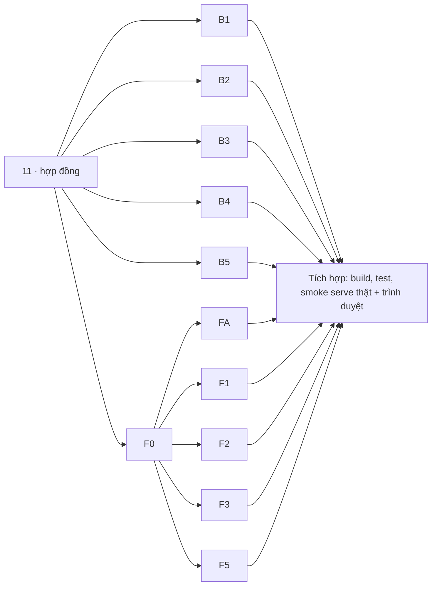

# 12 · Kế hoạch thực hiện 1:1 (đã chốt GAP)

`08-plan.md` chia pha theo thứ tự giá trị. Tài liệu này là **kế hoạch thi công** thực tế: mọi GAP được đóng trong v1 theo hợp đồng `11-api-contract.md`, nên không còn màn nào hiển thị “Chưa có API”. Mục “Sau v1” của `08` (đồng sáng tác, import, sync, diag, simulate, đổi model lúc chạy) cũng được đưa vào v1; chỉ **giao diện sáng** vẫn để sau.

## Nguyên tắc thi công

- **Hợp đồng trước.** `11-api-contract.md` là nguồn sự thật cho backend và frontend. Lệch hợp đồng → sửa tài liệu trước, rồi sửa hai phía.
- **Cắt chuyển sạch.** `/api/books*`, `#/book/:id`, `web/src/skeleton/*` bị xoá khi màn mới thay thế; không giữ đường cũ song song.
- **1:1 với artboard.** Giá trị pixel/màu/bo/khoảng cách lấy từ inline style trong `artboards/*.dc.html` qua token `web/src/styles/tokens.stylex.ts`; chuỗi lấy từ `07-copy.md`; không hard-code hex trong component.
- **Trung thực dữ liệu.** Trường thiếu → `—` hoặc trạng thái rỗng; mọi `[ngoặc vuông]` của artboard không vào sản phẩm.
- **Engine chỉ đọc với UI.** Mọi ghi vào `output/novel/` đi qua host/engine.
- **Dữ liệu thật an toàn.** Kiểm thử dùng HOME tạm và bản sao truyện; không đụng `~/.ainovel`, `~/.codex` thật, không quay vòng refresh token Codex.

## Lát cắt & quyền sở hữu tệp

| Lát | GAP | Sở hữu | Phụ thuộc |
|---|---|---|---|
| **B1 · Thư viện 3 cấp** | 1, 2, 3, 9, 11, 12, 13 | `internal/library/*`, `internal/entry/web/gateway.go`, `internal/entry/web/projects.go` (mới), gateway tests | Hợp đồng §1–3; gọi hook của B2/B3/B5 |
| **B2 · Đọc truyện & xuất** | 7, 4 | `internal/host/storyread.go` (mới), `internal/host/exp/*`, `internal/host/autoexport.go` (mới), `internal/entry/web/storyread.go` (mới) | `library.Story` |
| **B3 · Cấu hình, quy tắc, OAuth** | 5, 10, 16 | `internal/bootstrap/configfile.go` (kế thừa 3 cấp), `internal/rules/loader.go`, `internal/auth/oauth.go` (trang callback A4), `internal/entry/web/config.go` (mới) | `library.FindProjectDir` |
| **B4 · Lệnh live trong worker** | 6, 8 | `internal/entry/web/worker.go`, `internal/entry/web/worker_*.go` (mới), host methods mới nếu thiếu (`internal/host/web_*.go`) | — |
| **B5 · Tài khoản bổ sung** | 14, 15, quyền `p/s` | `platform/identity/*`, `internal/entry/web/auth.go` | — |
| **F0 · Nền móng frontend** | — | `web/src/styles/`, `web/src/ui/`, `web/src/shell/`, `web/src/router.ts`, `web/src/i18n/`, `web/src/api/*` (toàn bộ hợp đồng), `web/mock/*`, `web/src/main.tsx`, `web/src/App.tsx` | Hợp đồng |
| **FA · Đăng nhập & onboard** | — | `web/src/screens/auth/*`, `web/src/screens/onboard/*`, `web/src/screens/account/*` | F0 |
| **F1 · Workspace & Nhật ký** | — | `web/src/screens/workspace/*`, `web/src/screens/activity/*`, `web/src/lib/streamRounds.ts` (+test) | F0 |
| **F2 · Trình đọc, duyệt, xuất** | — | `web/src/screens/reader/*` | F0 |
| **F3 · Tạo truyện, dự án, truyện** | — | `web/src/screens/newstory/*`, `web/src/screens/project/*`, `web/src/screens/dialogs/*` | F0 |
| **F5 · Cài đặt** | — | `web/src/screens/settings/*` | F0 |

Hook giữa các lát backend (gateway gọi theo thứ tự, mỗi hàm trả `true` nếu đã xử lý):

```go
// B5 – internal/entry/web/auth.go (đã có, mở rộng)
func (g *Gateway) serveAccount(w, r, user webauth.User, current webauth.Session) bool
// B3 – internal/entry/web/config.go
func (g *Gateway) serveConfig(w http.ResponseWriter, r *http.Request, user webauth.User) bool   // /api/config*, /api/rules*, /api/system
// B2 – internal/entry/web/storyread.go; rest = phần sau "/api/projects/:p/stories/:s"
func (g *Gateway) serveStoryRead(w http.ResponseWriter, r *http.Request, user webauth.User, st library.Story, rest string) bool
// B1 – tất cả phần còn lại; chuyển tiếp rest còn lại tới worker như cũ.
```

Quyền webauth (B5) mà B1 dùng: `user.CanRead(id)`, `user.CanWrite(id)`, `user.CanReadProject(p)`, `user.CanManageProject(p)`, `user.CanCreateBooks()` và `Store.RenameStory(oldID, newID)`, `Store.GrantBook(username, id)` với id dạng `p/s`.

## Thứ tự



Đợt 1 chạy song song B1–B5 và F0. Đợt 2 chạy FA, F1, F2, F3, F5 khi F0 xong (backend có thể vẫn đang chạy; frontend dùng mock theo hợp đồng). Chỉ người tích hợp chạy `npm run build` (ghi `internal/entry/web/dist`); các lát frontend chỉ chạy `npx tsc --noEmit` và `npm run dev:mock`.

## Nghiệm thu

### Backend
- `go build ./... && go vet ./... && go test ./...` sạch.
- B1: thư viện mẫu gồm dự án mới + dự án nhận lại từ thư mục cũ (`_chung`, symlink rules) + truyện cũ ở root (`_`); tạo truyện `NN-truyen-moi`, đổi tên, ý tưởng, validate/fix đúng §3; người dùng chỉ thấy dự án/truyện được giao.
- B2: đọc chương committed/draft, plan, facts, outline (phẳng và layered), characters, foreshadow, reviews khi truyện đang bị TUI khoá; xuất thủ công theo khoảng chương vào `xuat-ban/`; xuất tự động khi xong tập/truyện (test bằng store giả).
- B3: TUI và worker trong `<dự án>/kich_ban/<truyện>` nhận cấu hình + quy tắc 3 cấp; `api_key` không bao giờ rời server; OAuth device flow chạy bằng server giả trong test; trang callback đúng A4.
- B4: cocreate (truyện mới và đang viết), import/simulate/sync/diag phát `job` qua SSE; đổi model/thinking lúc chạy ghi cấu hình như `/model`.
- B5: `mustChangePassword`, `onboardedAt`, `POST /api/me`, quyền `p/*`.

### Frontend (mỗi màn, so với artboard tương ứng)
- `npx tsc --noEmit` sạch; `npm run dev:mock` chạy mọi trạng thái artboard (`data-props`) bằng dữ liệu mock.
- Ảnh chụp 1440×900, 1280×800, 390×844 khớp bố cục, màu, bo, khoảng cách, chuỗi với artboard; không cuộn trang desktop; ô chat luôn thấy; không cuộn ngang ở 375px.
- Bàn phím: focus ring, `⌘K`, `[` `]`, Esc; `prefers-reduced-motion` tắt animation.
- Không còn chuỗi tiếng Trung từ host lộ ra với các mẫu trong bảng dịch `06`.

### Tích hợp
- `serve` thật trên bản sao `dit-dang-audio` (HOME tạm): onboard admin → dự án → truyện → Workspace → Trình đọc → xuất → Cài đặt; QR đăng nhập điện thoại (390×844); người đọc bị chặn ghi; truyện bị khoá vẫn đọc được.
- Xoá `web/src/skeleton/`, mọi tham chiếu `/api/books`, `#/book/`; README cập nhật.
