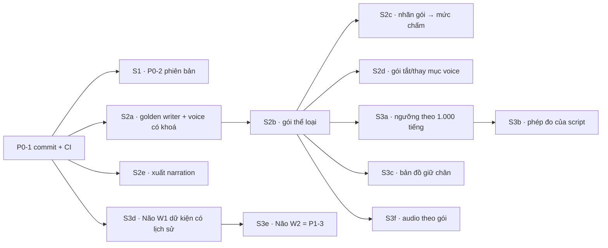

# Kế hoạch backend: PRD tối ưu tiếng Việt và Não truyện

- **Ngày:** 25/10/2026
- **Nguồn:** `toi-uu-ainovel-cli-tieng-viet.md` (P0, P1, Quyết định 1–11), `nao-truyen.md` (W1, W2), `brief-design.md` (D1–D15).
- **Phạm vi:** Go engine, API, TUI. Phần web chỉ thêm khi có artboard. Mã `D…` trỏ tới nhu cầu design tương ứng.

## Điều kiện trước khi code

1. **P0-1 xong.** Team chạy `p0-1-ke-hoach-commit.md`: PO gofmt `panels_outline.go` trước, thêm job `web` vào CI, bật chặn merge khi đỏ.
   - **Lý do:** cây hiện có 1.502 đường dẫn chưa commit. Code BE viết chồng lên sẽ lẫn vào các cụm, không review được theo PR.
2. **Mỗi lát một nhánh, một PR.** CI xanh mới merge. Lát nào đổi prompt thì PR báo số token trước và sau của từng vai (Quyết định 2).

## Thứ tự

Các lát cùng sprint không phụ thuộc nhau thì chạy song song, mỗi lát một người hoặc một agent sở hữu file riêng.

## Sprint 1

### S1 · P0-2 Nhận diện bản build

**Hiện trạng:**

- `--version` đã in tag, commit và ngày qua ldflags. Xem `cmd/ainovel-cli/main.go:20-30`, `:63`, và `internal/version/info.go`.
- `.goreleaser.yml` đã truyền `-X main.version/commit/date`.
- **Lỗi:** `internal/entry/web/config.go:1556` gọi `buildversion.Resolve(buildversion.Info{})` với struct rỗng, nên `/api/system` không bao giờ thấy giá trị ldflags.

**Việc:**

1. Truyền `versionInfo()` từ `main` vào gateway web, như đã làm cho TUI (`internal/entry/tui/app.go:20`) và worker (`run_worker.go:24`). Sau đó `/api/system` trả đúng tag, commit, ngày.
2. Thêm `Build string` vào `domain.ChapterRecord` (`internal/domain/revision.go:82`).
   - Tăng `ChapterRecordVersion` lên 2. `internal/store/chapter_records.go:116` phải đọc được cả v1, coi `Build` rỗng là "không rõ".
   - Ghi giá trị ở ba chỗ: `commit_chapter.go:264/609/643`, `revision/service.go:221`, `revision/migration.go:125`.
3. Kiểm tra bản mới một cách thụ động.
   - Dùng lại `internal/version/update.go:106` `fetchRelease`, lưu đệm 24 giờ trong `~/.ainovel`.
   - API trả `latest`, `hasUpdate`. TUI hiện một dòng ở thanh trạng thái.
   - Phần web chờ **D1**.
4. Bản phát hành có changelog: workflow `release.yml` đã gọi `gen-changelog.sh`. Chỉ cần kiểm script với nhãn commit tiếng Việt của P0-1.

**Nghiệm thu:**

- Có test: chương commit xong có `Build` đúng giá trị ldflags.
- Bản ghi v1 cũ vẫn đọc được.
- `/api/system` trả commit thật.
- Từ một truyện bất kỳ tra ra được commit đã viết từng chương.

## Sprint 2

### S2a · Khôi phục golden của writer, chia `voice.md` theo khoá (nền cho P0-6)

**Mục đích:** lưới an toàn trước mọi thay đổi prompt.

1. **Khôi phục golden trước khi sửa gì.**
   - Viết test so byte-for-byte prompt writer của style `default` với `assets/testdata/writer-golden.md`, sinh lại từ prompt tiếng Việt hiện tại.
   - Chỉ cập nhật golden qua biến môi trường, theo cách làm của ratchet màu.
2. **Chia `assets/voice.md` thành mục có khoá.** Ví dụ `<!-- voice:hoi-hop -->`, `<!-- voice:do-dai-doan -->`.
   - Ráp lại phải ra **đúng từng byte** như trước, golden không đổi.
   - Hai câu trái Master nằm ở `voice.md:11` và `:12`, mỗi câu phải có khoá riêng.

**Nghiệm thu:** golden xanh trước và sau khi chia mục, và PR không sửa tệp golden.

### S2b · P0-3 Gói thể loại

**Hiện trạng:**

- `assets.Load` đọc style nhúng sẵn, rồi phủ thêm `~/.ainovel/style/styles/*.md` và `<sách>/style/styles/*.md` (`assets/load.go:228-273`).
- Chỉ writer nhận style (`internal/agents/build.go:231`).

**Thiết kế (Quyết định 1 và 9: dùng lại khoá `style`, không thêm khoá mới):**

- **Thư mục gói:** `~/.ainovel/style/packs/<tên>/`, với `<sách>/style/packs/<tên>/` ghi đè.
  - Tìm thấy thư mục gói trùng `style` thì dùng gói.
  - Không thấy thì đọc `styles/<tên>.md` như cũ.
- **Nội dung một gói:**
  - `goi.json`: tên hiển thị, số chương chuẩn, tham số (P1-1, P1-5), trường outline bắt buộc (P1-2), audio (P1-4), danh sách khoá voice cần tắt hoặc thay (P0-6);
  - `van-phong.md`: phần style cho writer;
  - `luat/*.md`: Master, bộ sản xuất, phụ lục, nạp nguyên văn;
  - `cach-doc.json` (tuỳ chọn).
- **Ba vai đều nhận nguyên văn `luat/*.md`**, gồm writer, editor và architect. Bộ chuẩn hoá (`internal/userrules/normalize.go`) chỉ được rút `structured` từ gói, không thay phần văn bản.
- **Đếm token của prompt từng vai** lúc ráp.
  - Vượt 40% cửa sổ ngữ cảnh của model gán cho vai thì ghi cảnh báo vào nhật ký.
  - Chưa tự tách gói. Việc tách chỉ làm khi số đo thật cho thấy cần.
- **Thứ tự ưu tiên** theo PRD §Nguồn chuẩn: quy tắc trên UI được đè mục `[CẢNH BÁO]` và mục không nhãn, không được đè `[LỖI]`.

**Nghiệm thu:**

- Test đặt một câu đánh dấu trong `luat/` và thấy câu đó nguyên văn trong prompt của cả ba vai.
- Golden S2a vẫn xanh với `default`.
- Với gói A, review của editor dẫn được số mục, ví dụ `§7`. Phần này kiểm bằng eval ở S2c.
- Phần chọn gói trên web chờ **D2**. TUI và API chọn được ngay qua `style`.

### S2c · P0-4 Nhãn của gói thành mức chấm

**Hiện trạng:** `save_review.go:256-261` đã chặn hai trường hợp: `accept` mà còn issue `requires_change`, và `polish`/`rewrite` mà không có issue nào.

**Việc:**

1. Trình phân tích tách mục của gói thành danh sách `{số mục, nhãn, nội dung}` và đưa vào ngữ cảnh của editor.
2. Mở rộng schema issue (`domain.ConsistencyIssue`) với `rule_ref` (ví dụ "Master §7"), `quote` và `rule_text`. `save_review` từ chối vi phạm `[LỖI]` thiếu `requires_change=true`, severity `error`/`critical` hoặc đoạn trích `quote`.
   - Nếu cùng mục có cả `[LỖI]` và `[CẢNH BÁO]` (ví dụ Master §13), `rule_text` phải chép ít nhất 15 ký tự của chính câu luật, khớp duy nhất một mục con sau chuẩn hoá Unicode NFC, khoảng trắng, chữ hoa/thường và dấu `**`. Nhờ đó cảnh báo tỷ lệ thoại không bị nâng thành lỗi của quy tắc khác trong cùng §13.
   - `nhan_luat` trong `goi.json` ánh xạ tên file sang nhãn tham chiếu; Editor nhận chỉ mục số mục/nhãn bên cạnh nguyên văn luật.
3. Sửa câu trong `assets/prompts/editor.md` coi warning "thường không cần làm lại", để không mâu thuẫn với gói. Chỉ áp dụng khi có gói.
4. Eval `evals/cases/editor-goi-a/` chứa hai chương mẫu đúng như nghiệm thu P0-4. Kỳ vọng verdict/issue được ghi trong `rubric`: framework hiện chỉ nhận `role` như metadata, chưa có chạy riêng Editor với chương nạp sẵn hay assertion verdict/issue; không dùng các case này làm gate tự động cho P0-4. Mẫu cảnh báo đo bằng `kiem_tra_truyen.py`: 252/743 tiếng thoại (33,9166%, hiển thị 34%).

**Nghiệm thu:**

- Chương kết ở trạng thái an toàn ra `polish`.
- Chương có 34% thoại ra `accept` kèm issue `warning`.
- Lỗi cần thẻ có số mục trên web chờ **D4**. API trả `rule_ref` và `quote` ngay.

### S2d · P0-6 Gói tắt hoặc thay mục voice

**Việc:** `goi.json` khai `voice: {"hoi-hop": null, "do-dai-doan": "…"}`, trong đó `null` là tắt mục. Ráp voice theo khoá.

**Nghiệm thu:**

- Với gói A, prompt writer không còn hai câu ở `voice.md:11-12`.
- Golden `default` không đổi.

### S2e · P0-5 Xuất bản narration

**Việc:**

1. Thêm định dạng `narration` vào `internal/host/exp/exporter.go`, gồm cả kiểm định dạng (`:48`) và đoán định dạng theo đuôi tệp (`inferFormat`, `:220`).
   - Không có tiêu đề chương, bỏ Markdown, các chương cách nhau hai dòng trống.
   - Tuỳ chọn đọc số thành chữ dùng bộ chuẩn hoá của audio (`internal/audio/normalize.go`, `numbers.go`).
2. Mở định dạng mới ở mọi chỗ đang giới hạn định dạng:
   - `internal/host/autoexport.go:47`;
   - `internal/entry/web/storyread.go:321`, `:366`;
   - `projects.go:310`;
   - `worker_results.go:93`;
   - `/export` của TUI.

**Nghiệm thu:**

- Xuất truyện mẫu rồi chạy `kiem_tra_truyen.py --narration` ra 0 LỖI.
- Test xuất cho từng định dạng.
- Các ô chọn định dạng trên web chờ **D3**.

## Sprint 3

### S3a · P1-5 Ngưỡng theo 1.000 tiếng

**Việc:**

- Đổi `FatigueWords` (`internal/rules/snapshot.go:202`, `checker.go:70`) từ số lần mỗi chương sang số lần trên 1.000 tiếng. Gói được ghi đè ngưỡng.
- Chuyển cấu hình cũ theo công thức số cũ chia cho độ dài chương chuẩn, ghi rõ trong PR.

**Nghiệm thu:** cùng một mật độ dùng từ, chương 1.500 tiếng và chương 3.000 tiếng cho cùng kết quả.

### S3b · P1-1 Đưa phép đo của script vào Go

**Việc:**

- Bảy phép đo mới: tỷ lệ thoại, mật độ từ thủ tục, quãng dài không có thoại, "ngày thứ" + số, câu và đoạn vượt giới hạn, cụm 5 tiếng lặp, trùng mở đầu.
- Mở rộng `english_residue` (`internal/rules/lint.go:288`) để bắt thêm danh sách từ của gói.
- Ngưỡng lấy từ `goi.json`.

**Nghiệm thu:** golden test so với chính `kiem_tra_truyen.py` trên truyện mẫu, ví dụ chương 7 có 28% thoại, quãng từ dòng 725 đến 742 dài 332 tiếng không có thoại. Phần hiện trên web chờ **D6**.

### S3c · P1-2 Bản đồ giữ chân

**Việc:**

- Thêm các trường tuỳ chọn vào `domain.OutlineEntry` (`internal/domain/story.go:35`) và schema của `save_foundation`, `revise_outline`, `plan_chapter`.
- Thêm trường cấp truyện theo Master §21, lưu cùng tiền đề truyện. Không hỏi người dùng lúc tạo truyện (Quyết định 11 trong PRD):
  - **Nhóm người nghe (§1.2):** lấy từ `goi.json` (gói A khai "Nữ 18–35", theo bộ A §1). Gói không khai thì Architect chọn một trong năm nhóm của Master. Yêu cầu ban đầu của người dùng có nói rõ nhóm thì theo người dùng.
  - **"Điểm khác" (§17):** Architect viết. Trước W3, Architect được đưa tên và tiền đề của các truyện khác trong cùng dự án để tránh trùng. Từ W3 (P2-5), sổ cái 10 trục tự kiểm.
  - **Hạt giống phần hai (§19):** Architect viết cùng bản đồ giữ chân.
  - Editor báo `[LỖI]` khi thiếu nhóm người nghe hoặc "Điểm khác", báo `[CẢNH BÁO]` khi thiếu hạt giống phần hai, theo đúng nhãn của Master.
- Thêm kiểm tra chẩn đoán: `hook_type` lặp, vị trí cú lật, vị trí lời hứa.
- `goi.json` khai trường nào bắt buộc.

**Nghiệm thu:** không có gói thì hành vi giữ nguyên. Với gói A, thiếu trường bắt buộc thì Architect bị yêu cầu bổ sung. Truyện gói A có nhóm người nghe "Nữ 18–35" mà người dùng không phải nhập gì. Phần xem và sửa trên web chờ **D5**.

**Giao ước backend S3c:**
- `save_foundation(type="premise")` nhận thêm `nguoi_nghe`, `diem_khac`, `hat_giong_phan_hai`, lưu ở `meta/story_retention.json` cạnh `premise.md`; dữ liệu này nằm trong fingerprint thẩm định nền tảng. Không thay đổi màn tạo truyện.
- Chỉ tự lấy `nguoi_nghe` khi giá trị gói đúng một trong năm nhóm Master §1.2. Giá trị ghép của gói C không tạo mặc định: Architect chọn một nhóm được gói nêu. Gói không khai thì Architect tự chọn; yêu cầu ban đầu đã nêu rõ nhóm được ưu tiên.
- `promise` là mô tả lời hứa/đếm ngược. Chỉ đánh dấu `da_tra: <mô tả cảnh>` khi lời hứa của **tiêu đề hoặc đoạn mở đầu** được diễn trọn thành cảnh (§3), không dùng cho cú trả thưởng phụ. Diag lấy chương có dấu này đầu tiên làm cảnh lời hứa.
- Diag xấp xỉ vị trí bằng số thứ tự chương / tổng số chương, gồm hai đầu khoảng 35–60% và 45–60%. Khi còn cung khung chưa mở rộng, không dùng số chương chi tiết hiện có làm tổng truyện; hai phép kiểm vị trí tạm không chạy. Đại cương cũ chưa có bản đồ giữ chân không bị báo thiếu cú lật.
- `foundation_memory.other_stories` đưa tên và tiền đề các truyện khác cùng dự án, theo quy ước thư mục của `library`; không đọc truyện ngoài dự án hoặc tự suy đường dẫn khi không tìm thấy dự án.

### S3d · Não W1 Dữ kiện có lịch sử

Theo `nao-truyen.md` và ADR 0001.

**Việc:**

- Mã thực thể có phạm vi. Thêm `id` tuỳ chọn cho `characters.json`.
- `relationship_log.jsonl` chỉ ghi thêm. `relationship_state.json` tính lại từ log và giữ đúng dạng cũ.
  - Người gọi: `commit_chapter.go:294` → `WorldStore.UpdateRelationships` (`world.go:276`).
  - Test `world_test.go:345` đang khẳng định cặp không có chiều. Test này vẫn đúng cho `relationship_state`. Chiều chỉ có ở tệp xưng hô.
- `address_terms.json` có chiều, kèm công cụ để agent ghi xưng hô lúc commit chương.
- Sinh kho ghi chú `output/novel/nao/`.

**Nghiệm thu:**

- Viết lại truyện mẫu ra đủ lịch sử quan hệ theo chương.
- Mở bằng Obsidian thấy liên kết đúng.
- Truyện cũ không có tệp mới vẫn chạy tiếp.

### S3e · Não W2 Dùng dữ kiện (giao P1-3)

**Việc:**

- Chọn ngữ cảnh theo đồ thị, thay việc xoá nguyên khối trong `trimByBudget` (`internal/tools/novel_context.go:531`).
- Lint xưng hô tất định. `check_consistency` nhận bảng xưng hô làm dữ liệu đối chiếu.
- Lint mâu thuẫn.

**Nghiệm thu:**

- Truyện mẫu bị báo đủ 4 chỗ lệch xưng hô.
- Ép ngân sách nhỏ thì xưng hô của nhân vật có mặt không bị cắt.
- Phần web chờ **D7–D10**.

### S3f · P1-4 Audio theo gói

**Hiện trạng:**

- Đã có chế độ một giọng (`internal/audio/cast.go:23`, `ModeSingle`).
- Đã có từ điển cách đọc (`cach-doc.json`, `internal/audio/settings.go:76`).
- Đã có chuẩn hoá âm lượng (`ffmpeg.go:215`).
- **Chưa có nhạc nền:** không thấy `amix` hay sidechain trong code.

**Việc:**

- `goi.json` chọn chế độ, giọng nam hoặc nữ, và từ điển cách đọc mặc định, gộp dưới từ điển của truyện. Giọng nam hay nữ lấy mặc định theo nhóm người nghe (Master §15.4).
- **Nhạc nền: không làm** (Quyết định 10). Team ghép nhạc khi dựng, sau khi xuất audio.

**Nghiệm thu:**

- Gói A tạo audio một giọng nữ.
- Từ trong từ điển được đọc đúng như khai báo.
- Phần web chờ **D11**.

## Quyết định bổ sung (25/10)

- **Nhạc nền P1-4:** không làm trong công cụ; team ghép nhạc khi dựng (PO).
- **Trường cấp truyện của P1-2:** gói khai mặc định, Architect sinh phần còn lại, người dùng sửa sau ở màn đại cương (D5). Màn tạo truyện không đổi. Xem S3c.

## Triển khai (25/10)

Tất cả các lát BE đã làm trên cây hiện tại, trước P0-1. PO đồng ý làm luôn. Khi team chạy kế hoạch commit, phần này rơi vào các cụm tương ứng.

**Kiểm chung lần cuối:**
- `go build ./...`, `go vet ./...`, `go test -p 4 -count=1 ./...` đều qua.
- `gofmt` chỉ còn báo `panels_outline.go` (tệp PO đang sửa).
- Web: `tsc` sạch, vitest 93 tệp / 837 test qua, `npm run build` qua.
- Smoke bằng tệp chạy thật (`-ldflags` v0.9.0-rc1):
  - `--version` in đủ phiên bản, commit, ngày build.
  - `/api/system` trả `v0.9.0-rc1`, commit `9b5c138`, `built`, `hasUpdate`.
  - `/api/config/presets` trả `styles` như cũ, cùng `packs` có 3 gói.

| Lát | Trạng thái | Nghiệm thu | Còn mở |
|---|---|---|---|
| S1 · P0-2 | ✓ | `ChapterRecord` v2 có `build`, vẫn đọc được v1; `/api/system` trả phiên bản thật; `CheckLatest` đệm 24 giờ, bản `dev` bỏ qua; TUI hiện "Có bản mới …". Kho phát hành trỏ về fork `kentjuno/ainovel-cli`; `gen-changelog.sh` đổi sang tiếng Việt | Web hiện bản mới chờ **D1**. `latestVersion` có thể trễ một request |
| S2a · golden + voice | ✓ | `TestWriterGolden_DefaultStyle` khớp từng byte trước và sau khi chia `voice.md` thành 12 khoá (`tong-quan`, `mo-dau`, `show-dont-tell`, `doi-thoai`, `cam-xuc`, `quan-he`, `bi-mat`, `hoi-hop`, `do-dai-doan`, `chong-ai`, `cu-phap`, `tinh-tiet-cu`) | — |
| S2b · P0-3 | ✓ (code) / ✗ (eval) | Có 3 gói nhúng (`nu-tan-bao-thu`, `nguoc-hon-nhan`, `nien-dai-van`); `luat/` là bản chép từng byte từ `docs/prd/rules/`, có test chống lệch. Câu đánh dấu xuất hiện nguyên văn ở writer, editor và cả hai architect. Lỗi gói trả về lỗi tiếng Việt, không làm sập tiến trình. Token prompt: writer 3.524 → 18.442, editor 2.258 → 17.534, architect_short 1.933 → 17.209, architect_long 2.937 → 18.213. Vượt 40% cửa sổ thì ghi cảnh báo | Chưa chạy eval có model để xem editor dẫn số mục (tốn phí, cần PO duyệt). Thẻ gói trên web chờ **D2** (API: `presets.packs`) |
| S2c · P0-4 | ✓ (code) / ✗ (eval) | Issue có thêm `rule_ref`, `rule_text`, `quote`. Mục `[LỖI]` buộc mức `error`, `requires_change` và có `quote`. Mục trộn nhãn phải trích đúng câu luật. Số mục đếm được: Master 44 LỖI / 51 CẢNH BÁO, A 21/10, B 17/9, C 19/9 | Eval `evals/cases/editor-goi-a/` (chương 655 tiếng kết thúc an toàn; chương thoại 33,9%) đã soạn, nhưng khung eval chưa khẳng định được verdict, và chưa chạy. Web chờ **D4** |
| S2d · P0-6 | ✓ | Với gói A, prompt writer không còn hai câu ở `voice.md:11-12`; golden của `default` không đổi | — |
| S2e · P0-5 | ✓ | Thêm định dạng `narration` ở exporter, tự xuất, API GET/POST, worker, TUI `/export narration [doc-so]`. Chạy `kiem_tra_truyen.py --narration` trên truyện mẫu: **0 LỖI**, 17 CẢNH BÁO đều thuộc nội dung | `CountChapters` trả 0 với tệp narration. Đọc số thành chữ chưa áp từ điển cách đọc của dự án. Web chờ **D3** |
| S3a · P1-5 | ✓ | Ngưỡng tính theo lần/1.000 tiếng, tối thiểu 1. Mật độ bằng nhau thì kết luận như nhau. `max_per_chapter` cũ được quy đổi theo 1.500 tiếng. `Violation.Limit` là số lần được phép (số nguyên) | Chữ "lần/chương" và `DEFAULT_FATIGUE` trên web đã cũ, chờ **D6** |
| S3b · P1-1 | ✓ | 9 phép đo, chỉ chạy khi có gói. Khớp script trên cả 8 chương: chương 7 thoại 28%, quãng 725–742 dài 332 tiếng (vắt qua chương 5–6). Thứ tự: mặc định hệ thống < gói (đọc trực tiếp) < quy tắc người dùng; giá trị của gói không ghi vào snapshot | `fatigue_words` của gói để trống: luật A §6 giới hạn trên **cả truyện**, cần bộ đếm xuyên chương. Web chờ **D6** |
| S3c · P1-2 | ✓ | Có trường giữ chân theo chương và theo truyện, lưu ở `meta/story_retention.json`. Gói khai trường bắt buộc; thiếu thì Architect bị yêu cầu bổ sung. Có chẩn đoán hook lặp, vị trí cú lật và vị trí lời hứa (`promise="da_tra: …"`). Gói A/B có nhóm người nghe mặc định; gói C phải chọn một trong hai nhóm của gói. Architect được xem tiền đề các truyện cùng dự án | Web chờ **D5** |
| S3d · Não W1 | ✓ | Mã `nv:<slug>` lưu cục bộ. `relationship_log.jsonl` chỉ ghi thêm, lần đầu gieo từ trạng thái cũ. `address_terms.json` có chiều; đổi phải có `reason`. Kho ghi chú `output/novel/nao/` sinh tất định. Smoke trên bản sao truyện mẫu: ghi xưng hô chương 9 và sinh trang nhân vật đúng | Chưa sửa ngược xưng hô khi viết lại chương cũ, chưa xoá quan hệ qua revision. Web chờ **D7, D8, D10, D12** |
| S3e · Não W2 (P1-3) | ✓ (code) / ✗ (nghiệm thu PRD) | Chọn ngữ cảnh theo đồ thị, cắt từng mục từ cũ nhất, không bao giờ cắt xưng hô của nhân vật có mặt. Lint xưng hô tất định: chắc chắn thì báo error, suy ra thì báo warning. `check_consistency` nhận bảng xưng hô. Có lint mâu thuẫn | Truyện mẫu chỉ bắt được **1/4** nhân vật (Nhược Vy, chương 7 dòng 89: mày/tao), 0 báo nhầm. Ba trường hợp còn lại nằm trong lời thoại không có câu dẫn. Bộ luật chọn bỏ qua để không báo nhầm, nên phần đó dựa vào editor qua `check_consistency` (chưa chạy model) |
| S3f · P1-4 | ✓ | Gói A một giọng nữ, gói B một giọng nữ (suy từ nhóm người nghe), gói C không ép giới tính. Vai mới chọn giọng theo `Gender` trong danh mục; `vai.json` cũ giữ nguyên từng byte. Từ điển: mặc định < gói < dự án | Chưa có cách đọc tiếng Việt cho live, credit, casting, scandal… **PO cần cung cấp**. Không làm nhạc nền (Quyết định 10). Web chờ **D11** |

**Hợp đồng công cụ thay đổi:** `commit_chapter.address_terms` và `save_review.rule_ref/rule_text/quote` là trường nullable-required theo strict schema, giống `feedback`. Fixture của test engine đã cập nhật theo.
