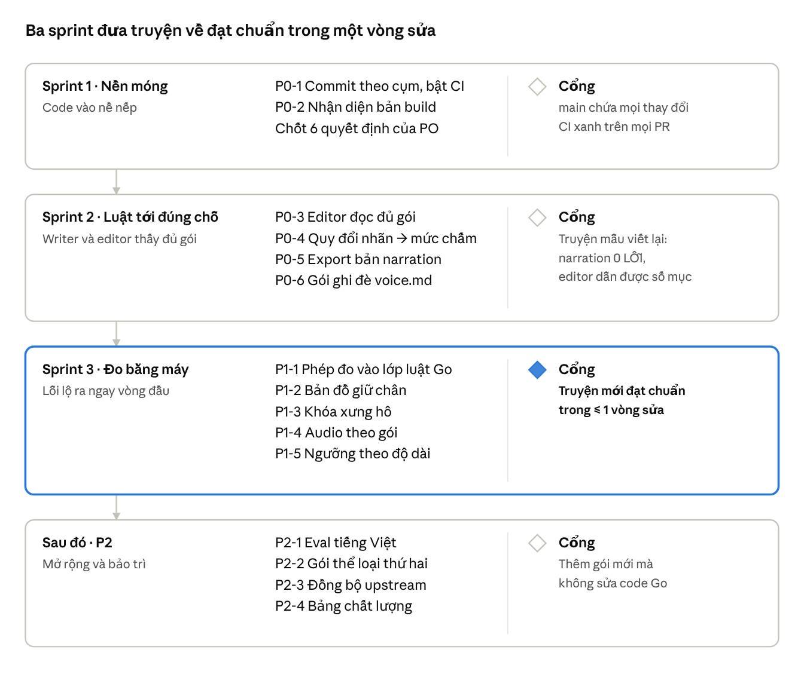

# PRD: Tối ưu ainovel-cli cho truyện audio tiếng Việt

- **Ngày:** 25/10/2026
- **PO:** Dat Nguyen
- **Trạng thái:** chờ PO chốt 6 quyết định ở mục [Quyết định PO](#quyết-định-po-cần-chốt-trước-khi-làm)
- **Bản cộng tác (comment, sửa trực tiếp):** https://claude.ai/artifact/2aXCpbCoFUyHmjs1n8DE7j

## Bối cảnh và mục tiêu

Mục tiêu của đợt tối ưu: với mọi thể loại, ainovel-cli viết ra truyện tiếng Việt đạt bộ luật của thể loại đó **trong một vòng sửa**. Bộ luật được nạp dưới dạng một gói thể loại, không vá thẳng vào prompt chung.

ainovel-cli (bản fork `kentjuno/ainovel-cli`) là công cụ viết tiểu thuyết đa thể loại. Nó viết được cả truyện ngắn một tập lẫn truyện dài nhiều quyển, với các phong cách default, romance, fantasy, suspense và wuxia. Ca kiểm thử đầu tiên của đợt này là bộ sản xuất A (nữ tần báo thù, 8 chương), vì nó có bộ luật chi tiết nhất và đã qua ba vòng review. Các vấn đề dưới đây lộ ra từ ca đó, nhưng nằm ở lõi công cụ, nên ảnh hưởng tới mọi thể loại:

- **Chỉ một vòng sửa có tác dụng:** trong 10 yêu cầu của prompt sửa lần hai, team chỉ làm được 1. Ở vòng ba, file nộp lại giống hệt bản trước từng byte.
- **Bản build cũ:** file team nộp vẫn có 《》 và "第 N 章", tức là đang chạy bản cũ hơn code hiện tại.
- **Editor không thấy đủ luật:** file style chỉ được ghép vào prompt writer. Rules thì bị một model khác tóm lại thành "một đoạn", nên editor không chấm đủ bộ luật.
- **Truyện dài ra sau mỗi vòng:** 12.775 → 12.890 → 13.381 tiếng, trong khi mục tiêu là 11.200–12.800.

Mục tiêu đo được cho đợt này nằm ở mục [Chỉ số thành công](#chỉ-số-thành-công).

## Phạm vi

**Trong phạm vi:**

- **Lõi dùng chung** cho mọi thể loại và cả hai luồng ngắn/dài: cách writer và editor nhận luật thể loại, các luật kiểm bằng máy lúc commit và lúc review, xuất bản.
- **Cơ chế gói thể loại:** mỗi thể loại mang theo style, bộ luật và ngưỡng kiểm tra riêng, nạp vào mà không sửa code.
- **Gói đầu tiên:** bộ A nữ tần báo thù, dùng làm chuẩn nghiệm thu cho lõi.
- **Pipeline audio**, cho mọi thể loại.
- **Quy trình mã nguồn:** nhánh, commit, CI, phát hành bản build.
- **Não truyện** (`nao-truyen.md`): dữ kiện có lịch sử theo chương, xưng hô có chiều, chọn ngữ cảnh theo đồ thị, kho ghi chú Obsidian sinh tự động. Khung mã/phạm vi/quyền cho cả ba cấp truyện, dự án và hệ thống.

**Ngoài phạm vi đợt này:**

- **Nội dung luật cho thể loại chưa có bộ sản xuất** (fantasy, wuxia, suspense…): cơ chế phải hỗ trợ được, nhưng phần nội dung làm ở đợt sau.
- **Viết bằng tiếng Trung:** thư mục `zh/` đang bị xóa trong bản chưa commit.
- **Giao diện web mới:** chỉ sửa khi một yêu cầu bên dưới cần tới. Màn hình của Não truyện chờ PO trao đổi với design (`nao-truyen.md` › *Cần design*).
- **Đăng nhập và thanh toán:** bảo mật hai phần này xử lý ở một đợt review riêng.

## Nguồn chuẩn và quy ước

Bộ luật có ba tầng. Code chỉ đọc nhãn và tham số, không phán xét nội dung luật.

| Tầng | Tài liệu | Vai trò với dev |
| --- | --- | --- |
| 1. Lõi | [`master-rules-v3.md`](rules/master-rules-v3.md) | Quy tắc chung cho mọi thể loại, đánh số §1–§22. Chuẩn chấm cao nhất |
| 2. Thể loại | [`rules-A-nu-tan-bao-thu.md`](rules/rules-A-nu-tan-bao-thu.md) (8 chương), [`rules-B-nguoc-hon-nhan.md`](rules/rules-B-nguoc-hon-nhan.md) (7 chương), [`rules-C-nien-dai-van.md`](rules/rules-C-nien-dai-van.md) (10 chương), [`phu-luc-the-loai-v3.md`](rules/phu-luc-the-loai-v3.md) | Nội dung của từng gói thể loại. Được ghi đè một mục của Master nếu ghi rõ "Ghi đè §x" |
| 3. Định dạng | [`dit-dang-van-phong.md`](rules/dit-dang-van-phong.md) | Cách đo, mẫu báo cáo chấm và script [`kiem_tra_truyen.py`](rules/kiem_tra_truyen.py). Script là **test oracle** khi port các phép đo sang Go |

Bản sao của các file trên nằm ở [`rules/`](rules/README.md), chép từ Project NovelAI của PO ngày 25/10/2026. Project là bản gốc; dev không sửa trực tiếp bản sao.

**Tham số script hiện có**, cũng là các tham số gói thể loại phải khai báo được:

| Tham số | Ý nghĩa | Ví dụ |
| --- | --- | --- |
| `--chuong N --tieng a-b` | Số chương và độ dài chương | Bộ C: `--chuong 10` |
| `--thoai a-b` | Khoảng tỷ lệ thoại (%) | Bộ B: `--thoai 35-50`, bộ C: `--thoai 30-45` |
| `--cau N --doan N` | Giới hạn câu và đoạn (tiếng) | Module G: `--cau 30 --doan 70` |
| `--so-voi f1 f2…` | So độ trùng mở đầu với truyện cũ (Master §17) | 3 truyện gần nhất |

**Quy ước nhãn**, áp dụng cho mọi gói thể loại:

- `[LỖI]`: bắt buộc sửa. Tương ứng severity `error`, đặt `requires_change=true`.
- `[CẢNH BÁO]`: sửa hoặc ghi lý do giữ nguyên. Tương ứng severity `warning`.
- Không có nhãn: định hướng văn phong, không chấm.

**Thứ tự ưu tiên khi mâu thuẫn:** Master > gói thể loại (trừ mục ghi rõ "Ghi đè §x") > quy tắc viết của người dùng trên UI (chỉ được ghi đè mục `[CẢNH BÁO]` hoặc không nhãn, xem Quyết định 9) > `voice.md` và style mặc định > prompt giao thức. Riêng giao thức thực thi (thứ tự công cụ, checkpoint, commit) không bị ghi đè.

## Yêu cầu P0: làm trước, chặn phát hành

Sáu yêu cầu này sửa đúng các nguyên nhân khiến ba vòng review không tiến triển. Tất cả đều là lõi dùng chung, không riêng cho thể loại nào.

### P0-1. Đưa thay đổi vào quản lý mã nguồn và bật CI

- **Vì sao:** 338 file đang chưa commit (+5.772/−6.900 dòng), gồm cả web, audio và đăng nhập. Chỉ một lần checkout nhầm là mất.
- **Yêu cầu:**
    - Tách thành nhánh và commit theo từng cụm: Việt hóa, lớp luật, audio, web, đăng nhập.
    - CI chạy `go build ./...`, `go vet ./...` và `go test ./...` trên mọi PR.
    - Thêm `/node_modules/` ở gốc repo vào `.gitignore`.
- **Nghiệm thu:** `main` xanh. PR đỏ không merge được. Không còn thay đổi nào nằm ngoài commit quá một ngày làm việc.

### P0-2. Nhận diện được bản build đang chạy

- **Vì sao:** team nộp truyện có 《》 và "第 N 章", trong khi code hiện tại đã xuất "Chương N" (`internal/host/exp/pattern.go`). Vậy là team đang chạy bản cũ mà không ai biết.
- **Yêu cầu:**
    - `ainovel-cli --version` in ra tag, commit và ngày build.
    - Mỗi truyện ghi phiên bản build đã viết từng chương vào `meta/`, không in vào chính văn.
    - Mỗi bản phát hành có changelog.
- **Nghiệm thu:** từ một truyện bất kỳ tra ra được commit đã viết ra nó. TUI và web báo khi có bản mới hơn.

### P0-3. Writer, editor và architect đọc đủ nguyên văn gói thể loại

- **Vì sao:**
    - Style chỉ được ghép vào prompt writer (`internal/agents/build.go:231`).
    - Rules thì bị bộ chuẩn hóa viết lại thành "một đoạn ngôn ngữ tự nhiên" (`internal/userrules/normalize.go`).
    - Hệ quả: Master v3 cộng một bộ sản xuất dài vài nghìn tiếng, nhưng ở phía editor chỉ còn lại bản tóm tắt.
- **Yêu cầu:**
    - Gom vào một "gói thể loại": style, bộ luật (Master + bộ sản xuất) và các tham số ở mục Nguồn chuẩn, nằm chung một thư mục, chọn bằng `style` trong config.
    - Writer, editor và architect đều nhận nguyên văn phần luật của gói.
    - Bộ chuẩn hóa vẫn được rút `structured`, nhưng không được tóm tắt phần văn bản của gói.
- **Nghiệm thu:**
    - Có test chứng minh một câu đánh dấu đặt trong gói xuất hiện nguyên văn trong ngữ cảnh của cả ba vai.
    - Với gói A, review của editor dẫn được số mục của Master v3 (ví dụ §7) hoặc của bộ A.

### P0-4. Quy đổi nhãn của gói sang mức chấm của editor

- **Vì sao:** `editor.md` coi accept là kết quả phổ biến nhất, và lỗi thẩm mỹ mức warning "thường không cần làm lại". Một `[LỖI]` như câu móc cuối chương vì vậy có thể chỉ bị trừ điểm rồi vẫn được duyệt.
- **Yêu cầu:** vi phạm `[LỖI]` của gói bắt buộc sinh issue mức `error` với `requires_change=true`, kèm số mục và đoạn trích. `[CẢNH BÁO]` sinh issue mức `warning`.
- **Nghiệm thu:** có eval với hai chương mẫu.
    - Chương kết ở trạng thái an toàn (vi phạm Master §7) phải ra verdict `polish`.
    - Chương chỉ có tỷ lệ thoại 34% (vi phạm §13, mức cảnh báo) ra `accept` kèm issue.

### P0-5. Xuất bản narration sạch

- **Vì sao:** bản TXT hiện tại vẫn có tiêu đề chương và dấu `*` in nghiêng. Team phải lọc tay trước khi đưa vào TTS.
- **Yêu cầu:**
    - Thêm chế độ export `narration` theo Master §15.5: không tiêu đề, không Markdown, các chương cách nhau hai dòng trống.
    - Tuỳ chọn đọc số thành chữ bằng chính bộ chuẩn hóa của audio (`internal/audio/numbers.go`).
- **Nghiệm thu:** export truyện mẫu rồi chạy `kiem_tra_truyen.py --narration` ra 0 LỖI.

### P0-6. Cho gói thể loại ghi đè mặc định của `voice.md`

- **Vì sao:** `assets/voice.md` có hai câu trái với Master v3:
    - "không nhất thiết mỗi chương đều phải làm hồi hộp", trái với Master §7 `[LỖI]`.
    - "tránh xé nhỏ văn bản thành các đoạn vụn 1–2 câu", trái với Master §15.1 (câu quan trọng tách đoạn riêng).
    - Hiện hai câu này và luật của gói cùng nằm trong prompt, model phải tự đoán bên nào thắng.
- **Yêu cầu:** chia `voice.md` thành từng mục có khóa. Gói thể loại được thay hoặc tắt từng mục theo khóa.
- **Nghiệm thu:** với gói A, prompt writer không còn hai câu trên. Với style `default`, prompt giữ nguyên từng byte (khôi phục test `writer-golden`: file `assets/testdata/writer-golden.md` đang bị xóa trong bản chưa commit).

## Yêu cầu P1: chất lượng truyện đo được bằng máy

Năm yêu cầu này đưa các phép đo vào chính công cụ, để vòng sửa đầu tiên đã có đủ dữ liệu.

### P1-1. Đưa các phép đo của script vào lớp luật Go, ngưỡng do gói quyết định

- **Vì sao:** hiện script `kiem_tra_truyen.py` chạy ngoài công cụ. Writer và editor không thấy kết quả của nó lúc viết.
- **Yêu cầu:** thêm các phép đo sau, xuất ra như vi phạm mức warning, ngưỡng lấy từ tham số của gói:
    - tỷ lệ thoại theo chương (§13);
    - mật độ từ thủ tục (§14);
    - quãng dài hơn N tiếng mà không có câu thoại nào (§5);
    - cụm "ngày thứ" + số hai đến bảy (§15.3);
    - từ tiếng Anh nội dung, theo danh sách của gói (live, credit, casting…). `english_residue` hiện chỉ bắt từ chức năng như "the", "not";
    - câu và đoạn vượt giới hạn (§15.1);
    - cụm 5 tiếng lặp lại (§13);
    - độ trùng mở đầu với các truyện trước của cùng kênh (§17).
- **Nghiệm thu:** golden test trên truyện mẫu cho ra đúng các con số của script. Ví dụ: chương 7 có 28% thoại; quãng từ dòng 725 đến 742 dài 332 tiếng không có thoại.

### P1-2. Bản đồ giữ chân nằm ngay trong outline

- **Vì sao:** Master §2, §3, §7, §8 và §21 cần dữ liệu theo từng chương: câu hỏi đang treo, lời hứa, kiểu móc, cú lật giữa truyện. Hiện outline chỉ có `hook` và `core_event`.
- **Yêu cầu:**
    - Thêm các trường tùy chọn vào outline: `open_questions`, `promise`, `hook_type`, `midpoint_twist`.
    - Thêm các trường cấp truyện theo Master §21: nhóm người nghe (§1.2), "Điểm khác" (§17), hạt giống phần hai (§19).
    - Gói thể loại khai báo trường nào là bắt buộc.
    - Thêm các kiểm tra diag: không quá 2 chương liên tiếp cùng một `hook_type` (§7); có cú lật trong khoảng 45–60% (§8); cảnh lời hứa nằm trong 35–60% (§3).
- **Nghiệm thu:** gói không khai báo các trường này thì hành vi giữ nguyên. Với gói A, thiếu trường bắt buộc thì Architect bị yêu cầu bổ sung.

### P1-3. Khóa cách xưng hô giữa các nhân vật

- **Vì sao:** truyện mẫu có 4 nhân vật bị đổi đại từ mà không có lý do, ví dụ Kỷ Dương lúc là "cậu", lúc thành "em". Lỗi này qua ba vòng sửa vẫn còn (Master §15.3 `[LỖI]`).
- **Yêu cầu:** giao qua Não truyện W1 + W2 (`nao-truyen.md`, chốt 25/10).
    - Xưng hô lưu theo **cặp có chiều** trong `address_terms.json`, mỗi dòng ghi chương bắt đầu, chương kết thúc và lý do đổi. Không thêm ma trận vào `characters.json` như phương án cũ, vì xưng hô thuộc về cặp nhân vật chứ không thuộc một nhân vật.
    - Luật Go tất định báo lỗi khi đại từ trong lời thoại có câu dẫn lệch với bảng. Lời thoại không xác định được người nói chỉ báo cảnh báo. `check_consistency` nhận bảng xưng hô làm dữ liệu đối chiếu.
    - Quan hệ ghi thêm vào `relationship_log.jsonl`, không ghi đè. `relationship_state.json` giữ đúng dạng cũ.
- **Nghiệm thu:** truyện mẫu bị báo đủ 4 chỗ lệch. Ép ngân sách ngữ cảnh nhỏ thì xưng hô của nhân vật có mặt trong chương vẫn không bị cắt.

### P1-4. Audio theo cấu hình của gói

- **Yêu cầu:**
    - Gói chọn được chế độ một giọng kể hay phân vai nhiều giọng (`internal/audio/cast.go`). Master §15.2 viết cho một giọng AI đọc cả truyện.
    - Gói chọn giọng nam hoặc nữ theo nhóm người nghe (Master §15.4).
    - Gói mang theo từ điển cách đọc mặc định (`cach-doc.json`), cho các từ như live, credit, casting.
    - ~~Nhạc nền thấp hơn giọng đọc khoảng 15 dB trở lên, hạ hẳn ở câu đinh và móc cuối chương (Master §15.4).~~ **Bỏ khỏi phạm vi công cụ** (Quyết định 10). Team ghép nhạc ở khâu dựng sau khi xuất audio.
- **Nghiệm thu:** gói A tạo audio một giọng nữ. Các từ trong từ điển được đọc đúng như khai báo.

### P1-5. Ngưỡng từ lạm dụng tính theo độ dài chương

- **Vì sao:** ngưỡng hiện tại là số cố định mỗi chương (`SystemDefaults` trong `internal/rules/snapshot.go`), ví dụ "một chút" và "im lặng" tối đa 2 lần. Chương dài thì báo nhiễu, chương ngắn lại lọt. Các bộ A, B, C có độ dài chương khác nhau nên càng cần.
- **Yêu cầu:** đổi ngưỡng sang số lần trên mỗi 1.000 tiếng. Gói được ghi đè ngưỡng.
- **Nghiệm thu:** cùng một mật độ dùng từ thì chương 1.500 tiếng và chương 3.000 tiếng cho cùng một kết quả.

## Yêu cầu P2: mở rộng và bảo trì

| Mã | Yêu cầu | Nghiệm thu |
| --- | --- | --- |
| P2-1 | Bộ eval tiếng Việt trong `evals/cases`, dùng truyện mẫu làm chuẩn so sánh. Chạy mỗi khi có PR sửa prompt | PR sửa prompt hiển thị chênh lệch số LỖI và CẢNH BÁO so với `main` |
| P2-2 | Nạp bộ B (7 chương) và bộ C (10 chương) thành gói, để chứng minh cơ chế không phụ thuộc vào bộ A | Thêm gói mới mà không sửa dòng code Go nào |
| P2-3 | Ghi nguồn gốc fork và quy trình chép tay bản vá từ upstream `datnt1998/noverse` (Quyết định 5: tách hẳn, không đồng bộ định kỳ) | Có tài liệu quy trình và một lần chép thử một bản vá thành công |
| P2-4 | Bảng chất lượng từng truyện trên web: số LỖI và CẢNH BÁO theo chương, theo số mục của gói | PO xem được trạng thái truyện mà không cần mở file |
| P2-5 | Não dự án (`nao-truyen.md` W3): sổ cái truyện 10 trục, kiểm luật khoảng cách, nhân vật vũ trụ chung, tìm theo từ + đồ thị | Truyện mới trùng tổ hợp trục 1+3+4+6 với một trong 10 truyện gần nhất bị báo `[LỖI]` |
| P2-6 | Embedding chạy trên máy (W4). **Hoãn:** W0 ngày 25/10 cho thấy vector chưa hơn `bm25` (R@5 75,0% so với 72,9%, hơn một câu trên 48). Đo lại khi dự án có ≥ 10 truyện | Vector hơn `bm25` ≥ 5 điểm R@5 trên `evals/nao-w0` mở rộng; tắt embedding vẫn chạy đủ |
| P2-7 | Não hệ thống (W5), khi có ≥ 2 dự án chạy: bài học từ editor, luật hay vi phạm theo gói | Lỗi `[LỖI]` lặp ở ≥ 3 truyện cùng gói được nhắc trước khi viết truyện mới; lọc đúng quyền tài khoản |

## Yêu cầu phi chức năng

- **Tương thích ngược:** khi không có gói thể loại nào, hành vi giữ nguyên. Truyện đang viết dở vẫn tiếp tục được từ checkpoint.
- **Luật tất định:** mọi luật kiểm bằng máy đều là code Go thuần. Cùng một văn bản luôn cho cùng một kết quả, không gọi model.
- **Warning không chặn commit:** giữ nguyên tắc hiện có. Chỉ editor mới quyết định có viết lại hay không.
- **Chi phí token:** nạp nguyên văn gói (P0-3) làm tăng prompt. Phải đo và báo số token trước/sau cho mỗi vai trong PR. Mức tăng chấp nhận được là một quyết định của PO (xem mục Quyết định).
- **Bảo mật:** web server giữ mặc định chỉ nghe `127.0.0.1`. Không commit API key; file mẫu chỉ được chứa giá trị giả.
- **Tái hiện được:** `go.mod` ghim Go 1.25.5. CI và máy dev phải dùng cùng phiên bản Go đó.

## Definition of Done

Một yêu cầu chỉ được tính là xong khi đạt đủ bảy điều:

- [ ] Có PR riêng, link tới mã yêu cầu (ví dụ P0-3).
- [ ] CI xanh: build, vet, test.
- [ ] Có test mới cho đúng tiêu chí nghiệm thu, không chỉ test có sẵn.
- [ ] PR sửa prompt có kết quả eval trước và sau.
- [ ] PR sửa prompt hoặc ngữ cảnh có số token trước và sau.
- [ ] Tài liệu người dùng được cập nhật: `HUONG_DAN_SU_DUNG.md` hoặc README.
- [ ] PO đã chạy thử trên truyện mẫu và xác nhận.

## Chỉ số thành công

Chỉ số chính là số vòng sửa cần để truyện đạt chuẩn: giảm từ ba vòng chưa đạt xuống một vòng. Số liệu gốc đo trên truyện mẫu "Trà Xanh Cướp Kịch Bản" (bộ A).

| Chỉ số | Hiện tại | Mục tiêu |
| --- | --- | --- |
| Số vòng sửa để đạt 0 LỖI | Chưa đạt sau 3 vòng | ≤ 1 vòng |
| Tỷ lệ mục sửa được thực hiện sau một vòng | 1/10 (vòng 2) | ≥ 9/10 |
| LỖI của bản narration khi chạy script | 3 (chữ Hán, Markdown, tiêu đề) | 0 |
| Chương có tỷ lệ thoại trong khoảng 40–55% | 3/8 | ≥ 7/8 |
| Tổng số tiếng so với mục tiêu 11.200–12.800 | 13.381, tăng qua mỗi vòng | Nằm trong khoảng |
| Nhân vật bị đổi xưng hô không có lý do | 4 | 0 |
| Thao tác tay sau export để có bản TTS | Lọc tiêu đề, dấu `*`, chữ Hán | Không có |

Khi đã đưa audio lên kênh, theo dõi thêm thời lượng xem trung bình và tỷ lệ nghe đến hết. Đây là chỉ số mà Master v3 nhắm tới, nhưng hiện chưa có số liệu gốc.

## Quyết định PO (chốt 25/10)

PO giao dev chốt các câu hỏi dưới đây ngày 25/10. Muốn đổi một quyết định thì sửa bảng này trước khi làm.

| # | Quyết định | Chốt | Lý do | Chặn |
| --- | --- | --- | --- | --- |
| 1 | Bộ luật thể loại nằm ở đâu | **Gói thể loại riêng**: style, Master, bộ sản xuất và tham số nằm chung một thư mục | Một chỗ để nạp và kiểm; thêm thể loại không phải sửa code (P2-2) | P0-3, P0-6, P1-* |
| 2 | Giới hạn tăng token khi nạp nguyên văn gói | **Trần: prompt của mỗi vai ≤ 40% cửa sổ ngữ cảnh của model gán cho vai đó.** Không đặt trần theo %. PR P0-3 phải báo số token trước và sau cho từng vai | Riêng phần chữ của gói A đã khoảng 87 KB (Master 30 KB, bộ A 15 KB, phụ lục 27 KB, văn phong 16 KB), nên trần +30% chắc chắn vỡ. Vượt trần thì tách gói: mục có nhãn `[LỖI]`/`[CẢNH BÁO]` nạp nguyên văn; ví dụ và kho mô-típ nạp theo chương cần | P0-3 |
| 3 | Audio cho gói A | **Một giọng kể** | Master §15.2 viết cho một giọng AI đọc cả truyện | P1-4 |
| 4 | Độ dài đoạn văn | **Theo từng gói**, qua khoá của `voice.md` (P0-6) | Gói A theo Master §15.1; gói không khai báo giữ `voice.md` | P0-6 |
| 5 | Còn đồng bộ upstream `datnt1998/noverse` không | **Tách hẳn.** Không đồng bộ định kỳ. Chỉ chép tay bản vá cần thiết (bảo mật, lỗi engine) và ghi nguồn trong commit | Bản Việt hoá đã đổi hơn 350 tệp và bỏ `zh/`, nên đồng bộ định kỳ sẽ xung đột liên tục. Giữ nguyên module path để khỏi sửa import | P2-3 |
| 6 | Bỏ hẳn khả năng viết tiếng Trung | **Có** | Đã chốt trước đó ở `docs/design/v1/19-gap-closure.md` §B ("bỏ chế độ viết tiếng Trung"). Comment trong mã giữ nguyên | P0-1 (cụm Việt hoá) |
| 7 | Ai commit P0-1 | **Dev chuẩn bị kế hoạch theo cụm ở `p0-1-ke-hoach-commit.md`; PO hoặc team chạy lệnh commit.** Agent không tự đổi trạng thái git | Giữ quy ước an toàn hiện hành; mỗi cụm đã có sẵn lệnh `git add` và thông điệp | P0-1 |
| 8 | Việc giao diện trong đợt này | **Dừng việc giao diện không bắt buộc.** StyleX giai đoạn 2 (chuyển từng màn) tạm dừng tới sau Sprint 3. Màn mới chỉ dựng khi có artboard; nhu cầu gom ở `brief-design.md` | Đúng phạm vi PRD ("Giao diện web mới: chỉ sửa khi một yêu cầu cần tới") | Mọi yêu cầu có UI |
| 9 | Hai kênh quy tắc | **Giữ hai kênh, chọn gói bằng khoá `style` sẵn có** (không thêm khoá `pack`). (a) Gói thể loại: nạp nguyên văn cho cả ba vai, không qua bộ chuẩn hoá. (b) Quy tắc viết trên UI (`20-settings-rules.md`): vẫn qua bộ chuẩn hoá, ra `structured` + lời dặn. Kênh (b) được ghi đè mục `[CẢNH BÁO]` và mục không nhãn của gói, **không** ghi đè `[LỖI]`. Gặp tên không có thư mục gói thì đọc `styles/<tên>.md` như cũ | Không thêm khoá cấu hình, nên không phát sinh UI mới. Tương thích ngược với mọi truyện đang dùng `style` | P0-3, P0-6 |
| 10 | Nhạc nền P1-4 | **Không làm trong công cụ.** Team ghép nhạc khi dựng, sau khi xuất audio. Công cụ chỉ xuất giọng đọc | Nhạc chỉnh được ở khâu dựng. Code hiện chưa có phần trộn nhạc, làm mới sẽ tốn công mà không chặn việc phát hành. Một giọng và từ điển cách đọc vẫn làm trong Sprint 3 | — |
| 11 | Trường cấp truyện của P1-2 (nhóm người nghe, "Điểm khác", hạt giống phần hai) | **Không hỏi lúc tạo truyện.** Nhóm người nghe lấy từ gói (gói A: "Nữ 18–35"); gói không khai thì Architect chọn theo Master §1.2. "Điểm khác" và hạt giống phần hai do Architect viết. Người dùng sửa sau ở màn đại cương | Màn tạo truyện giữ nguyên; bộ A §1 đã khai sẵn nhóm người nghe. "Điểm khác" cần so với truyện cũ, nên máy làm tốt hơn người nhập tay | P1-2 |

## Lộ trình đề xuất

| Giai đoạn | Việc | Cổng nghiệm thu |
| --- | --- | --- |
| Sprint 1 · Nền móng | P0-1, P0-2 (11 quyết định PO đã chốt 25/10) | `main` chứa mọi thay đổi; CI xanh trên mọi PR |
| Sprint 2 · Luật tới đúng chỗ | P0-3, P0-4, P0-5, P0-6 | Truyện mẫu viết lại: narration 0 LỖI, editor dẫn được số mục |
| Sprint 3 · Đo bằng máy | P1-1 đến P1-5 (P1-3 qua Não truyện W0–W2) | **Truyện mới đạt chuẩn trong ≤ 1 vòng sửa** |
| Sau đó · P2 | P2-1 đến P2-7 | Thêm gói mới mà không sửa code Go |

Mỗi sprint chỉ bắt đầu khi cổng của sprint trước đã đạt. Cổng của Sprint 3 chính là chỉ số thành công chính. Độ dài mỗi sprint do team tự ước lượng sau khi PO chốt các quyết định.
