# Phase 5: Finding recheck loop (targeted re-review)

## Overview

Hiện tại, khi commit viết lại xong, `CompleteRewrite` gỡ chương khỏi hàng đợi (`internal/store/progress.go:451-477`) và hệ thống mặc nhiên coi như mọi lỗi đã được sửa. Pagekin chỉ ra rằng văn bản đã đổi chưa chắc lỗi đã được sửa.

**Quyết định của user:** dùng **re-review có mục tiêu qua `save_review`**, không thêm tool mới. Mỗi phát hiện được kiểm lại **tối đa 1 lần**. Nếu vẫn chưa sửa, chương được viết lại **thêm đúng 1 lần**, sau đó không kiểm lại nữa: phát hiện vẫn nằm trong review hiện hành ở trạng thái `open`, tức "unresolved". Gate, badge và quality view đã hiển thị sẵn trạng thái này.

Tận dụng hạ tầng có sẵn:

- `save_review` đã có checkpoint `review`, nên editor guard chấp nhận ngay (`internal/agents/build.go:360-364`, `internal/agents/guard/subagent_guards.go:202-214`).
- Retry `save_review` đã idempotent (`save_review.go:175-186,215-224`), có thứ tự ghi rõ ràng (`:198-205`), và vòng review cũ được lưu trữ lại (`internal/store/world.go:417-437`).
- Quality view tính `open` theo thẻ review hiện hành và `fixed` theo thẻ của vòng đã lưu trữ (`internal/entry/web/quality_api.go:155-205`). Re-review thay review hiện hành, nên phát hiện đã sửa tự chuyển sang `fixed`.

```mermaid
stateDiagram-v2
  [*] --> Reviewed: save_review (review thường, recheck=false)
  Reviewed --> Rewriting: có issue requires_change → PendingRewrites
  Rewriting --> RecheckQueued: commit viết lại (cause=review) và review hiện hành có recheck=false
  RecheckQueued --> Rechecked: save_review (recheck=true, recheck_results)
  Rechecked --> Done: mọi kết quả fixed/unknown, không có issue requires_change
  Rechecked --> Rewriting2: có unfixed → issue requires_change → PendingRewrites
  Rewriting2 --> Done: commit viết lại; review hiện hành có recheck=true → KHÔNG xếp recheck
  Done --> [*]
```

- ID của phát hiện dùng chung một nguồn: `reviewItemID` (dạng `chN-<hash8>`, `internal/entry/web/review_items.go:548-559`) được **chuyển sang** `domain.ReviewItemID`, để web, quyết định "Giữ nguyên" (`internal/store/review_decisions.go`) và recheck cùng dùng.

Giới hạn suy ra trực tiếp từ dữ liệu, không cần bộ đếm riêng:

- Chỉ xếp recheck khi review hiện hành của chương **chưa phải** review recheck.
- Mỗi chương có tối đa 2 lần viết lại và 1 lần kiểm lại cho mỗi chuỗi review.

## Hiện trạng đã kiểm chứng (bổ sung)

- `CompleteRewrite` có 3 caller production với ngữ nghĩa khác nhau:
  - `internal/tools/commit_chapter.go:695`: viết lại thành công;
  - `internal/host/engine.go:600`: bỏ việc bị kẹt;
  - `internal/revision/service.go:159`: user tự sửa.

  Test caller: `internal/store/progress_test.go:190,202,209,249`, `internal/tools/save_review_rounds_test.go:45`, `internal/host/advance_gate_test.go:182`, `internal/entry/web/quality_api_test.go:272`.
- Sau khi viết lại, việc đánh dấu sách hoàn thành **chỉ** xảy ra trong `executeRewriteCommit` khi hàng đợi trống (`commit_chapter.go:713-745`). Router dừng ở `PhaseComplete` (`internal/flow/router.go:131-132`). Engine từ chối dispatch khi sách đã complete (`internal/host/engine.go:412-415`). Hold `rewrites_drained` chỉ nhìn `PendingRewrites` (`internal/flow/advance.go:55-59`).
- Khi user sửa chương, review từ chương đó trở đi bị xóa (`internal/store/revisions.go:94-145`, gọi từ `internal/revision/service.go:151-159`).

## File ownership

| Tạo mới | Sửa |
|---------|-----|
| `internal/domain/review_item.go` (`ReviewItemID`, chuyển từ web) + test | `internal/entry/web/review_items.go` (dùng `domain.ReviewItemID`) |
| `internal/tools/completion.go` (`evaluateCompletionAfterDrain`, tách từ `commit_chapter.go:713-745`) | `internal/domain/review.go` (`ReviewEntry.Recheck bool`, `RecheckResults []RecheckResult`) |
| | `internal/domain/runtime.go:41` (`Progress`): `PendingRechecks []int \`json:"pending_rechecks,omitempty"\`` |
| | `internal/store/progress.go`: `CompleteRewrite(chapter int, recheck bool)`, `ApplyReviewOutcome` (gỡ khỏi `PendingRechecks`), `DropRechecksFrom(chapter)`, kèm test |
| | `internal/tools/commit_chapter.go` (`executeRewriteCommit`), `internal/tools/save_review.go`, kèm test |
| | `internal/flow/router.go`, `flow/state.go`, `flow/advance.go`, kèm test |
| | `internal/host/engine.go:592-604` (đường bỏ việc kẹt: `recheck=false`) |
| | `internal/revision/service.go:151-159` (`DropRechecksFrom` cùng lúc invalidation) |
| | `internal/tools/novel_context_builders.go` (`recheck_findings` cho editor) |
| | `assets/prompts/editor.md` (mục "Kiểm lại") |
| | `internal/entry/web/api_dto.go`, `types.gen.ts`, `ReviewPanel.tsx`, `dist/**` |
| | `docs/architecture.md` (bảng ưu tiên Route), `docs/design/v1/11-api-contract.md`, `docs/chapter-advance-gate.md` |

## Requirements

1. **ID dùng chung.**
   - Chuyển `reviewItemID` (`review_items.go:551`) thành `domain.ReviewItemID(chapter, used, ref, quote)`. Chuyển phần tính **ref** của `issueRef` (`:502-521`) thành `domain.ReviewIssueRef(issue) string`. Ref chỉ phụ thuộc `RuleRef`; tên mục (lấy từ gói) vẫn do web tính.
   - Thêm `domain.ReviewEntryItemIDs(entry) []string`: duyệt `entry.Issues` đúng thứ tự, `quote = firstNonEmpty(Quote, Evidence)`, dùng một `used` **mới cho riêng entry đó**.
   - Web `issueItems` (`:475-495`) gọi các hàm domain, giữ nguyên cách chia sẻ `used` trong một payload như hiện tại.
   - Recheck (context, validation, chip trên web) **luôn** dùng `ReviewEntryItemIDs` của review chapter-scope. Nhờ vậy `recheck_findings` và `recheck_results` khớp nhau dù payload web có trộn nhiều review.
   - Test tham chiếu: với payload chỉ có một review, ID do web tạo phải trùng `ReviewEntryItemIDs`; dùng ít nhất 5 bộ input lấy từ test web hiện có.
2. **Xếp recheck.** Trong `executeRewriteCommit` (luồng chạy cho cả viết lại lẫn polish), gọi `CompleteRewrite(ch, recheck)` với `recheck = true` khi **đồng thời**:
   - cause viết lại gần nhất là `review`;
   - review chapter-scope hiện hành của `ch` có `Recheck == false`;
   - review đó có ít nhất một issue `requires_change` nhắm `ch`.

   `CompleteRewrite` gỡ khỏi `PendingRewrites` và thêm vào `PendingRechecks` **trong cùng một lần ghi** `progress.json`. Flow chỉ quay về `writing` khi **cả hai** hàng đợi trống.

   Hai caller còn lại (`engine.go:600`, `revision/service.go:159`) luôn truyền `recheck=false`. Ghi lý do ngay tại chỗ gọi.
3. **Không hoàn thành sách khi còn recheck.** `drained` = hai hàng đợi đều trống. Tách `evaluateCompletionAfterDrain` (`completion.go`) ra khỏi `commit_chapter.go:713-745`, và gọi hàm này ở **cả hai** nơi: `executeRewriteCommit` và `save_review` (sau khi `ApplyReviewOutcome` làm hai hàng đợi trống). Hold `rewrites_drained` (`advance.go:55-59`) cũng chờ cả `PendingRechecks`.
4. **Router.** Thêm ưu tiên 3b, ngay sau nhánh `PendingRewrites` (`router.go:153-176`). Khi `PendingRechecks` khác rỗng, trả `Instruction{Agent: "editor", Chapter: ch, Task: "Kiểm lại chương N: gọi novel_context(chapter=N), đọc recheck_findings, read_chapter, rồi save_review(scope=chapter, recheck=true, recheck_results=…)"}`. Cập nhật doc comment (`router.go:111-123`) và `docs/architecture.md`.
5. **Context.** Khi `ch ∈ PendingRechecks`, `working_memory.recheck_findings` liệt kê các issue `requires_change` của review hiện hành, mỗi mục gồm `{finding_id: ReviewItemID, severity, description, quote, suggestion, quote_still_present: bool}`. `quote_still_present` là kết quả `domain.LocateQuote` trên văn bản hiện tại. Các mục này được gắn nhãn là dữ liệu truyện, không phải chỉ thị (ranh giới tin cậy ở phase 02).
6. **`save_review`.** Thêm `recheck: bool` và `recheck_results: array<{finding_id, status: fixed|unfixed|unknown, quote: nullable, note}>`. Cả hai đều bắt buộc trong schema; review thường thì để `false` và `[]`.
   - **Phạm vi:** `recheck = true` chỉ hợp lệ khi `scope = chapter` và `chapter ∈ PendingRechecks`. Ngược lại trả `ErrToolPrecondition`.
   - **Phủ đủ:** đúng tập `finding_id` của `recheck_findings`, không thiếu, không trùng, không lạ.
   - **`fixed`:** cần `note`. Nếu quote cũ vẫn còn nguyên trong văn bản thì cần thêm một `quote` mới, định vị được, cho thấy ngữ cảnh đã đổi. Không có thì từ chối với lý do "đoạn lỗi còn nguyên".
   - **`unfixed`:** cần `quote` định vị được trong văn bản mới, **và** trong `issues` của review này phải có một issue `requires_change` nhắm chương đó với quote trùng (sau chuẩn hóa). Nhờ vậy đường viết lại sẵn có tự xếp lại chương.
   - **`unknown`:** cần `note`.
   - **Lưu và chuyển trạng thái:** `ApplyReviewOutcome` gỡ chương khỏi `PendingRechecks` **trong cùng một lần ghi** `progress.json` khi xếp issue mới vào `PendingRewrites`. Retry cùng nội dung vẫn idempotent nhờ `sameStoredReview`.
   - **Crash giữa lúc ghi review và lúc ghi progress:** chương vẫn còn trong `PendingRechecks`, router sẽ dispatch lại recheck. Cận trên vẫn giữ được, vì quyết định "có xếp recheck hay không" ở Requirement 2 chỉ dựa vào cờ `Recheck` của review hiện hành.
7. **Invalidation.** Trong `revision/service.go`, cùng lúc invalidation review (`:151-159`), gọi `Progress.DropRechecksFrom(changedChapter)`. Lý do: review nguồn đã bị xóa, nên recheck không còn đối tượng.
8. **Editor guard.** `save_review` vẫn là tool kết thúc, nên không cần đổi guard. Bổ sung test thật bằng `agents.Build` (không dùng runner giả): editor nhận task "Kiểm lại", gọi `save_review(recheck=true)`, rồi kết thúc mà không bị guard chặn.
9. **Web.**
   - Thêm `recheck`/`recheck_results` vào DTO `ReviewEntry`, chạy `go generate`.
   - `ReviewPanel`: review có `recheck=true` hiện nhãn "Kiểm lại". Mỗi mục có kết quả thì hiện chip "Đã sửa / Chưa sửa / Chưa rõ", ghép theo `finding_id` của **vòng trước** (bản lưu trữ).
   - Chạy `npm run typecheck && npm test && npm run build`, commit `dist`.

## Implementation Steps

1. `domain.ReviewItemID` và `domain.ReviewIssueRef`, kèm test tham chiếu. Cho web dùng hàm domain, chạy `go test ./internal/entry/web/...`: mọi test về ID và quyết định "Giữ nguyên" phải xanh mà không sửa expectation.
2. Thêm `PendingRechecks`, đổi `CompleteRewrite(ch, recheck)`, `ApplyReviewOutcome` (gỡ recheck), `DropRechecksFrom`. Cập nhật đủ 3 caller production và 7 caller test, mỗi chỗ có `recheck` phù hợp ngữ nghĩa. Test store: chuyển trạng thái atomic; flow chỉ về `writing` khi cả hai hàng đợi trống; `progress.json` cũ vẫn load được.
3. Tách `evaluateCompletionAfterDrain`. Test: sách đã complete được mở lại để viết lại → recheck pending → **chưa** complete → recheck toàn `fixed` → complete. Có thêm biến thể mode phân tầng.
4. Router 3b, `flow/state.go`, hold `rewrites_drained`. Test thứ tự ưu tiên và test hold.
5. `save_review`: thêm `recheck`, `recheck_results` và validation. Cập nhật golden schema bằng `-update`, review diff. Test bảng cho từng quy tắc ở Requirement 6, cộng retry idempotent và crash giữa hai lần ghi (giả lập bằng store lỗi ở lần ghi progress).
6. Context `recheck_findings`, cập nhật pin `novel_context_test`.
7. Invalidation: test user sửa chương khi recheck đang pending → chương rời `PendingRechecks`, router không dispatch recheck mồ côi.
8. Test editor guard thật (Requirement 8).
9. Test tích hợp trong `internal/host` (runner giả cho writer/editor, store thật): review → viết lại → recheck `unfixed` → viết lại → **không** recheck → Route sang chương kế tiếp. Không quá 6 instruction.
10. Eval: thêm `ed-recheck-unfixed` (tập dev) — fixture có review cũ, chương đã viết lại nhưng câu lỗi còn nguyên, `PendingRechecks=[N]`; gold `recheck_status: unfixed`. Collector đọc `recheck_results`. A/B dev và tóm tắt an toàn `reports/p5-ab.md`.
11. Web và ảnh chụp (sách fixture tổng hợp). Cập nhật docs.

## Test Matrix

| Lớp | Lệnh |
|-----|------|
| Domain và store | `go test ./internal/domain/... ./internal/store/...` |
| Flow | `go test ./internal/flow/...` |
| Tool | `go test ./internal/tools -run 'SaveReview\|Commit\|ContextTool\|Completion'` |
| Guard thật | `go test ./internal/agents/... -run Recheck` |
| Host | `go test -race ./internal/host -run 'Recheck\|AdvanceGate'` |
| Revision | `go test ./internal/revision/...` |
| Web | `go test ./internal/entry/web/...`, `cd web && npm run typecheck && npm test && npm run build` |

## Success Criteria

- [x] Test tích hợp chứng minh cận trên: mỗi chuỗi có ≤ 2 lần viết lại và ≤ 1 lần recheck, không có vòng lặp.
- [x] Sách không bao giờ chuyển sang `complete` khi `PendingRechecks` còn phần tử. Có test cho cả hai mode.
- [x] ID của các mục review cũ không đổi: quyết định "Giữ nguyên" đã lưu vẫn gắn đúng mục (test web xanh, không sửa expectation).
- [x] `ed-recheck-unfixed` đạt `unfixed` ≥ 2/3 lần.
- [x] Mỗi lần viết lại theo review làm phát sinh thêm ≤ 1 lượt editor (đo bằng `worker_runs` trong smoke ở phase 08).

## Risk Assessment

- **Đổi chữ ký `CompleteRewrite`.** Mọi caller phải chọn `recheck` một cách tường minh, compiler bắt được chỗ bị sót.
- **Editor không gọi `save_review`.** Router dispatch lại, guard bế tắc dừng sau 5 lần (`docs/architecture.md:64`). Lỗi hiện ra chứ không bị nuốt.
- **Re-review đầy đủ tốn token hơn một bản recheck tối giản.** Chấp nhận được, vì đổi lại dùng được toàn bộ hạ tầng review sẵn có. Chi phí đo ở phase 08.

## Rollback

Revert commit.

- `pending_rechecks` và các trường review mới đều là `omitempty`. Code cũ bỏ qua chúng: chương đang chờ recheck sẽ được coi như đã xong viết lại, đúng hành vi cũ.
- ID của mục review không đổi, nên quyết định "Giữ nguyên" vẫn an toàn.
