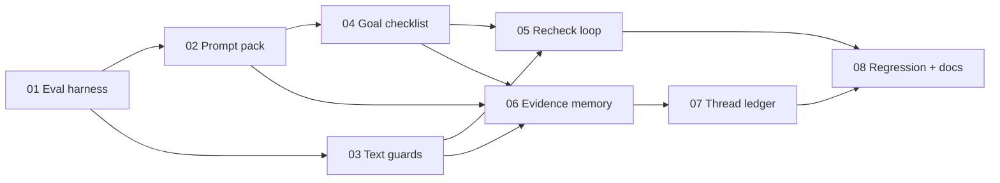

# Nâng chất lượng AI core từ bài học Pagekin

## Overview

Đầu vào đã chấp nhận: [báo cáo so sánh](../reports/xia-pagekin-ai-core-compare.md) và 6 phụ lục trong [`../reports/xia-pagekin/`](../reports/xia-pagekin/). Nguồn là Pagekin (`EthanYoQ/AI-Novel-Writer` @ `b049b516`, GPL-3.0). **Chỉ học cơ chế.** Mọi prompt và code đều phải tự viết; không chép nguyên văn.

Nguyên tắc xuyên suốt:

1. **Đo trước khi sửa.** Phase 01 dựng harness calibration (tập dev và held-out) và chạy baseline. Phase sau chỉ tune trên **dev**. Held-out chỉ được chạy ở baseline và ở phase 08.
2. **Thẩm quyền sự thật:** chính văn đã chốt > fact/tóm tắt phái sinh > kế hoạch tương lai. Chính văn và trích dẫn **không bao giờ** là chỉ thị cho agent (ranh giới tin cậy).
3. **Bằng chứng do code định vị.** Model chỉ trích dẫn; `domain.LocateQuote` kiểm. Vị trí được định vị lại mỗi lần dùng, không lưu offset.
4. **Clean cutover.** Không shim. JSON đã lưu vẫn đọc được nhờ `omitempty`. Payload đã đóng băng và record cũ không bị kiểm lại theo luật mới.
5. **Báo cáo an toàn.** Chỉ commit metric. Văn bản, lỗi thô và config nằm trong `workspace/` (đã gitignore).

## Phases

| # | Phase | Phụ thuộc | Mục báo cáo | Status |
|---|-------|-----------|-------------|--------|
| 1 | [Eval calibration harness](./phase-01-eval-calibration-harness.md) | — | P0 0.1, 0.2 | Pending |
| 2 | [Prompt authority pack](./phase-02-prompt-authority-pack.md) | 1 | P1 1.1–1.8 | Pending |
| 3 | [Runtime text guards](./phase-03-runtime-text-guards.md) | 1 | P1 1.9, P2 2.2–2.5 | Pending |
| 4 | [Review goal checklist](./phase-04-review-goal-checklist.md) | 2 | P2 2.1, quote grounding, P1 1.5 (thứ tự schema) | Pending |
| 5 | [Finding recheck loop](./phase-05-finding-recheck-loop.md) | 3, 4 | P2 2.8 | Pending |
| 6 | [Continuity evidence memory](./phase-06-continuity-evidence-memory.md) | 2, 3, 4 | P2 2.6, 2.7, 2.10 | Pending |
| 7 | [Thread ledger lifecycle](./phase-07-thread-ledger-lifecycle.md) | 6 | P2 2.12 | Pending |
| 8 | [Regression, A/B cuối, docs](./phase-08-regression-and-docs.md) | 1–7 | — | Pending |

Phase 02 và 03 chạy song song được: chúng sở hữu các file khác nhau và đều chỉ phụ thuộc phase 01. Riêng `writer.md` có 2 chỗ chạm: phase 02 sửa nhiều mục, phase 03 chỉ sửa dòng 8 (append). Cook merge phase 02 trước. Từ phase 04 trở đi chạy tuần tự.

## Quyết định đã chốt khi lập plan (có bằng chứng)

| # | Quyết định | Bằng chứng |
|---|-----------|-----------|
| D1 | **2.9 (chia batch khi length) bỏ.** Import đã có salvage/halve. Các caller structured còn lại có output nhỏ và có giới hạn. | `internal/host/imp/analyze.go:297-300`, `segment.go:356-360`; `ledger/architect.go:21-24` (10 giá trị); `arbiter` có output quyết định nhỏ |
| D2 | **2.11 (cast identity-first) bỏ.** Mình lưu toàn bộ cast trong một lần gọi. Khi lưu lại, ID được giữ theo khớp tên/biệt danh, nên không có lỗi trôi danh tính giữa các batch như Pagekin. | `internal/store/characters.go:24-35`, `nao_identity.go:52-70,123-146`; test va chạm biệt danh `internal/store/nao_test.go:72-76` |
| D3 | **2.5 tách đôi.** (a) Gỡ khối `<think>` ở đầu raw trong `llmcontract` trước khi decode (rẻ, hữu ích cho prompt-mode với Ollama). (b) Bộ lọc stream chỉ làm khi probe thật cho thấy provider đang cấu hình nhét `<think>` vào content. | MiniMax đã tách bằng `reasoning_split` (`provider/minimax/provider.go:93-115`). Chính văn đi qua tham số tool call, không qua content. Không tìm thấy `<think>` trong dữ liệu local. |
| D4 | **Ngân sách context giữ dạng mềm.** Phase 06 đọc `_trimmed` để biết A/B có thật hay không. | `internal/tools/novel_context.go:217-246` (mềm); `previous_tail` bị cắt trước `timeline` (`:617-633`). Báo cáo ghi "hard fail" là sai: `trimByBudget` trả lỗi nhưng `finalizeContextPayload` nuốt lỗi đó. |
| D5 | **Chỉ dùng gate tất định**, không dùng LLM judge. | `internal/eval/case.go:7-8` ("LLM Judge không được làm bẩn gate tất định") |
| D6 | **Giới hạn số lần sửa trong `llmcontract.Execute` mặc định là 3.** Đây là thay đổi hành vi: test `arbiter_test.go:145` phải đổi ý nghĩa. | Vòng lặp hiện không có giới hạn (`execute.go:107`). Tài liệu kiến trúc yêu cầu "Engine không được quay rỗng vô hạn" (`docs/architecture.md:64`). Hành vi này kế thừa từ upstream, không phải quyết định của user (`git log` 77931a2). |
| D7 | **Gate văn bản: chặn lỗi rõ, còn lại chỉ báo** (user chọn). Chặn: thẻ think, code fence, meta đầu/cuối, cắt cụt, viết lại co ngắn theo review, append trùng hoàn toàn. Chỉ báo: `opening_replay`. Lặp đoạn dùng `self_duplication` có sẵn. Detector đặt ở `internal/rules`. | `docs/architecture.md:62`; `internal/rules/lint.go:12-25,141-198`; `commit_chapter.go:551-566` |
| D8 | **Recheck dùng `save_review`** (user chọn). Không thêm tool mới. Cận trên suy ra từ cờ `Recheck` của review hiện hành. | `internal/agents/build.go:360-364`; `save_review.go:175-224`; `internal/store/world.go:417-437`; `internal/entry/web/quality_api.go:155-205` |
| D9 | **Quote của fact là tùy chọn, có thì kiểm** (user chọn). Import, `/sync`, payload đóng băng không hỏng. Đo `quote_coverage`. | `internal/host/imp/publish.go:161-233` (import đi qua `commit_chapter`); `internal/revision/analyze.go:30`; `commit_chapter.go:136-150` |
| D10 | **Gate và kiểm quote chỉ chạy khi nhận bản nộp mới**, không chạy ở đường phục hồi pending. | `commit_chapter.go:108-157` |
| D11 | **Phục bút đã đóng: mọi thao tác là no-op**, không báo lỗi, để replay không bao giờ vỡ. | `internal/store/world.go:214-227`; `internal/revision/projector.go:113-140` |

## Ngoài phạm vi

- P3 trong báo cáo: preset reasoning, recovery candidate, context receipts, cast proposal duyệt tay, reconciliation, repair chỉ sửa cú pháp, stale generation counter, writing skill theo stage, embedding (vẫn chờ eval `nao-w0` W4).
- LLM judge.
- Đa ngôn ngữ.
- Thay `edit_chapter` bằng viết lại toàn chương.

## Điều kiện tiên quyết

- Có cấu hình provider thật để chạy eval (`go run ./cmd/ainovel-cli eval … --config <file>`). Baseline và mọi A/B đều tốn token thật.
- Node/npm cho `web/` (`npm run typecheck`, `npm test`, `npm run build`). Thư mục `internal/entry/web/dist` được track trong git, nên phải build lại khi UI đổi.

## Success Criteria

- [ ] Harness assert được verdict, issue (`severity`/`rule_ref`), trạng thái mục tiêu chương, kết quả recheck, prose và fact của writer. Có 12 case editor và 5 case writer (dev và held-out) cùng `baseline.md` (repeat 3). Mỗi case fixture chạy đúng một worker.
- [ ] Ở A/B cuối (phase 08), cùng model và cùng quần thể case, so với baseline, trên **cả dev lẫn held-out**:
  - `critical_hit` **tăng**;
  - `false_positive` trên các case đối chứng **không tăng**;
  - `writer_violations` **không tăng**;
  - token mỗi chương tăng **≤ 25%**;
  - `tool_errors` tăng **≤ 10%**;
  - không case nào trước đây PASS bị chuyển sang FAIL.

  Chênh lệch tỉ lệ pass dưới 2/3 ghi là "không phân biệt được", không tính là cải thiện.
- [ ] `go vet ./...` và `go test -count=1 ./...` xanh. Chạy `-race` xanh cho `internal/host internal/store internal/tools internal/flow`. Web: `npm run typecheck && npm test && npm run build` xanh. `go generate ./internal/entry/web` không tạo diff.
- [ ] Docs khớp hành vi: `docs/evaluation-system.md`, `docs/context-management.md`, `docs/architecture.md`, `docs/design/v1/06-data-contract.md`, `docs/design/v1/11-api-contract.md`, `docs/chapter-advance-gate.md`.
- [ ] Prompt viết độc lập từ mô tả cơ chế, có ghi nguồn ý tưởng. Phase 08 có quét chuỗi và ghi kết quả.

## Rủi ro chính

| Rủi ro | Mức | Giảm thiểu |
|--------|-----|-----------|
| Kết quả eval nhiễu vì model ngẫu nhiên | Cao | Repeat 3, ngưỡng 2/3, tách dev và held-out; case sát ngưỡng chạy thêm tới repeat 5. Cố định model và config. |
| Gate văn bản chặn nhầm văn hay | TB | Chỉ chặn các tai nạn cơ học liệt kê ở D7; `opening_replay` chỉ báo. Có test bảng các câu văn hợp lệ; thông điệp lỗi chỉ đúng chỗ cần sửa. |
| Schema `save_review` / `commit_chapter` đổi làm model gọi tool lỗi nhiều hơn | TB | Đo `tool_errors`, ngưỡng ≤ 10%. Golden schema cập nhật có chủ đích. |
| Vòng recheck tạo kẹt hàng đợi hoặc hoàn thành sách sớm | TB | Cận trên suy ra từ dữ liệu. `drained` tính cả hai hàng đợi. Có test tích hợp và test hoàn thành sách. |
| Prompt injection từ chính văn hoặc sách import | TB | Ranh giới tin cậy trong prompt, nhãn dữ liệu trên payload, case `ed-injection-in-prose` ở held-out. |
| Rò rỉ dữ liệu qua báo cáo eval | TB | Chỉ commit metric, có secret scan, báo cáo thô nằm trong `workspace/`. |
| Prompt cache miss sau khi đổi prompt | Thấp | Chỉ miss một lần mỗi role. Khóa cache không phụ thuộc nội dung prompt (`internal/agents/build.go:36-42`). |

## Red Team Review

### Session — 2026-10-27

**Phát hiện:** 38 phát hiện từ 4 reviewer (Failure Mode, Assumption, Scope/Contract, Fact/Security), gộp thành 15 nhóm. **Chấp nhận cả 15**, **bác 0**.
**Mức độ:** 6 Critical, 7 High, 2 Medium.

| # | Phát hiện | Mức | Xử lý | Phase |
|---|-----------|-----|-------|-------|
| 1 | `start` + `PauseAfterStep` có race, engine có thể dừng trước khi worker chạy; `capReached` đếm cả chương seed | Critical | `engine.startOnce` đặt cờ trước khi start; `driveOnce` không dùng cap | 01 |
| 2 | Recheck: giới hạn "1 lần" mâu thuẫn với "lần thứ hai"; `CompleteRewrite` có 3 caller với ngữ nghĩa khác nhau; sách có thể hoàn thành khi recheck còn pending | Critical | Thiết kế lại theo `save_review` (D8); cận trên suy từ dữ liệu; `drained` tính hai hàng đợi | 05 |
| 3 | Quote bắt buộc làm hỏng import, `/sync` và pending | Critical | Quote tùy chọn (D9); chỉ kiểm khi nhận bản nộp mới (D10) | 06 |
| 4 | Từ chối thao tác lên phục bút đã đóng làm vỡ replay | Critical | No-op (D11) | 07 |
| 5 | Gate ở `validateCommitArgs` làm kẹt pending cũ | Critical | Chỉ chạy ở nhánh nộp mới | 03 |
| 6 | Trích dẫn sai đường dẫn `internal/imp`, `story.go:94` | Critical | Sửa thành `internal/host/imp/*`, `OutlineEntry.Promise` | 06, 07 |
| 7 | Gate chặn mâu thuẫn với nguyên tắc chỉ báo lỗi; trùng với `rules` (`self_duplication`) | High | D7; detector chuyển vào `internal/rules` | 01, 03 |
| 8 | `textguard` là package thứ hai làm cùng việc; `Locate` nên nằm ở domain | High | Bỏ `textguard`; dùng `rules/overlap.go` và `domain/quote.go` | 01, 04 |
| 9 | Kiểu `ChapterPlan` ở web viết tay, không do generate | High | Sửa tay `types.ts` và `ReviewPanel` | 02 |
| 10 | Mode không phân tầng: `outline_window` dừng ở chương hiện tại, writer không thấy chương sau | High | Thêm `upcoming_outline` | 02 |
| 11 | Repeat 3 + lấy kết quả tệ nhất + tune trên chính bộ case dùng để đo → overfit, nhiễu | High | Tỉ lệ pass, tách dev/held-out, giới hạn 2 vòng tune | 01, 02, 08 |
| 12 | Prompt injection qua chính văn, evidence, recheck | High | Ranh giới tin cậy, nhãn dữ liệu, case injection | 02, 05, 06 |
| 13 | Đường dẫn fixture, regex DoS, rò rỉ lỗi provider vào báo cáo | High | Chỉ nhận tên fixture, giới hạn regex RE2, báo cáo chỉ chứa metric, secret scan | 01, 08 |
| 14 | ID phát hiện trùng với `reviewItemID` của web | Medium | Dùng chung `domain.ReviewItemID` / `ReviewEntryItemIDs` | 05 |
| 15 | Kiểm tra giấy phép chỉ quét chuỗi là yếu | Medium | Quy trình viết độc lập, ghi chú nguồn gốc trong commit, ghi nguồn ý tưởng | 02, 08 |
| 16 | (Phát hiện khi rà toàn plan) Import publish **qua** `commit_chapter` (`internal/host/imp/publish.go:161-233`), nên admission gate có thể chặn chính văn của tác giả | Critical | Option `WithAuthorSource()` cho instance commit của import | 03, 06 |

## Validation Log

### Session 1 — 2026-10-27

**Trigger:** gate phán quyết red-team, gồm các quyết định cần user chọn.
**Câu hỏi:** 4

1. **Áp dụng kết quả red-team?** Chọn: áp dụng cả 15 nhóm.
2. **Thiết kế recheck (phase 05)?** Chọn: re-review qua `save_review`. → D8, viết lại phase 05.
3. **Gate văn bản (phase 03)?** Chọn: chặn lỗi rõ, còn lại chỉ báo. → D7, viết lại phase 03.
4. **Quote cho fact (phase 06)?** Chọn: tùy chọn, có thì kiểm. → D9, viết lại phase 06.

**Phase bị ảnh hưởng:** 01–08.
<!-- slug: ai-core-quality-uplift -->
