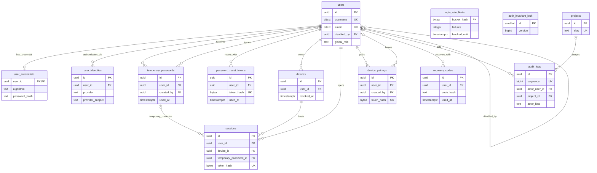
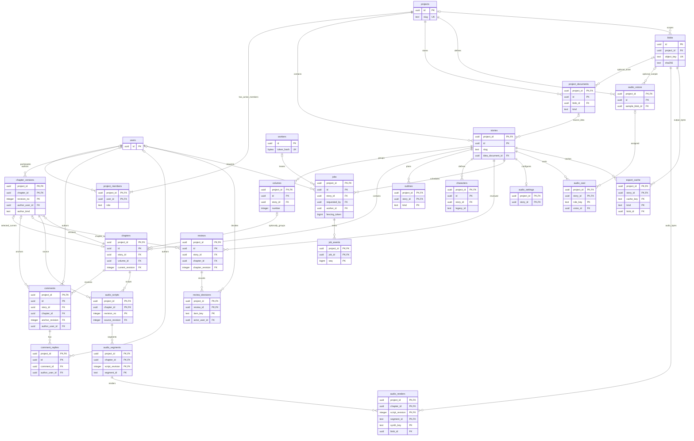

# Schema và hợp đồng đề xuất

Tài liệu thiết kế, **không phải migration đã tồn tại**. Mọi tên SQL/API mới bên dưới là proposed. Nguồn hiện tại đã đọc lại sau thay đổi repo: account schema `internal/webauth/store.go:63-119`; membership migration `internal/webauth/members.go:97-195`; comment model `internal/comments/comments.go:50-106`; chapter record `internal/store/chapter_records.go:73-95`; composition root `internal/store/store.go:16-39`; queue `internal/audio/queue.go:12-55`.

## 1. Quy tắc lưu trữ

- `Store` là facade nghiệp vụ; `file` và `postgres` là hai backend thực. Domain contracts giữ kiểu dữ liệu trong `internal/domain`; postgres implementation không gọi `os.ReadFile` để trả dữ liệu truyện. Không xây generic filesystem-in-SQL. Có typed repositories cho identity/library/chapters/outline/characters/comments/reviews/jobs/audio; `story_state` chỉ chứa các singleton/snapshot nghiệp vụ đã liệt kê, không chứa bản ghi chapter/user/job tùy ý.
- Chọn backend một lần cho mỗi process/run. Không fallback file khi Postgres lỗi. Có thể migrate domain trong các release staging, nhưng production chỉ bật postgres sau 08–09; không duy trì live dual-write/hybrid lookup.
- Các định danh UUID do Go tạo; user hiện dùng username, importer cấp UUID ổn định bằng source namespace+username và lưu mapping. Composite FK `(project_id, …)` ngăn liên kết chéo project. Đây là integrity, không phải authorization. Slug chỉ là địa chỉ ngoài, UUID là identity; rename không đổi blob key hay quyền.
- `created_at`, `updated_at`, `version` có ở mọi bảng. Với mutable row: `UPDATE … WHERE version=$expected`, tăng version và cập nhật `updated_at` trong cùng SQL; zero rows → conflict 409, không ghi đè. Với append-only row: version=1 và updated_at=created_at, cấm UPDATE/DELETE bằng grant/trigger; retention chỉ qua maintenance role. Timestamp dùng `timestamptz` UTC.
- Soft delete cho users/projects/stories/chapters/comments; mặc định query loại deleted. Không tái dùng username/email/slug đã soft-delete để tránh takeover/link cũ trỏ sang người khác. Không hard-delete lịch sử khi vô hiệu hóa tài khoản; FK actor là RESTRICT. Purge chỉ sau backup, retention rõ ràng và xử lý dependency từ con lên cha.
- Application role không phải schema owner/superuser, không có DDL; migration role riêng. SQL luôn parameterized. Repository entrypoint phải nhận actor immutable và project/story identity đã resolve, không lấy tenant từ process-global state.

## 2. DDL lõi

Các đoạn sau ghép theo thứ tự thành migration SQL goose. Thực thi bằng test 02/04/05/07/08; không tuyên bố đã chạy. Mọi bảng bổ sung dưới đây đều ghi đầy đủ columns và keys, không dùng ký hiệu “...”. `version` là row CAS; `revision_no` là content version.

```sql
CREATE EXTENSION IF NOT EXISTS citext;
CREATE EXTENSION IF NOT EXISTS pg_trgm;

CREATE TABLE users (
 id uuid PRIMARY KEY, username citext NOT NULL UNIQUE,
 email citext UNIQUE, display_name text NOT NULL,
 global_role text NOT NULL CHECK (global_role IN ('admin','member')),
 status text NOT NULL CHECK (status IN ('active','locked')),
 must_change_password boolean NOT NULL DEFAULT false,
 onboarded_at timestamptz, disabled_at timestamptz, disabled_by uuid REFERENCES users(id) ON DELETE RESTRICT,
 disabled_reason text NOT NULL DEFAULT '', deleted_at timestamptz,
 created_at timestamptz NOT NULL DEFAULT now(), updated_at timestamptz NOT NULL DEFAULT now(),
 version bigint NOT NULL DEFAULT 1 CHECK (version>0),
 CHECK (length(username::text) BETWEEN 2 AND 32 AND username::text ~ '^[a-z0-9._-]+$'),
 CHECK (email IS NULL OR (email::text=trim(email::text) AND email::text<>''))
);
CREATE TABLE user_credentials (
 user_id uuid PRIMARY KEY REFERENCES users(id) ON DELETE RESTRICT,
 algorithm text NOT NULL DEFAULT 'argon2id' CHECK (algorithm='argon2id'),
 password_hash text, password_changed_at timestamptz,
 created_at timestamptz NOT NULL DEFAULT now(), updated_at timestamptz NOT NULL DEFAULT now(),
 version bigint NOT NULL DEFAULT 1 CHECK (version>0),
 CHECK (password_hash IS NULL OR password_hash LIKE '$argon2id$%')
);
CREATE TABLE user_identities (
 id uuid PRIMARY KEY, user_id uuid NOT NULL REFERENCES users(id) ON DELETE RESTRICT,
 provider text NOT NULL, provider_subject text NOT NULL, provider_email citext,
 created_at timestamptz NOT NULL DEFAULT now(), updated_at timestamptz NOT NULL DEFAULT now(),
 version bigint NOT NULL DEFAULT 1 CHECK (version>0),
 UNIQUE(provider,provider_subject), UNIQUE(user_id,provider,provider_subject)
);
CREATE TABLE temporary_passwords (
 id uuid PRIMARY KEY, user_id uuid NOT NULL REFERENCES users(id) ON DELETE RESTRICT,
 password_hash text NOT NULL, expires_at timestamptz NOT NULL, used_at timestamptz, revoked_at timestamptz,
 created_by uuid REFERENCES users(id) ON DELETE RESTRICT,
 created_at timestamptz NOT NULL DEFAULT now(), updated_at timestamptz NOT NULL DEFAULT now(),
 version bigint NOT NULL DEFAULT 1 CHECK (version>0), CHECK(expires_at>created_at),
 UNIQUE(user_id,id), CHECK(password_hash LIKE '$argon2id$%')
);
CREATE UNIQUE INDEX temporary_passwords_one_open ON temporary_passwords(user_id)
 WHERE used_at IS NULL AND revoked_at IS NULL;
CREATE TABLE password_reset_tokens (
 id uuid PRIMARY KEY, user_id uuid NOT NULL REFERENCES users(id) ON DELETE RESTRICT,
 token_hash bytea NOT NULL UNIQUE CHECK(octet_length(token_hash)=32),
 expires_at timestamptz NOT NULL, used_at timestamptz, revoked_at timestamptz,
 created_at timestamptz NOT NULL DEFAULT now(), updated_at timestamptz NOT NULL DEFAULT now(),
 version bigint NOT NULL DEFAULT 1 CHECK(version>0), CHECK(expires_at>created_at)
);
CREATE TABLE devices (
 id uuid PRIMARY KEY, user_id uuid NOT NULL REFERENCES users(id) ON DELETE RESTRICT,
 name text NOT NULL, user_agent text NOT NULL DEFAULT '', last_ip inet,
 last_seen_at timestamptz, revoked_at timestamptz,
 created_at timestamptz NOT NULL DEFAULT now(), updated_at timestamptz NOT NULL DEFAULT now(),
 version bigint NOT NULL DEFAULT 1 CHECK(version>0), UNIQUE(user_id,id)
);
CREATE TABLE sessions (
 id uuid PRIMARY KEY, user_id uuid NOT NULL REFERENCES users(id) ON DELETE RESTRICT,
 device_id uuid NOT NULL, token_hash bytea NOT NULL UNIQUE CHECK(octet_length(token_hash)=32),
 credential_kind text NOT NULL CHECK(credential_kind IN ('password','temporary','pairing','recovery')),
 temporary_password_id uuid,
 CHECK((credential_kind='temporary')=(temporary_password_id IS NOT NULL)),
 last_ip inet, user_agent text NOT NULL DEFAULT '', last_seen_at timestamptz NOT NULL DEFAULT now(),
 expires_at timestamptz NOT NULL, revoked_at timestamptz,
 created_at timestamptz NOT NULL DEFAULT now(), updated_at timestamptz NOT NULL DEFAULT now(),
 version bigint NOT NULL DEFAULT 1 CHECK(version>0), CHECK(expires_at>created_at),
 FOREIGN KEY(user_id,device_id) REFERENCES devices(user_id,id) ON DELETE RESTRICT,
 FOREIGN KEY(user_id,temporary_password_id) REFERENCES temporary_passwords(user_id,id) ON DELETE RESTRICT
);
CREATE INDEX sessions_user_active ON sessions(user_id,expires_at) WHERE revoked_at IS NULL;
CREATE INDEX sessions_expiry ON sessions(expires_at);
CREATE TABLE device_pairings (
 id uuid PRIMARY KEY, user_id uuid NOT NULL REFERENCES users(id) ON DELETE RESTRICT,
 token_hash bytea NOT NULL UNIQUE CHECK(octet_length(token_hash)=32),
 created_by uuid REFERENCES users(id) ON DELETE RESTRICT,
 expires_at timestamptz NOT NULL, used_at timestamptz, revoked_at timestamptz,
 created_at timestamptz NOT NULL DEFAULT now(), updated_at timestamptz NOT NULL DEFAULT now(),
 version bigint NOT NULL DEFAULT 1 CHECK(version>0), CHECK(expires_at>created_at)
);
CREATE TABLE recovery_codes (
 id uuid PRIMARY KEY, user_id uuid NOT NULL REFERENCES users(id) ON DELETE RESTRICT,
 code_hash text NOT NULL CHECK(code_hash LIKE '$argon2id$%'), mask text,
 used_at timestamptz, revoked_at timestamptz,
 created_at timestamptz NOT NULL DEFAULT now(), updated_at timestamptz NOT NULL DEFAULT now(),
 version bigint NOT NULL DEFAULT 1 CHECK(version>0)
);
CREATE UNIQUE INDEX recovery_one_open ON recovery_codes(user_id) WHERE used_at IS NULL AND revoked_at IS NULL;
CREATE TABLE login_rate_limits (
 bucket_hash bytea PRIMARY KEY CHECK(octet_length(bucket_hash)=32),
 failures integer NOT NULL DEFAULT 0 CHECK(failures>=0), window_started_at timestamptz NOT NULL,
 blocked_until timestamptz, expires_at timestamptz NOT NULL,
 created_at timestamptz NOT NULL DEFAULT now(), updated_at timestamptz NOT NULL DEFAULT now(),
 version bigint NOT NULL DEFAULT 1 CHECK(version>0)
);
CREATE INDEX login_rate_limits_expiry ON login_rate_limits(expires_at);
CREATE TABLE auth_invariant_lock (
 id smallint PRIMARY KEY CHECK(id=1),
 created_at timestamptz NOT NULL DEFAULT now(), updated_at timestamptz NOT NULL DEFAULT now(),
 version bigint NOT NULL DEFAULT 1 CHECK(version>0)
);
INSERT INTO auth_invariant_lock(id) VALUES(1);

CREATE TABLE projects (
 id uuid PRIMARY KEY, slug text NOT NULL UNIQUE, name text NOT NULL,
 description text NOT NULL DEFAULT '', notes text NOT NULL DEFAULT '', universe_name text NOT NULL DEFAULT '',
 settings jsonb NOT NULL DEFAULT '{}', deleted_at timestamptz,
 created_at timestamptz NOT NULL DEFAULT now(), updated_at timestamptz NOT NULL DEFAULT now(),
 version bigint NOT NULL DEFAULT 1 CHECK(version>0), CHECK(length(slug)>0)
);
CREATE TABLE project_members (
 project_id uuid NOT NULL REFERENCES projects(id) ON DELETE RESTRICT,
 user_id uuid NOT NULL REFERENCES users(id) ON DELETE RESTRICT,
 role text NOT NULL CHECK(role IN ('owner','collab','view')), removed_at timestamptz,
 created_at timestamptz NOT NULL DEFAULT now(), updated_at timestamptz NOT NULL DEFAULT now(),
 version bigint NOT NULL DEFAULT 1 CHECK(version>0), PRIMARY KEY(project_id,user_id)
);
CREATE UNIQUE INDEX project_one_owner ON project_members(project_id)
 WHERE role='owner' AND removed_at IS NULL;
CREATE INDEX project_members_by_user ON project_members(user_id,project_id) WHERE removed_at IS NULL;
CREATE TABLE audit_logs (
 id uuid PRIMARY KEY, project_id uuid REFERENCES projects(id) ON DELETE RESTRICT,
 sequence bigint GENERATED BY DEFAULT AS IDENTITY UNIQUE NOT NULL,
 actor_user_id uuid REFERENCES users(id) ON DELETE RESTRICT,
 actor_kind text NOT NULL CHECK(actor_kind IN ('user','worker','system','import')),
 action text NOT NULL, target_kind text NOT NULL, target_id text NOT NULL,
 request_id text, details jsonb NOT NULL DEFAULT '{}', occurred_at timestamptz NOT NULL DEFAULT now(),
 created_at timestamptz NOT NULL DEFAULT now(), updated_at timestamptz NOT NULL DEFAULT now(),
 version bigint NOT NULL DEFAULT 1 CHECK(version=1), CHECK(updated_at=created_at)
);
CREATE INDEX audit_project_time ON audit_logs(project_id,occurred_at DESC,id);
CREATE INDEX audit_actor_time ON audit_logs(actor_user_id,occurred_at DESC);
CREATE TABLE blobs (
 id uuid PRIMARY KEY, project_id uuid REFERENCES projects(id) ON DELETE RESTRICT,
 object_key text NOT NULL UNIQUE, storage_driver text NOT NULL CHECK(storage_driver IN ('local','s3')),
 sha256 text NOT NULL CHECK(sha256 ~ '^[0-9a-f]{64}$'), size_bytes bigint NOT NULL CHECK(size_bytes>=0),
 content_type text NOT NULL, visibility text NOT NULL DEFAULT 'private' CHECK(visibility IN ('private','public')),
 state text NOT NULL CHECK(state IN ('staged','ready','deleting')), created_by uuid REFERENCES users(id) ON DELETE RESTRICT,
 created_at timestamptz NOT NULL DEFAULT now(), updated_at timestamptz NOT NULL DEFAULT now(),
 version bigint NOT NULL DEFAULT 1 CHECK(version>0), UNIQUE(project_id,id)
);
CREATE INDEX blobs_gc ON blobs(state,created_at);
CREATE INDEX blobs_tenant_hash ON blobs(project_id,sha256);
CREATE TABLE stories (
 project_id uuid NOT NULL REFERENCES projects(id) ON DELETE RESTRICT, id uuid NOT NULL,
 slug text NOT NULL, title text NOT NULL, short_title text NOT NULL DEFAULT '', synopsis text NOT NULL DEFAULT '',
 title_renamed boolean NOT NULL DEFAULT false, status text NOT NULL CHECK(status IN ('idea','writing','paused','done','published')),
 tags text[] NOT NULL DEFAULT '{}', published_at timestamptz, deleted_at timestamptz,
 created_at timestamptz NOT NULL DEFAULT now(), updated_at timestamptz NOT NULL DEFAULT now(),
 version bigint NOT NULL DEFAULT 1 CHECK(version>0), PRIMARY KEY(project_id,id), UNIQUE(project_id,slug)
);
CREATE TABLE volumes (
 project_id uuid NOT NULL, story_id uuid NOT NULL, id uuid NOT NULL,
 number integer NOT NULL CHECK(number>0), title text NOT NULL DEFAULT '', outline jsonb NOT NULL DEFAULT '{}',
 created_at timestamptz NOT NULL DEFAULT now(), updated_at timestamptz NOT NULL DEFAULT now(),
 version bigint NOT NULL DEFAULT 1 CHECK(version>0), PRIMARY KEY(project_id,id),
 UNIQUE(project_id,story_id,number), UNIQUE(project_id,story_id,id),
 FOREIGN KEY(project_id,story_id) REFERENCES stories(project_id,id) ON DELETE RESTRICT
);
CREATE TABLE chapters (
 project_id uuid NOT NULL, story_id uuid NOT NULL, id uuid NOT NULL, volume_id uuid,
 number integer NOT NULL CHECK(number>0), title text NOT NULL DEFAULT '', draft_text text NOT NULL DEFAULT '',
 current_revision integer, deleted_at timestamptz,
 created_at timestamptz NOT NULL DEFAULT now(), updated_at timestamptz NOT NULL DEFAULT now(),
 version bigint NOT NULL DEFAULT 1 CHECK(version>0), PRIMARY KEY(project_id,id),
 UNIQUE(project_id,story_id,number), UNIQUE(project_id,story_id,id),
 FOREIGN KEY(project_id,story_id) REFERENCES stories(project_id,id) ON DELETE RESTRICT,
 FOREIGN KEY(project_id,story_id,volume_id) REFERENCES volumes(project_id,story_id,id) ON DELETE RESTRICT,
 CHECK(current_revision IS NULL OR current_revision>0)
);
CREATE TABLE chapter_versions (
 project_id uuid NOT NULL, chapter_id uuid NOT NULL, revision_no integer NOT NULL CHECK(revision_no>0),
 content text NOT NULL, sha256 text NOT NULL CHECK(sha256 ~ '^[0-9a-f]{64}$'),
 origin text NOT NULL CHECK(origin IN ('generated','user','import')),
 author_kind text NOT NULL CHECK(author_kind IN ('user','agent','import')),
 author_user_id uuid REFERENCES users(id) ON DELETE RESTRICT, agent_name text,
 facts jsonb NOT NULL DEFAULT '{}', style_delta jsonb NOT NULL DEFAULT '{}',
 legacy_build text, accepted_at timestamptz NOT NULL,
 created_at timestamptz NOT NULL DEFAULT now(), updated_at timestamptz NOT NULL DEFAULT now(),
 version bigint NOT NULL DEFAULT 1 CHECK(version=1), PRIMARY KEY(project_id,chapter_id,revision_no),
 FOREIGN KEY(project_id,chapter_id) REFERENCES chapters(project_id,id) ON DELETE RESTRICT,
 CHECK((author_kind='user' AND author_user_id IS NOT NULL AND agent_name IS NULL)
    OR (author_kind='agent' AND agent_name IS NOT NULL AND author_user_id IS NULL)
    OR (author_kind='import' AND author_user_id IS NULL AND agent_name IS NULL)),
 CHECK(updated_at=created_at)
);
ALTER TABLE chapters ADD CONSTRAINT chapters_current_version_fk
 FOREIGN KEY(project_id,id,current_revision) REFERENCES chapter_versions(project_id,chapter_id,revision_no)
 DEFERRABLE INITIALLY DEFERRED;
CREATE TABLE outlines (
 project_id uuid NOT NULL, story_id uuid NOT NULL, kind text NOT NULL CHECK(kind IN ('flat','layered','premise','compass','retention')),
 payload jsonb NOT NULL, text_content text,
 created_at timestamptz NOT NULL DEFAULT now(), updated_at timestamptz NOT NULL DEFAULT now(),
 version bigint NOT NULL DEFAULT 1 CHECK(version>0), PRIMARY KEY(project_id,story_id,kind),
 FOREIGN KEY(project_id,story_id) REFERENCES stories(project_id,id) ON DELETE RESTRICT
);
CREATE TABLE characters (
 project_id uuid NOT NULL, story_id uuid NOT NULL, id uuid NOT NULL, legacy_id text NOT NULL,
 name text NOT NULL, payload jsonb NOT NULL,
 created_at timestamptz NOT NULL DEFAULT now(), updated_at timestamptz NOT NULL DEFAULT now(),
 version bigint NOT NULL DEFAULT 1 CHECK(version>0), PRIMARY KEY(project_id,id), UNIQUE(project_id,story_id,legacy_id),
 FOREIGN KEY(project_id,story_id) REFERENCES stories(project_id,id) ON DELETE RESTRICT
);
CREATE TABLE comments (
 project_id uuid NOT NULL, story_id uuid NOT NULL, id uuid NOT NULL, chapter_id uuid NOT NULL,
 author_user_id uuid REFERENCES users(id) ON DELETE RESTRICT, legacy_author_name text,
 body text NOT NULL, original_paragraph integer, original_quote text NOT NULL DEFAULT '', chips text[] NOT NULL DEFAULT '{}',
 anchor jsonb, anchor_revision integer, candidates jsonb NOT NULL DEFAULT '[]',
 status text NOT NULL CHECK(status IN ('pending','sent','fixed','lost','unsure','done')),
 fixed_by text CHECK(fixed_by IN ('agent','quote_gone')), sent_at timestamptz, fixed_at timestamptz, resolved_at timestamptz,
 unfixed boolean NOT NULL DEFAULT false, moved boolean NOT NULL DEFAULT false,
 relinked boolean NOT NULL DEFAULT false, whole boolean NOT NULL DEFAULT false, new_quote text NOT NULL DEFAULT '',
 deleted_at timestamptz,
 created_at timestamptz NOT NULL DEFAULT now(), updated_at timestamptz NOT NULL DEFAULT now(),
 version bigint NOT NULL DEFAULT 1 CHECK(version>0), PRIMARY KEY(project_id,id),
 FOREIGN KEY(project_id,story_id,chapter_id) REFERENCES chapters(project_id,story_id,id) ON DELETE RESTRICT,
 FOREIGN KEY(project_id,chapter_id,anchor_revision) REFERENCES chapter_versions(project_id,chapter_id,revision_no) ON DELETE RESTRICT,
 CHECK(author_user_id IS NOT NULL OR legacy_author_name IS NOT NULL)
);
CREATE TABLE comment_replies (
 project_id uuid NOT NULL, comment_id uuid NOT NULL, id uuid NOT NULL,
 author_user_id uuid REFERENCES users(id) ON DELETE RESTRICT, legacy_author_name text, body text NOT NULL,
 created_at timestamptz NOT NULL DEFAULT now(), updated_at timestamptz NOT NULL DEFAULT now(),
 version bigint NOT NULL DEFAULT 1 CHECK(version>0), PRIMARY KEY(project_id,id),
 FOREIGN KEY(project_id,comment_id) REFERENCES comments(project_id,id) ON DELETE RESTRICT,
 CHECK(author_user_id IS NOT NULL OR legacy_author_name IS NOT NULL)
);
CREATE TABLE reviews (
 project_id uuid NOT NULL, story_id uuid NOT NULL, id uuid NOT NULL,
 scope_key text NOT NULL, round integer NOT NULL CHECK(round>0), chapter_id uuid, chapter_revision integer,
 payload jsonb NOT NULL, reviewer_kind text NOT NULL CHECK(reviewer_kind IN ('user','agent','import')),
 reviewer_user_id uuid REFERENCES users(id) ON DELETE RESTRICT, agent_name text,
 invalidated_at timestamptz,
 created_at timestamptz NOT NULL DEFAULT now(), updated_at timestamptz NOT NULL DEFAULT now(),
 version bigint NOT NULL DEFAULT 1 CHECK(version>0), PRIMARY KEY(project_id,id), UNIQUE(project_id,story_id,scope_key,round),
 FOREIGN KEY(project_id,story_id) REFERENCES stories(project_id,id) ON DELETE RESTRICT,
 FOREIGN KEY(project_id,story_id,chapter_id) REFERENCES chapters(project_id,story_id,id) ON DELETE RESTRICT,
 FOREIGN KEY(project_id,chapter_id,chapter_revision) REFERENCES chapter_versions(project_id,chapter_id,revision_no) ON DELETE RESTRICT,
 CHECK((chapter_id IS NULL)=(chapter_revision IS NULL)),
 CHECK((reviewer_kind='user' AND reviewer_user_id IS NOT NULL AND agent_name IS NULL)
 OR (reviewer_kind='agent' AND agent_name IS NOT NULL AND reviewer_user_id IS NULL)
 OR (reviewer_kind='import' AND reviewer_user_id IS NULL AND agent_name IS NULL))
);
CREATE TABLE review_decisions (
 project_id uuid NOT NULL, review_id uuid NOT NULL, item_key text NOT NULL, decision text NOT NULL CHECK(decision='kept'),
 actor_user_id uuid REFERENCES users(id) ON DELETE RESTRICT, payload jsonb NOT NULL,
 created_at timestamptz NOT NULL DEFAULT now(), updated_at timestamptz NOT NULL DEFAULT now(),
 version bigint NOT NULL DEFAULT 1 CHECK(version>0), PRIMARY KEY(project_id,review_id,item_key),
 FOREIGN KEY(project_id,review_id) REFERENCES reviews(project_id,id) ON DELETE RESTRICT
);
CREATE INDEX stories_title_trgm ON stories USING gin(title gin_trgm_ops) WHERE deleted_at IS NULL;
CREATE INDEX chapters_title_trgm ON chapters USING gin(title gin_trgm_ops) WHERE deleted_at IS NULL;
CREATE INDEX chapter_content_trgm ON chapter_versions USING gin(content gin_trgm_ops);
CREATE INDEX characters_name_trgm ON characters USING gin(name gin_trgm_ops);
CREATE INDEX comments_chapter ON comments(project_id,chapter_id,created_at) WHERE deleted_at IS NULL;
CREATE INDEX reviews_scope ON reviews(project_id,story_id,scope_key,round DESC);
```

## 3. Engine, jobs, audio, importer DDL

`story_state` chuyển các snapshot có kiểu; mỗi kind phải có Go validator/version codec và parity test. Append log có bảng riêng, không gom vào một JSON mảng vô hạn. Project documents chứa ideas/rules/style overrides/ledger và reference blob, không chứa password/provider secrets plaintext.

```sql
CREATE TABLE project_documents (
 project_id uuid NOT NULL REFERENCES projects(id) ON DELETE RESTRICT, id uuid NOT NULL,
 kind text NOT NULL CHECK(kind IN ('idea','rules','style','ledger','config','asset')),
 logical_name text NOT NULL, text_content text, payload jsonb, blob_id uuid,
 created_at timestamptz NOT NULL DEFAULT now(), updated_at timestamptz NOT NULL DEFAULT now(),
 version bigint NOT NULL DEFAULT 1 CHECK(version>0), PRIMARY KEY(project_id,id), UNIQUE(project_id,kind,logical_name),
 FOREIGN KEY(project_id,blob_id) REFERENCES blobs(project_id,id) ON DELETE RESTRICT,
 CHECK(text_content IS NOT NULL OR payload IS NOT NULL OR blob_id IS NOT NULL)
);
ALTER TABLE stories ADD COLUMN idea_document_id uuid;
ALTER TABLE stories ADD CONSTRAINT story_idea_fk
 FOREIGN KEY(project_id,idea_document_id) REFERENCES project_documents(project_id,id) ON DELETE RESTRICT;
CREATE TABLE story_artifacts (
 project_id uuid NOT NULL, story_id uuid NOT NULL, kind text NOT NULL,
 artifact_key text NOT NULL, payload jsonb, text_content text, blob_id uuid, schema_version integer NOT NULL DEFAULT 1 CHECK(schema_version>0),
 created_at timestamptz NOT NULL DEFAULT now(), updated_at timestamptz NOT NULL DEFAULT now(),
 version bigint NOT NULL DEFAULT 1 CHECK(version>0), PRIMARY KEY(project_id,story_id,kind,artifact_key),
 FOREIGN KEY(project_id,story_id) REFERENCES stories(project_id,id) ON DELETE RESTRICT,
 FOREIGN KEY(project_id,blob_id) REFERENCES blobs(project_id,id) ON DELETE RESTRICT,
 CHECK(kind IN ('chapter_plan','summary','snapshot','import_artifact','style_sample','custom_style','custom_rules','diagnostic')),
 CHECK(payload IS NOT NULL OR text_content IS NOT NULL OR blob_id IS NOT NULL)
);
CREATE TABLE story_leases (
 project_id uuid NOT NULL, story_id uuid NOT NULL, holder_id uuid,
 fencing_token bigint NOT NULL DEFAULT 0 CHECK(fencing_token>=0), lease_until timestamptz,
 created_at timestamptz NOT NULL DEFAULT now(), updated_at timestamptz NOT NULL DEFAULT now(),
 version bigint NOT NULL DEFAULT 1 CHECK(version>0), PRIMARY KEY(project_id,story_id),
 FOREIGN KEY(project_id,story_id) REFERENCES stories(project_id,id) ON DELETE RESTRICT,
 CHECK((holder_id IS NULL)=(lease_until IS NULL))
);
CREATE TABLE story_state (
 project_id uuid NOT NULL, story_id uuid NOT NULL, kind text NOT NULL,
 payload jsonb NOT NULL, schema_version integer NOT NULL CHECK(schema_version>0),
 created_at timestamptz NOT NULL DEFAULT now(), updated_at timestamptz NOT NULL DEFAULT now(),
 version bigint NOT NULL DEFAULT 1 CHECK(version>0), PRIMARY KEY(project_id,story_id,kind),
 FOREIGN KEY(project_id,story_id) REFERENCES stories(project_id,id) ON DELETE RESTRICT,
 CHECK(kind IN ('book','progress','run_meta','user_rules','user_rules_runtime','signals','pending_commit','pending_revision',
 'world_rules','foreshadow','timeline','cast','address_terms','relationships','style_rules',
 'foundation_audit','simulation','format','config','import_manifest','import_intent','import_state','export_preferences','rewrites'))
);
CREATE TABLE story_events (
 project_id uuid NOT NULL, story_id uuid NOT NULL, stream text NOT NULL,
 seq bigint NOT NULL CHECK(seq>0), payload jsonb NOT NULL,
 created_at timestamptz NOT NULL DEFAULT now(), updated_at timestamptz NOT NULL DEFAULT now(),
 version bigint NOT NULL DEFAULT 1 CHECK(version=1), PRIMARY KEY(project_id,story_id,stream,seq), CHECK(updated_at=created_at),
 FOREIGN KEY(project_id,story_id) REFERENCES stories(project_id,id) ON DELETE RESTRICT,
 CHECK(stream IN ('decisions','usage','runtime_queue','runtime_log','rule_violations','world_changes','relationships','rewrite_history','import_artifacts','import_failures','outline_feedback','comment_events'))
);
CREATE TABLE checkpoints (
 project_id uuid NOT NULL, story_id uuid NOT NULL, seq bigint NOT NULL CHECK(seq>0),
 scope_key text NOT NULL, step text NOT NULL, artifact_ref text NOT NULL, sha256 text NOT NULL,
 occurred_at timestamptz NOT NULL, payload jsonb NOT NULL,
 created_at timestamptz NOT NULL DEFAULT now(), updated_at timestamptz NOT NULL DEFAULT now(),
 version bigint NOT NULL DEFAULT 1 CHECK(version=1), PRIMARY KEY(project_id,story_id,seq), CHECK(updated_at=created_at),
 FOREIGN KEY(project_id,story_id) REFERENCES stories(project_id,id) ON DELETE RESTRICT
);
CREATE TABLE agent_sessions (
 project_id uuid NOT NULL, story_id uuid NOT NULL, agent text NOT NULL, task_key text NOT NULL,
 seq bigint NOT NULL CHECK(seq>0), payload jsonb NOT NULL,
 created_at timestamptz NOT NULL DEFAULT now(), updated_at timestamptz NOT NULL DEFAULT now(),
 version bigint NOT NULL DEFAULT 1 CHECK(version=1), PRIMARY KEY(project_id,story_id,agent,task_key,seq), CHECK(updated_at=created_at),
 FOREIGN KEY(project_id,story_id) REFERENCES stories(project_id,id) ON DELETE RESTRICT
);
CREATE TABLE workers (
 id uuid PRIMARY KEY, name text NOT NULL, token_hash bytea NOT NULL UNIQUE CHECK(octet_length(token_hash)=32),
 capabilities text[] NOT NULL, revoked_at timestamptz, last_seen_at timestamptz,
 created_at timestamptz NOT NULL DEFAULT now(), updated_at timestamptz NOT NULL DEFAULT now(),
 version bigint NOT NULL DEFAULT 1 CHECK(version>0), CHECK(capabilities <@ ARRAY['tts']::text[])
);
CREATE TABLE jobs (
 project_id uuid NOT NULL, story_id uuid NOT NULL, id uuid NOT NULL,
 kind text NOT NULL CHECK(kind IN ('tts','audio_export','text_export','engine','story_import','simulate','sync')),
 state text NOT NULL CHECK(state IN ('queued','running','paused','waiting','failed','completed','cancelled')),
 idempotency_key text NOT NULL, input jsonb NOT NULL, result jsonb, error jsonb,
 progress_done integer NOT NULL DEFAULT 0 CHECK(progress_done>=0), progress_total integer CHECK(progress_total>=progress_done),
 requested_by uuid REFERENCES users(id) ON DELETE RESTRICT, worker_id uuid REFERENCES workers(id) ON DELETE RESTRICT,
 lease_until timestamptz, fencing_token bigint NOT NULL DEFAULT 0 CHECK(fencing_token>=0),
 cancelled_at timestamptz, started_at timestamptz, finished_at timestamptz,
 created_at timestamptz NOT NULL DEFAULT now(), updated_at timestamptz NOT NULL DEFAULT now(),
 version bigint NOT NULL DEFAULT 1 CHECK(version>0), PRIMARY KEY(project_id,id), UNIQUE(project_id,story_id,kind,idempotency_key),
 UNIQUE(project_id,story_id,id),
 FOREIGN KEY(project_id,story_id) REFERENCES stories(project_id,id) ON DELETE RESTRICT,
 CHECK(kind<>'tts' OR state<>'running' OR (worker_id IS NOT NULL AND lease_until IS NOT NULL)),
 CHECK(state NOT IN ('completed','cancelled') OR finished_at IS NOT NULL)
);
CREATE INDEX jobs_claim ON jobs(kind,state,created_at) WHERE state IN ('queued','running');
CREATE INDEX jobs_story ON jobs(project_id,story_id,created_at DESC);
CREATE TABLE job_events (
 project_id uuid NOT NULL, job_id uuid NOT NULL, seq bigint NOT NULL CHECK(seq>0), event_type text NOT NULL, payload jsonb NOT NULL,
 created_at timestamptz NOT NULL DEFAULT now(), updated_at timestamptz NOT NULL DEFAULT now(),
 version bigint NOT NULL DEFAULT 1 CHECK(version=1), PRIMARY KEY(project_id,job_id,seq), CHECK(updated_at=created_at),
 FOREIGN KEY(project_id,job_id) REFERENCES jobs(project_id,id) ON DELETE RESTRICT
);
CREATE TABLE audio_settings (
 project_id uuid NOT NULL, story_id uuid NOT NULL, payload jsonb NOT NULL,
 created_at timestamptz NOT NULL DEFAULT now(), updated_at timestamptz NOT NULL DEFAULT now(),
 version bigint NOT NULL DEFAULT 1 CHECK(version>0), PRIMARY KEY(project_id,story_id),
 FOREIGN KEY(project_id,story_id) REFERENCES stories(project_id,id) ON DELETE RESTRICT
);
CREATE TABLE audio_voices (
 project_id uuid NOT NULL REFERENCES projects(id) ON DELETE RESTRICT, id uuid NOT NULL, legacy_id text NOT NULL,
 metadata jsonb NOT NULL, sample_blob_id uuid,
 created_at timestamptz NOT NULL DEFAULT now(), updated_at timestamptz NOT NULL DEFAULT now(),
 version bigint NOT NULL DEFAULT 1 CHECK(version>0), PRIMARY KEY(project_id,id), UNIQUE(project_id,legacy_id),
 FOREIGN KEY(project_id,sample_blob_id) REFERENCES blobs(project_id,id) ON DELETE RESTRICT
);
CREATE TABLE audio_cast (
 project_id uuid NOT NULL, story_id uuid NOT NULL, role_key text NOT NULL, voice_id uuid, payload jsonb NOT NULL,
 created_at timestamptz NOT NULL DEFAULT now(), updated_at timestamptz NOT NULL DEFAULT now(),
 version bigint NOT NULL DEFAULT 1 CHECK(version>0), PRIMARY KEY(project_id,story_id,role_key),
 FOREIGN KEY(project_id,story_id) REFERENCES stories(project_id,id) ON DELETE RESTRICT,
 FOREIGN KEY(project_id,voice_id) REFERENCES audio_voices(project_id,id) ON DELETE RESTRICT
);
CREATE TABLE audio_scripts (
 project_id uuid NOT NULL, story_id uuid NOT NULL, chapter_id uuid NOT NULL, revision_no integer NOT NULL CHECK(revision_no>0),
 source_revision integer NOT NULL, source_sha256 text NOT NULL, status text NOT NULL, payload jsonb NOT NULL,
 created_at timestamptz NOT NULL DEFAULT now(), updated_at timestamptz NOT NULL DEFAULT now(),
 version bigint NOT NULL DEFAULT 1 CHECK(version>0), PRIMARY KEY(project_id,chapter_id,revision_no),
 FOREIGN KEY(project_id,story_id,chapter_id) REFERENCES chapters(project_id,story_id,id) ON DELETE RESTRICT,
 FOREIGN KEY(project_id,chapter_id,source_revision) REFERENCES chapter_versions(project_id,chapter_id,revision_no) ON DELETE RESTRICT
);
CREATE TABLE audio_segments (
 project_id uuid NOT NULL, chapter_id uuid NOT NULL, script_revision integer NOT NULL,
 segment_id text NOT NULL, ordinal integer NOT NULL CHECK(ordinal>=0), speaker text NOT NULL, text_content text NOT NULL, payload jsonb NOT NULL,
 created_at timestamptz NOT NULL DEFAULT now(), updated_at timestamptz NOT NULL DEFAULT now(),
 version bigint NOT NULL DEFAULT 1 CHECK(version>0), PRIMARY KEY(project_id,chapter_id,script_revision,segment_id),
 UNIQUE(project_id,chapter_id,script_revision,ordinal),
 FOREIGN KEY(project_id,chapter_id,script_revision) REFERENCES audio_scripts(project_id,chapter_id,revision_no) ON DELETE RESTRICT
);
CREATE TABLE audio_renders (
 project_id uuid NOT NULL, chapter_id uuid NOT NULL, script_revision integer NOT NULL, segment_id text NOT NULL,
 synth_key text NOT NULL CHECK(synth_key ~ '^[0-9a-f]{64}$'), blob_id uuid NOT NULL,
 duration_sec double precision NOT NULL CHECK(duration_sec>=0), sample_rate integer NOT NULL CHECK(sample_rate>0),
 selected boolean NOT NULL DEFAULT false, parameters jsonb NOT NULL,
 created_at timestamptz NOT NULL DEFAULT now(), updated_at timestamptz NOT NULL DEFAULT now(),
 version bigint NOT NULL DEFAULT 1 CHECK(version>0), PRIMARY KEY(project_id,chapter_id,script_revision,segment_id,synth_key),
 FOREIGN KEY(project_id,chapter_id,script_revision,segment_id) REFERENCES audio_segments(project_id,chapter_id,script_revision,segment_id) ON DELETE RESTRICT,
 FOREIGN KEY(project_id,blob_id) REFERENCES blobs(project_id,id) ON DELETE RESTRICT
);
CREATE UNIQUE INDEX audio_one_selected ON audio_renders(project_id,chapter_id,script_revision,segment_id) WHERE selected;
CREATE TABLE export_cache (
 project_id uuid NOT NULL, story_id uuid NOT NULL, cache_key text NOT NULL,
 blob_id uuid NOT NULL, kind text NOT NULL CHECK(kind IN ('txt','epub','wav','mp3','m4b','srt','zip','cover','script','marks')),
 input_manifest jsonb NOT NULL, expires_at timestamptz,
 created_at timestamptz NOT NULL DEFAULT now(), updated_at timestamptz NOT NULL DEFAULT now(),
 version bigint NOT NULL DEFAULT 1 CHECK(version>0), PRIMARY KEY(project_id,story_id,cache_key,kind),
 FOREIGN KEY(project_id,story_id) REFERENCES stories(project_id,id) ON DELETE RESTRICT,
 FOREIGN KEY(project_id,blob_id) REFERENCES blobs(project_id,id) ON DELETE RESTRICT
);
CREATE TABLE import_runs (
 id uuid PRIMARY KEY, source_id text NOT NULL, manifest_sha256 text NOT NULL, status text NOT NULL CHECK(status IN ('planned','running','failed','verified','published')),
 report jsonb NOT NULL DEFAULT '{}', published_at timestamptz,
 created_at timestamptz NOT NULL DEFAULT now(), updated_at timestamptz NOT NULL DEFAULT now(),
 version bigint NOT NULL DEFAULT 1 CHECK(version>0), UNIQUE(source_id,manifest_sha256)
);
CREATE TABLE import_items (
 source_id text NOT NULL, relative_path text NOT NULL, record_key text NOT NULL,
 source_sha256 text NOT NULL, semantic_sha256 text, target_kind text NOT NULL, target_id text NOT NULL,
 import_run_id uuid NOT NULL REFERENCES import_runs(id) ON DELETE RESTRICT,
 disposition text NOT NULL CHECK(disposition IN ('imported','derived','excluded','quarantined')),
 created_at timestamptz NOT NULL DEFAULT now(), updated_at timestamptz NOT NULL DEFAULT now(),
 version bigint NOT NULL DEFAULT 1 CHECK(version>0), PRIMARY KEY(source_id,relative_path,record_key)
);
```

### 3.1 Trigger/grant requirements tạo cùng migration, không để implementer tự quyết

1. `auth_invariant_lock` chỉ một hàng; mọi thay đổi role/status/deleted_at của user và bootstrap đầu tiên phải khóa hàng này `SELECT … FOR UPDATE` **trước** đọc count. Deferred constraint trigger trên `users` từ chối transaction cuối cùng không còn admin active/nondeleted; trạng thái DB rỗng chỉ hợp lệ trước bootstrap đầu tiên. Health/schema-ready vẫn cho frontend setup truy cập khi chưa có user; `CreateFirstAdmin` cùng session trong một transaction, mọi API khác giữ guard. Khóa singleton cũng bảo vệ race hai admin tự hạ quyền. Không chỉ dựa vào mutex Go.
2. Deferred constraint trigger trên `projects` và `project_members`, cộng user status changes: active project phải có **đúng một** owner active/nondeleted. Partial unique index chỉ bảo vệ “tối đa một”, không bảo vệ “ít nhất một”. Mọi membership/owner transaction khóa `projects` row trước đọc/ghi; trigger cũng lấy row lock. Transfer đổi owner cũ→collab trước rồi owner mới→owner trong một transaction; deferred check không cho commit ở giữa. Không vô hiệu hóa/soft-delete owner khi chưa transfer/delete project. Phải test race remove-owner/transfer/disable user.
3. Trigger `prevent_immutable_change` gắn vào `chapter_versions`, `audit_logs`, `checkpoints`, `agent_sessions`, `story_events`, `job_events`: cấm UPDATE/DELETE cho application role; maintenance migration có quy trình riêng. `chapter_versions` bổ sung digest check trong Go khi insert, revision tăng dưới chapter row lock, `sha256` là content canonical hash hiện dùng. Không giả vờ `version` metadata là content revision.
4. Trigger timestamp/version guard trên mutable tables từ chối update không tăng version đúng 1 hoặc không đổi `updated_at`. Go repositories vẫn thực hiện CAS; trigger không tự cứu lost update. Append-only import giữ `created_at=updated_at` là timestamp nguồn; audit `occurred_at` giữ event time.
5. `blobs.project_id IS NULL` chỉ dành system/embedded asset được deployment service tạo; API người dùng luôn phải có project. Không attach global blob vào chapter/audio qua composite FK. Một bucket private, object-key UUID tenant prefix; không global dedup rò sự tồn tại dữ liệu tenant khác.
6. Đối với query phân trang, keyset `(created_at,id)` hoặc `(number,id)`; mọi query đọc/chỉnh đều có project predicate và join parent deleted/status. Các index FK theo project bổ sung bằng migration nếu query plan của fixture cho thấy thiếu; không đặt `pg_trgm` lên JSONB đại trà. Search `ILIKE`/similarity parameterized, luôn scope project trước giới hạn; match tiếng Việt có dấu giữ nguyên, không hứa bỏ dấu bằng `pg_trgm`.
7. `audit_logs.sequence` giữ cursor dạng số 20 chữ số hiện tại (`internal/webauth/members.go:53-64,265-284`); import preserve sequence và reset identity next value sau max. API `before` không bị đổi ngầm thành UUID. Row retention một năm giữ behavior hiện tại, chạy maintenance role/job, không biến thao tác đọc thành xóa audit bằng application role.
8. `story_artifacts` là nơi duy nhất cho plans/summaries/snapshots/import keyed artifacts; `story_state` không còn summaries/snapshots dạng mảng nguyên truyện. `story_leases` được tạo trong00003 cùng narrative, trước engine06; claim/renew/release CAS và fencing_token được kiểm tra mọi transaction mutate. Custom config có secrets phải mã hóa envelope với `CONFIG_ENCRYPTION_KEY`, payload chỉ chứa ciphertext/kid, không plaintext.
9. File backend nâng project format2→3 (proposed `CurrentProjectFormatVersion=3`) với history immutable `meta/chapter_versions/<chapter>/<revision>.json`; latest `meta/chapter_records` vẫn authority. Account JSON version3→4 độc lập, thêm temp/device metadata. Write saga ghi history trước pointer/progress và replay idempotent; không tạo nội dung revision cũ đã mất. Import/reverse-export phải phân biệt hai marker, không gọi tất cả “file version4”.
10. Mọi mutation có permission check **trong cùng transaction**, khóa share user/membership và project scope trước job/lease/story/chapter/blob; revoke/grant lấy khóa tương ứng nên linearize trước hoặc sau mutation, không có check-then-use ở handler ngoài tx làm authority. Admin mutation dùng thứ tự singleton auth lock→project IDs tăng dần→user IDs tăng dần; narrative/worker dùng project→user/membership→lease/job→story/chapter→blob; login chỉ user→session, không giữ hash transaction. Forced deadlock/cancel rollback tests phải chứng minh không partial write; không thêm auto-retry side effects.
11. Phân bổ goose SQL:00001 extensions/foundation;00002 users/credentials/identities/temp/reset/devices/sessions/pairings/recovery/limiter/auth lock/projects/project_members/audit/blobs;00003 toàn bộ narrative + project_documents/story_state/story_artifacts/story_events/checkpoints/agent_sessions/story_leases và search/immutability triggers;00004 workers/jobs/job_events/audio_*/export_cache;00005 import_runs/import_items. Mỗi function/trigger/grant đi cùng table phase, không tạo parent sau child hoặc chạy lại CREATE TABLE ở phase khác.

## 4. Accounts và API parity

### Trạng thái hiện có cần giữ

`webauth.Store` được tạo tại `cmd/ainovel-cli/serve.go:149` và dùng process-scoped trong `NewGateway` (`internal/entry/web/gateway.go:133-152`). Global roles hiện là `admin|member`, project roles `owner|collab|view`, `disabled`, `mustChangePassword` (`internal/webauth/store.go:39-41,63-95,113-146`). Hash hiện tại là Argon2id 64 MiB/3 vòng/2 thread, giới hạn 2 hash đồng thời (`internal/webauth/password.go:14-23,35-74`), không phải bcrypt. `login` giới hạn IP/username rồi gọi `Login`/set cookie (`internal/entry/web/auth.go:99-133`). Guard `authorizeRequest` cho phép các account route cần thiết trước `serveAccount` (`internal/entry/web/gateway.go:513-535`, `internal/entry/web/authorization.go:105-126`). Giữ `CreateUser`, `UpdateUser`, `DeleteUser`, `ChangePassword`, `RevokeAll`, onboarding, setup và recovery; không làm OAuth trong lần này, `user_identities` chỉ tránh khóa schema vào login method.

### Hợp đồng mật khẩu/session

- Giữ Argon2id và encoded hash nguyên byte khi import; không rehash/double-hash ở importer. Mật khẩu mới dùng cùng `hashPassword`/`verifyPassword` hiện có và hash-slot limit; env chỉ cho điều chỉnh đồng thời trong giới hạn RAM, không hạ thuật toán. Plaintext chỉ trong request/response cấp mật khẩu tạm một lần, không log/audit. Không thêm bcrypt hoặc áp giới hạn 72 byte của bcrypt lên người dùng hiện tại.
- **Chỉ global admin** tạo/quản lý user như guard hiện tại (`internal/entry/web/authorization.go:21-22`); project owner không được tự cấp admin. Temp password có thể do admin nhập ở API hiện tại hoặc sinh cryptographic ở CLI; hash Argon2id, TTL `AUTH_TEMP_PASSWORD_TTL=24h`. Admin create/reset qua `CreateUser`/`UpdateUser` giữ envelope password và must-change hiện tại (`internal/entry/web/auth.go:402-422,448-465`). Reset revoke session/pairing/reset/recovery liên quan; mỗi user tối đa một temp chưa dùng/chưa revoke.
- Temp chỉ dùng được **một lần**: transaction khóa user+temp, kiểm tra expiry/status/hash, ghi `used_at`, tạo restricted session cùng device trong cùng commit. Crash/rollback không tiêu token. Hai login đồng thời chỉ một thành công. Session restricted chỉ gọi `/api/me`, logout, đổi mật khẩu và các nhánh hiện có; không đọc project/chapter/blob/SSE/jobs.
- Đổi mật khẩu trong một transaction: verify current secret đúng loại, ghi credential permanent, xóa must-change, revoke mọi session trừ `keepSession` hiện tại và pairings như `ChangePassword` (`internal/webauth/store.go:897-931`); current cookie giữ nguyên theo HTTP contract 200 `{ok:true}` (`internal/entry/web/auth.go:295-312`). Restricted session đã dùng temp vẫn kiểm tra current secret qua hash temp được giữ, không cho dùng lại temp để login. Hết hạn temp sau login không làm mất quyền đổi mật khẩu trong restricted session còn hiệu lực.
- Reset token random32 byte, SHA-256 bytes, expiry30 phút (`AUTH_RESET_TOKEN_TTL`), consume một lần dưới row lock + revoke session; repository hỗ trợ admin/reset flow, **không thêm email sender/public forgot-password UI**. Recovery code hiện dùng một Argon2id hash+mask cho mỗi admin (`internal/webauth/recovery.go:15-27,173-179`), giữ nguyên encoded hash/mask/one-time semantics, không chuyển sang SHA-256 khi không có plaintext. Pairing có bảng riêng vì quyền/TTL khác.
- Cookie random 32 byte, database chỉ SHA-256; bearer/device id không lộ trong log. Revoke từng device/phiên và revoke-all cập nhật `revoked_at`; authenticate kiểm tra user active/nondeleted, session expiry/revoke và device revoke mỗi request. IP/user-agent là metadata, không làm fingerprint khóa người dùng. Last-seen throttle cập nhật có CAS, không giữ transaction suốt response.
- Login limiter trước Argon2/body-expensive path, bucket IP + username riêng (HMAC/hash không plaintext); atomic DB UPSERT/window, generic 401 và `Retry-After` 429; giới hạn IP tổng ngăn username random bypass và giới hạn username giảm password spray. Không dùng khóa account vĩnh viễn để attacker gây DoS. Postgres hỏng: fail closed 503, không bypass auth. Pair/recovery có limiter riêng giữ behavior hiện tại.

### Quyền dự án

Global admin giữ quyền quản trị/toàn bộ tài nguyên; global member chỉ có quyền trong `project_members`: owner quản lý project/share/delete, collab sửa nghiệp vụ, view chỉ đọc. Giữ `routePermission`/`requestAllowed` hiện tại (`internal/entry/web/authorization.go:14-104`), không phát minh global collaborator. Membership recheck lúc enqueue và publish, không cache actor. HTTP authorization giữ 403/message hiện tại; repository lookup theo UUID sai scope trả not-found để tránh IDOR, không sửa ngầm contract route hiện có.

Importer giữ nguyên map `User.Projects` version 3. Format cũ `writer|reader` + `books` được chuyển đúng quy tắc hiện có (`internal/webauth/members.go:97-195`): writer→member/collab, reader→member/view; wildcard chỉ expand các project của đúng root nhập, không cấp project tương lai. Không tự cấp quyền trên mọi project. Nếu một project có nhiều owner cũ hoặc không owner explicit, dry-run yêu cầu owner mapping để đạt đúng một owner; mặc định đề xuất một admin, nhưng không âm thầm hạ owner hoặc đoán tác giả. Global admin vẫn bypass như `User.ProjectRole` (`internal/webauth/store.go:121-128`).

### API trace phải giữ

Login `POST /api/login` → limiter → account repo → set cookie; pair `POST /api/pair`; recovery `POST /api/recover`; setup qua `serveSetup` (`internal/entry/web/gateway.go:495-506`); current user/logout/change-password/sessions/pairings/recovery qua `serveAccount` (`internal/entry/web/auth.go:245-371`). User management và project grants đi chung `serveUsers`/`UserPatch.Projects` (`internal/entry/web/auth.go:390-519`, `internal/webauth/store.go:570-580`), không có handler `serveMembers`. Giữ AD tests (`internal/entry/web/members_ad_test.go:27-69,159-182`), `path_permissions_test.go` và setup/recovery tests. New API resolve user ID server-side; username URL resolve citext, không tin body actor.

## 5. Transaction boundaries và blob protocol

- Commit chapter postgres: lock story lease + chapter row → check expected row/content version → insert immutable version → set current_revision → update progress/checkpoint/rewrite/review invalidation/comment anchors → append domain event → commit. Không gọi LLM, S3, ffmpeg trong transaction. File backend giữ PendingCommit recovery semantics, không hứa atomic cross-file.
- Import project: reserve deterministic IDs/mapping → upload/hash blobs trước → transaction import relational rows/manifest per bounded story batch → reconcile → publish run. Trước publish chỉ migration role thấy imported data; app bị maintenance gate, không có nửa dữ liệu visible. Source thay đổi so với manifest thì fail conflict, không tự overwrite DB user edits.
- Blob write: generate immutable key scoped project → stream hash + upload local/S3 multipart → HEAD/GET verify size/hash (ETag không phải SHA-256) → transaction mark blob ready + attach FK bằng expected version. Upload thành công nhưng DB fail tạo orphan; retry dùng same idempotency key/hash. GC chỉ xóa staged/unreferenced sau grace 7 ngày và kiểm tra reference trong transaction; không xóa đồng thời attach. Blob ready được attach luôn còn immutable object, không overwrite cùng key.
- Blob copy: stream source→target qua interface, hash source stream và download hash target, checkpoint manifest theo key/size/hash. Chưa đổi active driver/pointer trước 100% reconcile. Không dùng server-side CopyObject cross-provider làm bằng chứng. Giữ driver/location cũ tới hết rollback window; khi copy database manifest cập nhật location trong maintenance transaction, không redirect bucket cũ nửa chừng.
- Job claim: `SELECT … FOR UPDATE SKIP LOCKED` trong transaction ngắn, predicate kind/capability; increment fencing_token và lease. ACK/heartbeat/output attach dùng `(job_id,worker_id,fencing_token,state='running',lease_until>now())`; late output/cancelled/version-stale bị từ chối. Network có thể khiến render lại nhưng publish effect idempotent một lần. DB giờ là authority, không dùng đồng hồ Mac.

## 6. Import mapping tối thiểu bắt buộc

| Nguồn thật | Đích | Chính sách |
|---|---|---|
| `~/.ainovel/web-accounts.json` (`internal/webauth/store.go:196-203`, `cmd/ainovel-cli/serve.go:149`) | users, credentials, devices/sessions/pairing/recovery, audit | UUID deterministic theo username/source, giữ Argon2id và Projects/disabled/onboarding; invalidate token cũ có report; temp cũ giữ hash + hạn cutover+24h, buộc đổi mật khẩu |
| `<root>/.ainovel/library.json`, `project.json`, `story.json` (`internal/library/library.go:21-26,47-96`) | projects/settings, stories, membership map | Canonical root/source UUID; slug `_` hỗ trợ legacy project; không hardcode dirs.kich_ban |
| `<story>/output/novel` hiện tại (`internal/host/storyread.go:22-35`) | story data | CLI ngoài library dùng explicit engine root; historical layout khác chỉ nhận khi fixture/manifest khai báo, không đoán fallback |
| `meta/book.json`, progress/run/signals/runtime/format | story_state, story_events | Validate từng schema; giữ advance permit/pending steer/pending commit, không làm mất resume |
| `chapters/*.md`, `meta/chapter_records/*.json` | chapters, chapter_versions | Dùng record canonical làm accepted version; file khác record tạo workspace draft/pending revision, không âm thầm ghi đè accepted text |
| outline/layered outline/premise/compass/retention | outlines, volumes | Flat/layered parity, không invent volume với number sai; unvolumed chapter cho phép NULL |
| characters/cast/world/timeline/foreshadow/address/relationships | characters, story_state/events | Stable legacy IDs, preserve relation logs/snapshots; markdown nao vault là derived |
| drafts/plans/summaries/snapshots/reviews/decisions | chapters draft, story_artifacts, reviews, review_decisions | Giữ review rounds/invalidation, checkpoint hashes semantic + raw hash |
| sessions agents/cocreate, checkpoints, usage, decisions, rewrites | agent_sessions, checkpoints, story_events | Unique stream sequence, parse complete JSONL lines, quarantine trailing partial line có report |
| `<story>/.ainovel/gop-y/<n>.json`, `_events.json` (`internal/comments/comments.go:121-140,182-183,895-896`) | comments, story_events | Giữ pending/sent/fixed/lost/unsure/done và tất cả anchor/candidates/chips; source hiện chưa có reply model, table replies không thêm API ngoài yêu cầu |
| meta/import/* và simulation sources/profiles (`internal/host/imp/workspace.go:51-74`) | state/events + source blobs | Giữ manifest/intent/segmentation/analyses/resume/failure private; export được cấu trúc cũ khi rollback |
| audio/settings.json, vai.json, ban-doc/tap-NN/CC.json, chuong, ung-vien, cache, queue.json và export-requests.json (`internal/audio/paths.go:21-35,81-117`, `internal/entry/web/audio_resume.go:59-76`) | audio_* , jobs, export_cache, blobs | Running→queued/recoverable, không đánh done khi thiếu blob; stale/missing target có report |
| project assets/voices/covers/exports/text sources/rules/style/ideas/ledger | project_documents + blobs | Config secrets đi encrypted settings với key từ env; không import plaintext token vào JSONB |
| logs/lock/tmp/pid/nao projections | excluded hoặc private diagnostic blob | Mỗi path có disposition; exclude chỉ với lý do và hash trong report, không silently skip unknown file |

Importer fail khi unknown required file/schema, duplicate case-insensitive username/email hoặc owner mapping thiếu; dry-run báo toàn bộ xung đột trước apply. Thông báo rõ logout một lần, TTL/one-time mới của mật khẩu tạm, exact-one-owner repair và soft-delete identifier reservation trước cutover; không export plaintext bearer cookies từ DB để “giữ đăng nhập”.

## 7. ERD — Auth

ERD là hình chiếu của DDL đề xuất ở §2–3, không phải schema hiện có. `PK` là primary key, `FK` là foreign key, `UK` là unique key; các thuộc tính cùng gắn `PK` tạo **khóa ghép**, không phải nhiều primary key độc lập. Sơ đồ chỉ hiện khóa/thuộc tính định danh chính; toàn bộ columns, CHECK, partial indexes và deferred constraints lấy DDL làm chuẩn. `projects` xuất hiện ở sơ đồ Auth chỉ để thể hiện scope nullable của audit; chi tiết dự án nằm ở sơ đồ sau.



**Cardinality/constraint không được đọc sai:**

- User có 0 hoặc 1 credential row trong lúc provision/import; login local hợp lệ phải có permanent hoặc temporary credential tương ứng. Identity `(provider,provider_subject)` unique theo **cặp**, không provider hoặc subject riêng lẻ.
- Device-session FK là `(user_id,device_id)`; temporary-session FK là `(user_id,temporary_password_id)`, nên session không liên kết credential/device của user khác. ERD biểu diễn cardinality FK vật lý 0..N sessions theo một temp; state machine04 khóa/consume token nên chỉ **một lần đăng nhập** tạo restricted session. Không diễn giải sơ đồ thành temp password được reuse.
- Recovery có nhiều bản ghi lịch sử, partial unique chỉ cho một code chưa dùng/chưa revoke. Pair/reset/temp có expiry/one-time state; FK riêng không tự thực thi state machine.
- `login_rate_limits` cố ý **không FK đến users**: cần rate-limit cả username không tồn tại và IP, lưu hashed bucket để không tạo account enumeration hoặc bắt buộc user row trước login.
- `auth_invariant_lock` là singleton lock điều phối, không quan hệ ownership; deferred invariant bảo vệ ít nhất một admin active. Audit actor/project nullable cho system/import, không ép mọi event có user/project.

## 8. ERD — Dự án, nội dung, jobs, audio và blobs

`project_members` là join user↔project với role `owner|collab|view`. Quan hệ project→members 1..N trong **trạng thái project active đã commit**; DDL FK cho phép draft transaction chưa có member, nhưng deferred exact-one-owner bắt buộc trước commit. Composite FK trong DDL luôn có `project_id`, và có `story_id` khi phải ngăn liên kết volume/chapter khác truyện. `users`/`workers` hiện tối thiểu để nối author, requested_by và service principal.



Chapter có thể chưa có accepted version; `current_revision` trỏ về đúng một version cùng project/chapter khi khác NULL. Review có thể là global/arc, vì vậy chapter/version optional; không ép mọi review là review chương. Blob project nullable chỉ cho system asset; tài nguyên người dùng vẫn scoped project và attach bằng composite FK. Exact-one-owner, author-kind CHECK, immutable version và unique selected audio render **không thể thay bằng đường nối ERD**; giữ tất cả invariant ở DDL và tests.

Các bảng state/artifacts/leases/checkpoints/agent sessions/import ledger ở §3 không vẽ lặp trong hai sơ đồ trọng tâm này; DDL vẫn là full inventory và giữ composite scope. ERD không thêm table `audio` giả: các bảng `audio_*` được vẽ riêng để thấy source version→script→segment→render→blob.

## 9. Ma trận phân quyền và đối chiếu mã nguồn

### Quy ước

- Mỗi cột là **quyền hiệu lực trên project của tài nguyên đang xét**, không phải role có cùng tên ở project khác. Admin hệ thống active bypass project membership như `User.ProjectRole` (`internal/webauth/store.go:121-128`). Owner/collab/view là global `member` có membership tương ứng; không phải thành viên là user đã đăng nhập nhưng không có membership và không phải admin.
- Mọi dấu ✓ cho người dùng đều còn yêu cầu session hợp lệ, user không disabled/deleted, không `mustChangePassword`, đúng project và chưa soft-delete. Guard restricted-session hiện ở `internal/entry/web/authorization.go:105-108`; ngoại lệ account self-service không phải quyền truyện.
- `worker` trong bảng là **remote TTS service principal07**, không phải agent/engine child đang thực thi quyền của user. Không có cookie người dùng, không có quyền UI/DB tổng quát. ✓ có điều kiện job nghĩa là đúng kind/capability, active lease/fencing token, input/blob scope và quyền người enqueue còn hiệu lực.
- Các thao tác destructive hiện dùng owner do `DELETE` chung (`internal/entry/web/authorization.go:63-79`, `projects.go:871-879`). Không âm thầm cho collab DELETE vì coi đó là sửa thông thường.

### Ma trận đích

| Thao tác | Admin hệ thống | Owner | Collab | View | Không phải thành viên | Worker TTS |
|---|---|---|---|---|---|---|
| Xem truyện/chương, metadata và bản thẩm duyệt | ✓ | ✓ | ✓ | ✓ | ✗ | ✗; chỉ snapshot job, không API truyện |
| Sửa metadata truyện/nội dung nháp | ✓ | ✓ | ✓ | ✗ | ✗ | ✗ |
| Xóa truyện hoặc chương | ✓; soft-delete/invariant | ✓; soft-delete/invariant | ✗ | ✗ | ✗ | ✗ |
| Viết/chấp nhận sửa nội dung chương | ✓; CAS/version | ✓; CAS/version | ✓; CAS/version | ✗ | ✗ | ✗ |
| Chạy/dừng agent, viết lại hoặc chấm thẩm duyệt | ✓ | ✓ | ✓ | ✗ | ✗ | ✗; không chạy literary agent |
| Duyệt chương/đi tiếp (`POST …/next`) | ✓; không còn mục Bắt sửa | ✓; cùng gate | ✓; cùng gate | ✗ | ✗ | ✗ |
| Giữ nguyên mục Cảnh báo (`POST …/keep`) | ✓; có lý do | ✓; có lý do | ✓; có lý do | ✗ | ✗ | ✗ |
| Bỏ giữ Cảnh báo (`DELETE …/keep`) | ✓ | ✓ | ✓; đã chốt 2026-10-28, đối xứng POST keep (đổi từ phase 04) | ✗ | ✗ | ✗ |
| Xem góp ý | ✓ | ✓ | ✓ | ✓ | ✗ | ✗ |
| Thêm/sửa/gửi góp ý | ✓ | ✓ | ✓ | ✗ | ✗ | ✗ |
| Xóa góp ý | ✓ | ✓ | ✗; DELETE owner-only | ✗ | ✗ | ✗ |
| Tạo/nhập/sửa giọng của project | ✓ | ✓ | ✓; không cài engine máy chủ | ✗ | ✗ | ✗; không quản voice catalog |
| Yêu cầu tạo âm thanh/TTS | ✓ | ✓ | ✓ | ✗ | ✗ | ✗; không tự enqueue yêu cầu người dùng |
| Thực hiện synth và nộp kết quả TTS của job đã cấp | ✗; không dùng quyền user để ACK worker | ✗ | ✗ | ✗ | ✗ | ✓; job-scoped lease/fence/hash |
| Tạo export lưu bền/background (`POST …/exports`, audio export) | ✓ | ✓ | ✓ | ✗ | ✗ | ✗; CPU export do executor VPS |
| Xuất văn bản trực tiếp không lưu (`GET …/export`) | ✓ | ✓ | ✓ | ✓; giữ hành vi GET hiện tại | ✗ | ✗ |
| Tải file/blob có quyền đọc | ✓ | ✓ | ✓ | ✓; blob ready/private auth | ✗ | ✓; chỉ input/output capability của job, không tùy chọn blob |
| Mời/gỡ tài khoản **đã tồn tại** vào project | ✓ | ✓; chỉ project mình, endpoint scoped mới | ✗ | ✗ | ✗ | ✗ |
| Đổi vai member trong project | ✓; không để mất owner | ✓; collab/view, không sửa global role | ✗ | ✗ | ✗ | ✗ |
| Chuyển owner | ✓; đúng một owner active sau commit | ✓; atomic transfer, target user active | ✗ | ✗ | ✗ | ✗ |
| Quản lý user hệ thống, tạo tài khoản, cấp/reset mật khẩu tạm | ✓; last-admin/self-protection | ✗; owner không tạo system user | ✗ | ✗ | ✗ | ✗ |
| Xem nhật ký quản trị/tài khoản (`/api/admin/audit`) | ✓ | ✗ | ✗ | ✗ | ✗ | ✗ |
| Xem hoạt động/job events của project được cấp | ✓ | ✓ | ✓ | ✓; không bao gồm audit admin hoặc secret diagnostic | ✗ | ✗; chỉ trạng thái lease/job của chính worker |
| Khóa/mở tài khoản hệ thống | ✓; không tự khóa/khóa admin cuối, owner phải transfer trước | ✗ | ✗ | ✗ | ✗ | ✗ |

### Đối chiếu current behavior và delta phải triển khai

| Nhóm | Control flow và bằng chứng hiện tại | Quan hệ với ma trận |
|---|---|---|
| Read/edit/delete truyện | `routePermission` chọn view cho GET/HEAD, collab cho write, owner cho DELETE/share (`internal/entry/web/authorization.go:27-40,63-79`) → `requestAllowed` → role methods (`:85-103`, `internal/webauth/store.go:138-146`); story handler lặp guard (`internal/entry/web/projects.go:871-879`) | **Giữ nguyên**. Nonmember không được dùng role của project khác; phase04/05 thêm repository scope check và composite FK, không chỉ tin gateway |
| Viết/chạy agent/duyệt | Story mutation qua `storyAccessAllowed` rồi proxy worker (`internal/entry/web/projects.go:867-879`); `POST …/next` kiểm tra quyền và blocking-review gate trước proxy (`internal/entry/web/comments.go:37-75`) | **Giữ nguyên collab trở lên**, không phát minh owner-only approval hoặc view approval. Giữ 409 khi còn Bắt sửa |
| Quyết định review | POST/DELETE keep handler có hai nhánh riêng (`internal/entry/web/review_keep.go:18-23,44-75,78-101`), nhưng outer gateway phân DELETE thành owner trước handler (`internal/entry/web/authorization.go:63-66`) | **Đổi đã chốt 2026-10-28**: collab được unkeep bằng `DELETE …/keep` đối xứng POST keep; bất đối xứng hiện tại không còn là contract đích. Behavior change triển khai phase 04: fail-before test assert collab DELETE → 403 trước khi đổi guard, sau đổi assert 2xx |
| Góp ý | `serveComments` gọi story guard trước Add/Patch/Delete (`internal/entry/web/comments.go:37-40,85-101,112-131`); outer guard làm DELETE owner-only | **Giữ nguyên**: view xem nhưng không góp ý; collab thêm/sửa không xóa. Reply model chưa có UI hiện tại; không tự thêm quyền view viết reply |
| Giọng/TTS | Import voice và pronunciation write đòi collab (`internal/entry/web/audio.go:970-974,1088-1092`); story audio mutations dùng outer project/story guard. Cài TTS máy chủ và machine jobs chỉ admin (`internal/entry/web/authorization.go:18-22`, `jobs.go:336-343`) | **Giữ user rights**, tách “tạo giọng” khỏi “cài engine”. **Mới07**: Mac worker chỉ synth job đã được cấp, không quyền cài server hoặc quản user/catalog |
| Export/download | `GET …/export` gọi `serveExportDownload`; GET export/file download và POST persisted exports là các route khác nhau (`internal/entry/web/storyread.go:81-103,473-496`), rồi outer guard phân theo method | **Giữ ngoại lệ GET export cho view**. Background/persisted/audio export POST cần collab. Worker mới chỉ tải snapshot/blob thuộc job; không dùng signed URL như quyền bucket |
| Mời/đổi project member | Current user grants là `UserPatch.Projects` (`internal/webauth/store.go:570-587`) qua `serveUsers`/`UpdateUser` (`internal/entry/web/auth.go:423-453`), nhưng `/api/users` admin-only (`auth.go:363-368`, `authorization.go:21-22`). `share` chỉ có guard owner (`projects.go:876-877`); không có project-member CRUD/transfer handler được trace | **Đổi đã chốt 2026-10-28**: owner được mời/gỡ member đã tồn tại, đổi role collab/view, chuyển owner của project mình; admin giữ global powers. Phase04 thêm API scoped project, không mở `/api/users` cho owner: `POST /api/projects/:p/members` mời existing user; `PATCH/DELETE /api/projects/:p/members/:userID` sửa/gỡ grant; `POST /api/projects/:p/owner` atomic transfer. Owner không đặt global role/password/disabled; target transfer là user active. Behavior change triển khai phase 04, fail-before tests bắt buộc |
| Owner invariant | Current map cho nhiều user cùng `ProjectOwner`; global admin bypass (`internal/webauth/store.go:113-128`), `UpdateUser` nhận toàn Projects patch (`:584-587`) | **Mới04/08**: đúng một active owner bằng row lock/deferred constraint; explicit repair map khi import 0 hoặc nhiều owner. Không tự hạ quyền owner cũ hoặc đoán một user. Ma trận không cho owner gán thêm owner bằng patch thông thường |
| Quản user/audit/khóa | `serveAccount` admin guard trước `serveUsers` (`internal/entry/web/auth.go:363-368`); audit có guard riêng (`:343-357`); create/reset/disable/delete/self-protection (`:402-410,423-453,466-492`) | **Giữ admin-only**. **Bổ sung04** last-admin/owner race-safe DB constraints, temp TTL/one-time; owner project không được xem admin audit/khóa user |
| Hoạt động project so với admin audit | Jobs list lọc `CanRead` cho project jobs, machine jobs chỉ admin (`internal/entry/web/jobs.go:310-343`); event stream reauth (`authorization.go:131-155`) | **Giữ read-scope cho project events**, không suy ra view/owner được đọc admin security logs. Worker mới dùng private job API07, không SSE người dùng |

**Yêu cầu test phát sinh từ ma trận:** chạy cùng bảng user-role × HTTP method × project-scope trên file và postgres; đặc biệt owner gọi `/api/users` vẫn403, owner scoped membership API chỉ thay đúng project, collab POST **và** DELETE keep đều được (quyết định 2026-10-28), view GET direct export được nhưng POST persistent export bị chặn, nonmember GET/range/blob denied, worker credential không dùng được ở public user API. Phase04/05/07 phải bổ sung cases này; phase09 E2E dùng cùng expectations. Các endpoint scoped membership/private worker ở đây đều là **proposed**, chưa tồn tại/chưa được test trong lượt lập kế hoạch.

### Quyết định ma trận đã chốt — 2026-10-28

Bốn điểm hở của ma trận đã được anh xác nhận:

1. **Owner quản membership của project mình**: mời member đã tồn tại, gỡ member, đổi role collab/view, chuyển owner — qua scoped endpoints mới. Admin giữ global powers. **Behavior change** (chưa có handler nào): triển khai phase 04 với fail-before tests.
2. **Collab được unkeep Cảnh báo** (`DELETE …/keep` đối xứng `POST …/keep`). **Behavior change** so với guard DELETE owner-only hiện tại: triển khai phase 04, fail-before test assert 403 trước khi đổi.
3. **View download export có sẵn, không tạo persisted export** — giữ nguyên hành vi, không đổi.
4. **Remote TTS worker job-scoped only** — giữ nguyên thiết kế, không đổi.
