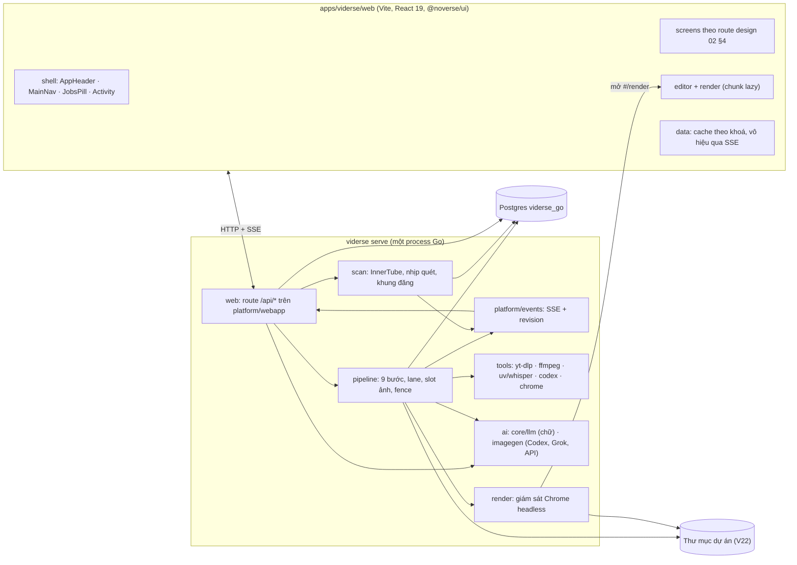

# Kết quả cần đạt

Viderse trong `apps/viderse` thay hẳn yt-factory trong việc vận hành nhiều kênh YouTube. Một video đi theo chuỗi 9 bước máy, trình bày thành 4 trợ lý:

- Trinh sát: `download`, `backdrop`, `transcript`.
- Đạo diễn: `metadata`, `scenes`.
- Hoạ sĩ: `images`.
- Kiểm định: `build`, `score`, `export`.

Chuỗi này giữ đúng logic, cổng chất lượng (≥ 90) và cách phục hồi của yt-factory. Giao diện, luồng, trạng thái và câu chữ làm đúng bộ design `apps/viderse/docs/design/v1/`.

- **Nguồn logic** là `/Users/dat/Personal/yt-factory`, commit `2c201e6`. Bản TS `/Users/dat/Projects/viderse` không phải nguồn.
- **Nguồn hành vi và giao diện** là `apps/viderse/docs/design/v1/`. Khi các nguồn lệch nhau thì ưu tiên theo thứ tự: `01-ia-flows.md`, rồi artboard, rồi các tài liệu còn lại (README design › Cách làm việc).
- Chỗ nào code buộc phải làm khác design thì ghi vào `11-hoi-dap.md` trước khi làm. Gói nào xong thì ghi vào `10-gap-closure.md`.

# Quyết định đã chốt (anh, 2026-10-29)

| Câu hỏi | Chốt |
|---|---|
| Dữ liệu yt-factory | **Bắt đầu trắng.** Không viết bộ nhập. Nhóm "Bản cũ" và danh sách job cũ ở Cài đặt › Lưu trữ (design 09 §3) không cần làm; ghi hỏi đáp để design gỡ. |
| Writer hiện có trong verse | **Gỡ bỏ** code, bảng `agent_runs`/`scripts`, `/api/runs`, `/api/scripts` và prompt. Mục "Writer vượt độ dài" đóng theo. |
| D1, D2, D5–D8 | **Theo đúng đề xuất của design.** D1: nghe trên LAN, ghép thiết bị bằng QR. D2: 10 intent, luôn hỏi xác nhận. D5: khoá YouTube Data API tuỳ chọn, không có thì đọc trang công khai. D6: ngưỡng 85; Tự duyệt hết chỉ qua Tuỳ chỉnh và có xác nhận. D7: 50 ảnh trả phí mỗi ngày cho mỗi nhà cung cấp. D8: lưu trên máy, gửi kèm khi Báo lỗi. |
| Cách chạy | **Web + launchd như Noverse**, bỏ Electron. Thông báo hệ thống dùng Notification API cùng Badging API của trình duyệt (cài dạng PWA). |
| Lượt chạy thật tốn tiền ảnh | **Mỗi lượt chỉ vẽ 1 ảnh trả phí.** Smoke đặt giới hạn D7 = 1 và chọn video chỉ cần 1 cảnh; phần còn lại kiểm bằng nhánh chờ hạn mức. |
| Cấu trúc mã | **Ưu tiên dễ sửa, dễ thay về sau** theo mục "Cấu trúc mã" bên dưới. |

# Dữ kiện đã kiểm (2026-10-29)

| Dữ kiện | Nguồn |
|---|---|
| Phần server của yt-factory có khoảng 41k dòng prod, chưa tính test. Lớn nhất: `server/clone` 20.1k (test 15.0k), `server/tools` 5.0k, `server/editor` 4.8k, `server/channels` 3.9k, `lib` 2.7k, `server/templates` 2.2k | `wc -l` trên `git ls-files` |
| Engine editor `src/editor/engine` 159k dòng prod (Freecut và OpenReel, MIT); `src/editor/ui` 8.1k | như trên, kèm `LICENSE-freecut` và `LICENSE-openreel` |
| UI cũ: `src/components` 14.7k, `src/app` 9.2k. Có khoảng 77 method HTTP dưới `src/app/api`. Tiến độ chỉ cập nhật bằng poll, không có SSE | scout frontend |
| 9 bước theo thứ tự: download, backdrop, transcript, metadata, scenes, images, build, score, export. Cổng xuất: `CLONE_EXPORT_MIN_SCORE = 90`, không có blocker, không có mục `unknown` | `src/lib/clone-steps.ts`, `src/lib/clone-quality.ts:43,156-158` |
| Mỗi job chạy một process Node. Lease và fence nằm trong SQLite. Mặc định `jobConcurrency` 2, `imageConcurrency` 3, `rescanHours` 1 | `runner.ts`, `launch.ts`, `clone-settings.ts` |
| Chữ (metadata) đi qua Codex CLI ở chế độ cô lập. Ảnh dùng `gpt-image-2` qua Codex CLI, dự phòng `grok-imagine-image` | `metadata.ts`, `image-prompt.ts:5`, `tools/grok.ts` |
| Transcript: sidecar Python 3.11 với faster-whisper 1.2.1, quản lý bằng `uv` | `scripts/clone-transcribe.py`, `tools/transcription.ts` |
| Xuất video: Chrome headless mở trang `/render`, chạy engine editor có GPU. Sau đó ffmpeg nén libx264 CRF 28. Độ lớn âm thanh đo bằng PCM gửi lên server rồi chạy ebur128 | `export-launcher.ts`, `export-compress.ts:87-91`, `measurements.ts` |
| Đọc kênh YouTube qua InnerTube (`youtubei.js`), không dùng Data API. Fixtures có ở `src/server/youtube/fixtures` | scout backend |
| Thiết kế V0–V24 chưa có gói nào được làm ở yt-factory | `10-gap-closure.md` trống |
| Lõi của verse đã có: LLM chữ có structured output và retry, OAuth Codex. Chưa có tạo ảnh và TTS | `core/llm`, `core/llmcontract`, `core/auth` |
| Noverse đã có hub SSE: ring 500 sự kiện, nối lại bằng `Last-Event-ID`. Phía web có `data/events.ts` (363 dòng) và `data/cache.ts` (339 dòng) | `apps/noverse/internal/entry/web/events.go` |
| Máy anh đã có sẵn: ffmpeg, ffprobe, yt-dlp, uv, codex, python3.11, psql | `command -v` |

# Kiến trúc đích

| # | Quyết định | Lý do |
|---|---|---|
| A1 | **Port theo test, không theo hình code.** Mỗi module Go có các ca test chuyển từ file test tương ứng của yt-factory. Logic thuần dùng test dạng bảng; phần chạm Postgres dùng `platform/pgtest`. | yt-factory có 543 file test và đã kiểm nhiều ca biên. Chuyển ca test là cách nhanh nhất để chứng minh hành vi giống bản cũ. |
| A2 | **Một process, worker là goroutine.** Số lane bằng `jobConcurrency`; slot ảnh là semaphore trong process. Chỉ một `viderse serve` được chạy worker, giữ bằng `pg_try_advisory_lock`. Lease và fence vẫn ghi trong Postgres, nhưng chỉ để phục hồi sau khi sập. | Bỏ được chi phí mỗi job một process Node, bỏ phối hợp nhiều process qua bảng settings, và hết tranh khoá SQLite (`sqlite-busy.ts`). |
| A3 | **Đẩy sự kiện bằng SSE có số revision.** `GET /api/status` và `GET /api/activity` giữ đúng hình dữ liệu của design (§5, §11), dùng cho lần tải đầu và làm đường dự phòng. Client chỉ poll 3 giây khi mất SSE. | JobsPill cập nhật dưới 1 giây, design chỉ đòi ≤ 3 giây. Không còn 6 vòng poll song song như ở yt-factory. Đây là khác về cách truyền so với chữ "poll 3 giây" ở §5, nên ghi hỏi đáp. |
| A4 | **Chữ gọi thẳng `core/llm`** (provider `openai-codex` OAuth, structured output qua `llmcontract`). Ảnh đi qua interface `imagegen.Provider`: bản đầu là Codex CLI `image_gen` và Grok y như yt-factory; V17 thêm Gemini, OpenRouter, Ollama. | Mỗi lần gọi chữ không còn phải khởi động CLI. Ảnh giữ đúng đường đang chạy ổn. |
| A5 | **Transcript giữ sidecar Python** (faster-whisper qua `uv`); Go chỉ giám sát process. | Chất lượng nhận dạng đã kiểm. Viết lại bằng Go không được gì thêm. |
| A6 | **Xuất video giữ engine editor TS.** Engine chuyển vào `apps/viderse/web/src/editor/` thành chunk lazy. Trang `#/render/<requestId>` chạy trong Chrome headless do Go giám sát; ffmpeg nén ở bước cuối. | Xem trước trong editor và bản xuất dùng chung một engine nên không lệch nhau. Viết lại bằng filtergraph ffmpeg vừa lớn vừa dễ sai. |
| A7 | **Port client InnerTube sang Go** (`internal/youtube`), chạy với fixtures của yt-factory. Khoá Data API (D5) là tuỳ chọn, chỉ dùng cho số liệu sau đăng. | Không kéo Node vào lúc chạy. |
| A8 | **Postgres là nguồn sự thật về trạng thái.** Tệp nằm trong thư mục dự án (V22), DB chỉ lưu đường dẫn tương đối. Mọi tệp ghi nguyên tử (ghi tạm rồi đổi tên). | Phục hồi được, và di chuyển được thư mục dự án. |
| A9 | **View-model tính ở server.** `agentView`, `subline`, nhóm trạng thái, `bulkEligibility` và lời giải thích hàng chờ đều viết bằng Go. Web chỉ hiển thị; CLI dùng chung code Go. Go test sinh JSON mẫu (golden) để test web đọc lại. | Mỗi luật chỉ có một bản. Hợp đồng giữa Go và TS được test giữ. |
| A10 | **Hạ tầng dùng chung chuyển lên `platform/`.** Hub SSE thành `platform/events`; client SSE và cache của web thành mã dùng chung. Noverse chuyển sang dùng bản chung trong cùng commit, không để lại bản sao. Mã chỉ Viderse dùng (tools, pipeline) ở lại trong app. | Theo luật chia sẻ của README verse: app thứ hai cần thì mới chuyển. |

# Hiệu năng và ổn định: ngưỡng nghiệm thu

| Chỉ số | Ngưỡng | Đo bằng |
|---|---|---|
| JS tải lần đầu (shell + Bàn dựng), gzip | ≤ 250 kB; editor/render chỉ tải khi mở route của nó | script kiểm kích thước dist, phase 01 |
| API danh sách (`/api/clone?channel=all`, Khám phá), local, với 1.000 job và 20.000 video đối thủ | p95 ≤ 100 ms | benchmark Go có seed dữ liệu |
| Từ lúc job đổi trạng thái tới lúc JobsPill hoặc Bàn dựng cập nhật | ≤ 1 s khi có SSE; ≤ 3 s khi rơi về poll | test e2e đo thời gian |
| Mất máy chủ → hiện dải báo mất kết nối | ≤ 5 s (design V12) | smoke trên trình duyệt |
| Cuộn danh sách 20.000 video | DOM ≤ 200 hàng; không có frame dài trên 50 ms | Chrome performance trace |
| `viderse serve` lúc rảnh | RSS ≤ 150 MB, chưa tính process con | `ps` |
| `kill -9` giữa bất kỳ bước nào | Khởi động lại thì job chạy tiếp từ checkpoint, không vẽ lặp ảnh đã trả tiền, không mồ côi process con | test phục hồi, phase 05 và phase 10 |
| Rút ổ chứa thư mục dự án khi đang chạy | Cần xử lý trong ≤ 10 s, không hỏng video; cắm lại thì tự chạy tiếp (design V22) | smoke, phase 10 |

# Các phase

| Phase | Gói design | Phụ thuộc | Ước lượng | Trạng thái |
|---|---|---|---|---|
| [01 · Nền móng, dọn Writer, shell](phase-01-foundation.md) | V0, V12, hỏi đáp #1–#4 | — | 32h | xong |
| [02 · Công cụ máy, kết nối, Cài đặt](phase-02-tools-settings.md) | V7, V17, V22, phần tài khoản của V23, V24, bước setup của V9 | 01 | 48h | xong code và QA ảnh (30/10/2026); còn chủ máy thử Grok, QR Bilibili, khoá API thật |
| [03 · Trinh sát: đối thủ, Khám phá](phase-03-rivals-explore.md) | V5, §12 | 02 | 44h | xong code, review và QA ảnh (30/10/2026); điều khiển cần Kênh đã mở ở phase 04, cần Hàng chờ khoá tới phase 05, `MExplore` ở phase 09 |
| [04 · Kênh và Thư viện](phase-04-channels-library.md) | V4, V8, V9, V15, V23 | 03 | 52h | xong code, review, QA ảnh cặp và smoke thật (31/10/2026); vẽ thử bìa và điều khiển cần video/hàng chờ khoá tới phase 05, mức tự chủ phase 08, `MChannel`/`MCreate` phase 09 |
| [05 · Lõi pipeline, Làm video, Hàng chờ](phase-05-pipeline-queue.md) | V2, V6, §1–§4 | 04 | 88h | xong code, review và merge (01/11/2026); còn smoke các bước AI thật (cần đăng nhập ChatGPT hoặc Grok trên máy thử) |
| [06 · Editor, render, xuất video](phase-06-editor-render.md) | V13, bước `export` | 05 | 60h | xong code, review, merge và xuất MP4 thật trên fixture (01/11/2026); `kill -9` khi xuất có test; còn so thời gian xuất với yt-factory trên cùng dự án mẫu |
| [07 · Bàn dựng, Duyệt, Việc nền](phase-07-workbench-review.md) | V1, V3, V14, V16, V18 | 05, 06 | 60h | xong code, đo 1440×900 và merge (01/11/2026); còn chủ máy bấm thử thông báo macOS thật; đề xuất trợ lý, `learn`, thiết lập duyệt theo kênh chuyển phase 08 |
| [08 · Trợ lý chủ động](phase-08-assistant-autonomy.md) | V11, V19, V20, V21 | 07 | 40h | xong code, đo 1440×900 và merge (01/11/2026); còn chạy bộ 40 câu ý định (≥ 95%), smoke trợ lý và điểm ảnh với model thật — cần đăng nhập ChatGPT hoặc Grok |
| [09 · Điện thoại qua LAN](phase-09-mobile-lan.md) | V10, D1 | 07 | 20h | tạm hoãn theo lời anh; phase 10 không nghiệm thu V10 cho tới khi mở lại |
| [10 · Nghiệm thu, chạy live, thôi dùng yt-factory](phase-10-acceptance-cutover.md) | toàn bộ | 01–09 | 16h | chưa |

Mỗi phase là một lát cắt dọc gồm backend, web và test. Phase chỉ xong khi đủ cả 4 việc:

- smoke trên `viderse serve` thật, có trình duyệt;
- ghi gói vào `10-gap-closure.md`;
- commit;
- kiểm Actions vẫn tắt, push, và xác nhận số run CI là 0.

# Hỏi đáp với design (`11-hoi-dap.md`)

Đã ghi ngày 29/10/2026:

- **Đã chốt:** #1–#4 (dev trả lời: brand, `quiet`, `tone="agent"`, toast dạng thẻ; đều chỉ thêm, Noverse không đổi), #5 (D8), #7 (API trả `loginUrl`).
- **Chờ design:**
  - #8 SSE thay poll 3 giây (A3);
  - #9 không nhập dữ liệu yt-factory;
  - #10 không còn Electron (V14 thông báo, V22 chọn thư mục phía server);
  - #11 D1 chọn cách (a);
  - #12 giữ cả `/api/status` lẫn `/api/activity`;
  - #14 lớp `.vv-badge` chưa có định nghĩa;
  - #15 màu orb trợ lý;
  - #16 mốc đổi sang bản điện thoại (700px hay 768px).
- **Design hỏi dev:** #6 (Bilibili trên điện thoại, thử ở phase 09), #13 (Khớp theo giọng trong Editor, trả lời ở phase 06).

Ghi thêm trong phase 02 (30/10/2026):

- **Đã chốt:** #24 (kit thêm `Button size="compact"` 32px; nút theo đúng class artboard từng chỗ).
- **Chờ design:**
  - #17 màn Chuẩn bị máy là route `#/setup` sau đăng nhập;
  - #18 thẻ tổng không có số luồng; #19 chưa có “Giới hạn từng kênh”; #20 thẻ phiên bản không có ngày phát hành;
  - #21 chọn thư mục bằng danh sách của máy chủ; #22 “Ổ ngoài USB”; #23 banner đếm việc nền;
  - #25 mốc “từ HH:MM” và “một số video”; #26 dữ liệu Kết nối AI chưa có nguồn;
  - #27 thứ tự thẻ và thẻ trùng loại; #28 giá mỗi video = 7 ảnh, lưới 4 nguồn vẽ;
  - #29 state điện thoại chưa vẽ của Tài khoản, giãn dòng 1,5; #30 dải mất kết nối, tông chấm cảnh báo, nhãn pha cài.

Ghi thêm trong phase 04 (31/10/2026):

- **Chờ design:** #38 nút cần video đã làm; #39 bảng video, số liệu đầu kênh, Dặn trợ lý; #40 Mẫu chuẩn khi tạo kênh; #41 giá ước tính template; #42 định dạng ảnh nhận diện; #43 bỏ liên kết đối thủ trên máy tính; #44 thêm kênh nền chạy nền; #45 nhập prompt trùng tên; #46 không có nhập template, thẻ không ảnh; #47 Kênh và Tạo kênh trên điện thoại; #48 đổi tên template không làm cũ xem thử.

# Rủi ro chính

| Rủi ro | Cách giảm |
|---|---|
| Port state machine của clone (`service.ts` 78 KB, `runner.ts`, `repository.ts`) lệch hành vi | A1: chuyển ca test trước rồi mới viết code. Có test phục hồi `kill -9` cho từng bước. |
| InnerTube đổi định dạng | Fixtures, kèm lỗi `unexpected_page` báo to như bản cũ. Khi lỗi thì ghi vào Cần xử lý, không âm thầm bỏ qua. |
| Engine editor 159k dòng gắn chặt với Next | Chỉ 9 tệp trong `src/editor` import `next/`. Thay bằng router hash và API client; engine giữ nguyên, ghi rõ commit gốc trong `UPSTREAM.md`. |
| Tốn tiền vẽ ảnh khi nghiệm thu | D7 giới hạn 50 ảnh/ngày. Mỗi lượt chạy thật chỉ vẽ 1 ảnh trả phí (giới hạn D7 = 1 khi smoke). |
| Mở LAN (D1) làm lộ app | Mọi `/api/*` và tệp media đều cần phiên. Thiết bị mới phải ghép bằng QR. webguard chặn yêu cầu khác origin. Có giới hạn số lần đăng nhập (`platform/identity`). |
| Tách `platform/events` làm hỏng Noverse | Chuyển trong cùng commit, chạy đủ test Noverse. Live Noverse chỉ cập nhật khi chủ động chạy `run-live.sh update`. |

# Cấu trúc mã

Mục tiêu: đổi một nhà cung cấp, một bước pipeline hay một màn mà không phải sửa lan sang chỗ khác.

**Go (`apps/viderse/internal`)**

- Mỗi gói là một mảng nghiệp vụ (`tools`, `youtube`, `scan`, `pipeline`…). `domain` chỉ chứa kiểu giá trị và mã lỗi dùng chung, không I/O.
- Chiều phụ thuộc: `cmd` → `web`, `persistence` → gói nghiệp vụ → `domain`. Gói nghiệp vụ không import `web`, `persistence`, `bootstrap` hay `cmd`, và không import gói nghiệp vụ ngang hàng nếu một interface nhỏ đủ dùng. `archtest` (`TestLayeredAppImports`) chặn các chiều sai trong mã chạy thật; tệp test được phép ráp store thật.
- Interface đặt ở phía dùng và nhỏ nhất có thể (ví dụ `pipeline` khai `type Drawer interface{ Draw(...) }`). Hệ ngoài (binary, HTTP, LLM, YouTube) luôn nằm sau interface để thay bản khác hoặc test bằng bản giả trong `_test.go`.
- `cmd/viderse` là nơi duy nhất ráp các phần; `bootstrap` chỉ giữ danh tính app (thư mục dữ liệu, cấu hình OAuth, DSN). Constructor nhận phụ thuộc, không biến toàn cục, không `init()` có tác dụng phụ.
- Postgres: mỗi mảng một tệp `persistence/postgres/queries/<mảng>.sql`, sinh bằng sqlc; mỗi phase một migration. Gói nghiệp vụ dùng store qua interface, không cầm `*pgx.Pool`.
- **Theo dõi mỗi phase:**
  - review kiến trúc theo các luật trên;
  - đo đường nóng: GET p95 trên dữ liệu thật cỡ lớn, số dòng DOM, số sự kiện SSE/giây khi có tiến độ, kích thước JS tải lần đầu;
  - chi phí lúc rảnh: ngoài ping SSE 2 giây và nhịp kiểm ổ ≤ 10 giây, máy chủ không làm gì.
  - đối chiếu artboard trước khi nhận phần UI: mỗi trạng thái tweak của artboard thuộc phase (máy tính 1440×900, điện thoại 390×844) có một cặp ảnh chụp artboard và app. Mỗi cặp phải khớp, hoặc có mục hỏi-đáp ghi lý do lệch. Chạy được test không thay cho bước này.
  - Mỗi báo cáo agent có mục "Kiến trúc & hiệu năng" ghi số đo.
- HTTP mỏng: đọc yêu cầu → gọi service → ghi JSON. Kiểu wire tách khỏi kiểu domain. Mã lỗi domain đổi sang HTTP ở đúng một chỗ.
- Test: logic thuần dùng test dạng bảng; chạm Postgres dùng `platform/pgtest`; ca test chuyển từ yt-factory ghi nguồn ở tên test hoặc comment đầu tệp.

**Web (`apps/viderse/web/src`)**

- `api/`: client có kiểu theo từng tài nguyên. `data/`: hook đọc dữ liệu và bảng sự kiện → khoá cache. `screens/<route>/`: mỗi route một chunk lazy. `components/`: phần ghép riêng của Viderse. `shell/`, `i18n/vi.ts` (mọi câu chữ), `styles/`.
- Thành phần chung (nút, banner, toast, dialog, danh sách ảo hoá…) nằm trong kit `@noverse/ui`. App không tự viết lại thứ kit đã có; thứ chung còn thiếu thì thêm vào kit.
- Không mã màu hex, bo góc hay khoảng cách viết cứng ngoài token.

# Quy ước khi làm

Theo AGENTS.md của repo và các quy ước tài nguyên hiện có:

- **Việc nặng:** chạy từng việc một, bọc trong `lockf -k /tmp/verse-heavy.lock` và `nice -n 10`.
- **Go:** `GOTOOLCHAIN=go1.26.0 GOMAXPROCS=4`, `go test -p 2`, `-race -p 1`.
- **Vitest:** `--maxWorkers=2`.
- **Commit:** conventional, không mã plan hay phase trong code, test hoặc commit; quét secret trước mỗi commit.
- **Đồ thứ ba:** engine editor giữ `LICENSE-freecut` và `LICENSE-openreel`, ghi thêm vào `third_party/NOTICE` của verse. ffmpeg chỉ gọi binary ngoài, không nhúng.
