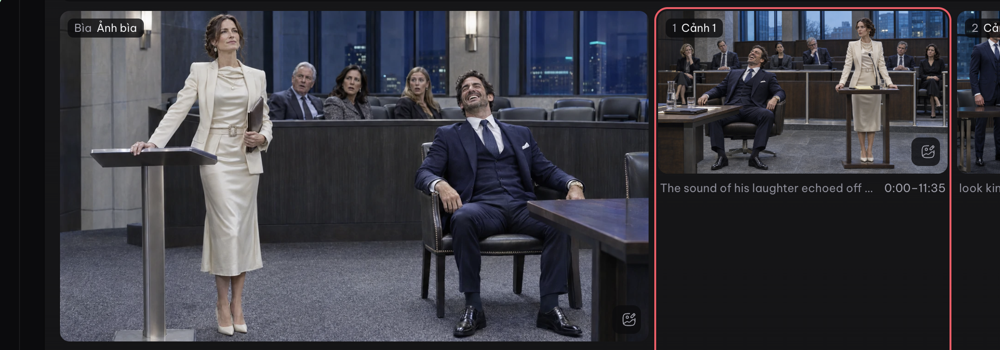
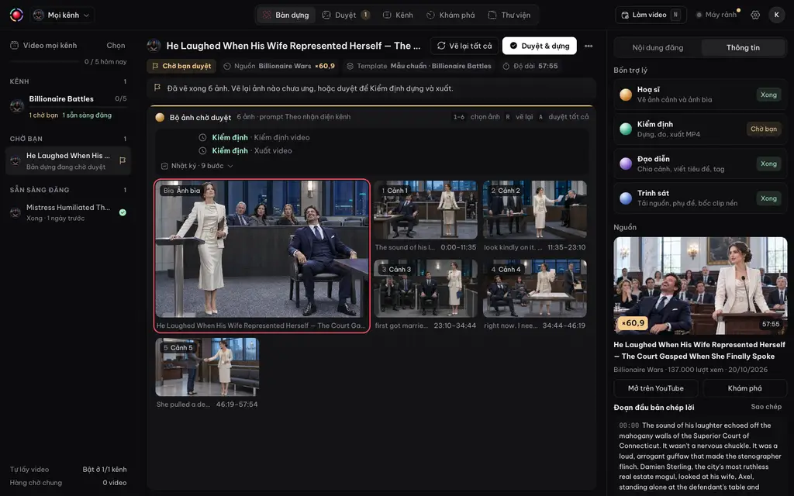

# Grid ảnh và lỗi stale giả · 07/11/2026

## Cause
- Desktop cover chỉ span2cột,không span2hàng như Main.dc.html1082; scene cùng hàng bị stretch theo cover. Trên production1568×900, Cảnh1/2 cao277.719px nhưng preview123.75px,còn khoảng trống129.375px sau caption.
- Build đọc path legacy `editor/media/<id>/metadata.json` thay vì authoritative Editor repository head. Production có đủ4media snapshot: GETmetadata200,contentHash khớp4pins,source blob vẫn được tham chiếu; head đang ở `editor/revisions/*.json`,không còn legacy blob. Failed build chứa stale do hiểu nhầm media đã xoá. Không phải cần đăng nhập lại hoặc thay template.

## Source repair
- Cover span2×2,preview flex-grow để lấp ô,các scene không còn chịu chiều cao cover. Giữ preferred16:9 cho trường hợp chỉ có cover; không thay artboard hoặc selection/viewer behavior.
- Tích hợp pending fix cause-aligned: build.Deps.MediaMetadata nối Editor.GetMediaMetadata; bỏ việc tự đọc legacy metadata. Vẫn acquire pinned bytes/hash và chặn media bị xoá/thay thật. Di chuyển cùng native render-smoke wiring và test harness; regression dùng Editor/Postgres import thật bao gồm valid/deleted/replaced. Không bypass stale guard,không đổi dữ liệu hoặc reset job.
- User dirty index và pending source khác trong LiveStudio không được đưa vào candidate; chỉ patch layout từ clean source được stage ở private index.

## Verification observed
- Focused LiveStudio13test pass,typecheck/build pass.
- Build package Postgres tests pass3.448s. Cmd tests lúc đầu fail3do archive thiếu SQL migration identity Noverse; bổ sung đúng tracked migration+role SQL rồi cmd pass27s. Native build candidate pass; không overlay.
- Read-only local transport8046 dùng actual production GET với phiên thật,block mọi mutation; không fixture hoặc sửa DOM. 1568scene cao148.344px,cover308.688px,captionbottomGap0 ở6tile. 1440scene130.344px,cover272.688px,gap0;không tràn ngang. Tile→viewer→next→close hoạt động. Phone390×844workbench→video→Ảnh6không tràn ngang;nguồn/layout phone không thay.

## Deployment / retry
- PR#16 đã merge; production https://vid.aarverse.studio chạy `9871dfb09d97b9e69a32bb42092857c8d6fe0342`,tree khớp candidate. SHA256 native `60f575ab81066e3b239c6855294783d60c9280dd00c9cb53f4212b83a9cbab61`;PID41280,installed/process inode3366802. Public ready đạt;entry/workbench chunks bytehash khớp clean build.
- Backup private và restore rehearsal đạt tại `~/server/apps/viderse/releases/9871dfb09d97b9e69a32bb42092857c8d6fe0342/rollout-20261106T172529Z/`;DB restore `viderse_release_20261106172530`;schema giữ41,không migration mới.
- Production1440đã đo cover272.688px/scene130.344px,gap sau caption0 ở6tile,không overflow. Existing authenticated browser đã bấm Thử lại thật;buildattempt7→8,đã tạo durable Editor project GET200 cùng source-independent audio/data và dừng ở **awaiting_review**,đúng return contract Handler.Run. Không gọi waiting là succeeded hoặc tự bấm Duyệt & dựng.
- Trước/sau retry giữ nguyên:imagesattempt1,image output digest84a4520112467ed58f8af01de82f9a6b,snapshot digest78282f2d1739e6a40ac53a3ea53af478,14paid image receipts. Bản dựng57:54.967đã tạo;score/export còn pending đợi người dùng duyệt. UI desktop/phone390×844không còn stale/missing-media text hoặc mã media lỗi,không tràn ngang.
- Watcher SSE throwaway đợi riêng succeeded đã timeout900s vì không nhận awaiting_review là terminal;đó là lỗi tiêu chí của scaffold,không phải build bị treo. DB chứng minh build đạt gate review từ17:27:22Z;code Handler.Run577vàexisting regression xác nhận gate này là chủ ý. Local smoke server,watcher vàtemporary deploy SSH agent đều đã dừng;scaffold/cookie riêng được xoá.

## Ảnh trước / sau
| Ảnh người dùng báo lỗi | Production1440×900sau sửa và retry |
|---|---|
|  |  |

Đây là đối chiếu lỗi cụ thể,không phải nghiệm thu toàn bộ artboard hoặc Safari thiết bị thật.
