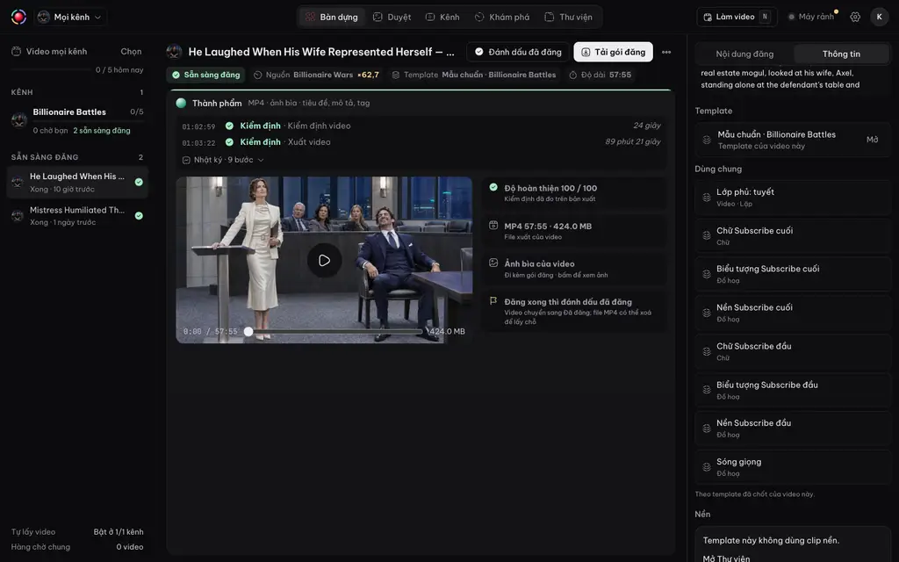
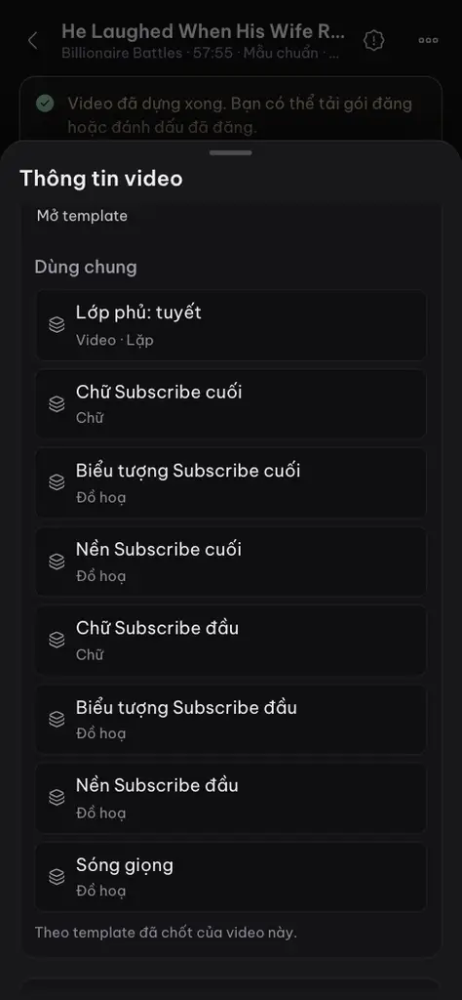

# Bàn dựng · asset dùng chung và nền · #95A,07/11/2026

## Cause và scope
API đã gửi nguyên templateSnapshot đã chốt nhưng readCloneJob chỉ lấy templateName;UI không có danh sách layer dùng chung. Inspector Nền suy từ existence của backdrop view thay vì có recipe/source nên0clip vẫn cảnh báo thiếu/lặp. Production recipe backdrop=null,randomPicksfalse,wantedCount0;template có8shared tracks(tuyết,Subscribe đầu/cuối,sóng giọng). Không có clip nền cần sửa hoặc thêm dữ liệu giả.

Người dùng chọn#95A: giữ2tab,hiện danh sách chỉ đọc trong Thông tin,dưới Template;phone dùng cùng component trong sheet. Không thay artboard,không thêm tab Tài nguyên hoặc khả năng sửa/xoá shared assets. Asset projection chỉ từ snapshot.project.timeline của video,không đọc template mới hoặc toàn bộ thư viện;dynamic slots bị loại,track rỗng/orphan không bịa thêm,layer tắt được ghi rõ. Snapshot legacy thiếu inventory không bị coi như template rỗng. Nền không cấu hình hiển thị đúng empty state và link Thư viện,không coverage/repair CTA giả.

## Verification
- Permanent regression trước vá:unconfigured template vẫn có progressbar/cảnh báo,1test fail. Sau vá5file/24tests passed(bao gồm mobile11,APIguard,slot filtering/unknown-vs-empty,track grouping và no-background state).
- Clean archive typecheck/build/size/native build đạt;entry142.6/150KiB,phone179.8/200KiB,CSS33.9/40KiB. Rollup annotation/static-dynamic import/lazychunk warnings vẫn được giữ.
- Read-only local transport dùng real production GET/existing session,không fixture/DOM injection,block mọi mutation. PC1440×900hiện8layer đúng tên,snow Video/Lặp;không câu Nền sẽ lặp hoặc overflow. Phone390×844cùng8layer,sheet1dialog,y118.172→844,height725.828,có scroll,nền không cấu hình đúng;tap scrim đóng,mở lại đạt.
- Inline review:không server API/schema/encoder changes;projected labels chỉ render React text,internal IDs chỉ làm key;không import Editor vào initial bundle. Other user dirty changes/index không đưa vào candidate.

## Deployment
Đã phát hành và kiểm trực tiếp;chỉ đóng bug asset/empty-background,không phải nghiệm thu toàn bộ Bàn dựng.
- Đã deploy https://vid.aarverse.studio commit `3f6b1650cbb59ab6ee123689d24f4c7a37d67d13` từ PR#18. Merge tree khớp candidate;binary SHA256 `5353f7341ddc8a649d7e292d81adbde44fed5bc5b88516d67164165132bac056`,PID88642,installed/process inode3588986. Public ready và entry/shared-list chunk bytehash đạt. Schema41 không đổi;backup/restore rehearsal đạt,không encoder/server API change.
- Backup tại `~/server/apps/viderse/releases/3f6b1650cbb59ab6ee123689d24f4c7a37d67d13/rollout-20261107T062245Z`,restore DB `viderse_release_20261107062245`. SCP qua Tailscale timeout120s khi mới staged27MB;production chưa thay ở thời điểm đó. Rsync nén/resume hoàn tất,checksum đúng rồi mới rollout.
- Actual authenticated production1440×900và390×844hiện cùng8asset,snow lặp đúng,Nền không cấu hình không warningfalse,không tràn ngang. Phone sau fonts/motion settle chỉ1dialog,y118.172→844;open/scrim-close/reopen3actions đạt. First desktop screenshot timeout30s,reopen/capture sau settle đạt;không sửa DOM để làm ảnh proof. Links Template/Thư viện giữ route hiện có,không thử sửa/xoá asset hoặc export.
- Local read-only proxy,credential file vàSSH agent tạm đã dừng/xoá. Không gọi đây là full artboard1:1hoặc physical Safari PASS.

## Xuất chậm
[Phân tích riêng](export-performance.md):89m21s là elapsed thật,78m24s browser supervision và10m57s hậu xử lý. Chưa benchmark hoặc đổi chất lượng/cấu hình xuất;không hứa tốc độ tăng chưa đo.

## Production
| Desktop1440×900 | Phone390×844 |
|---|---|
|  |  |
